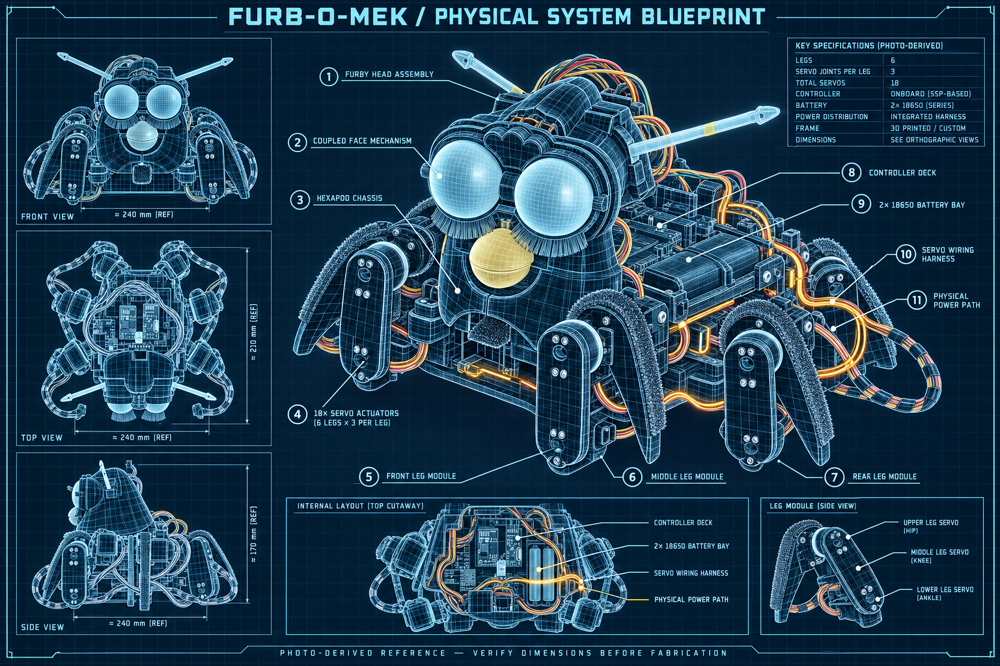
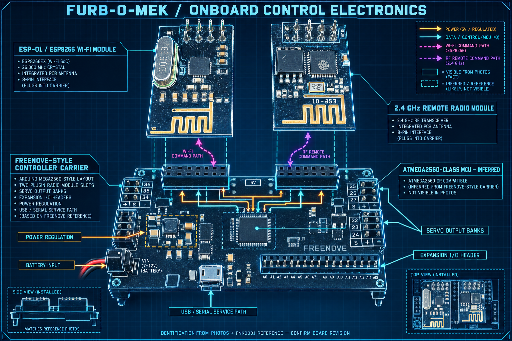
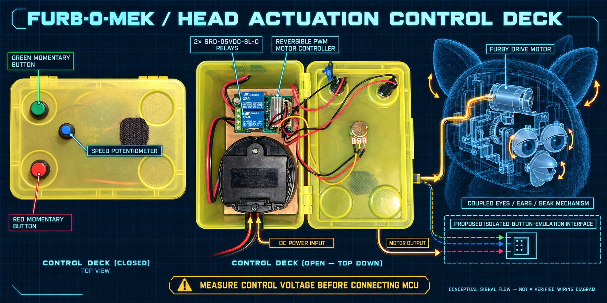
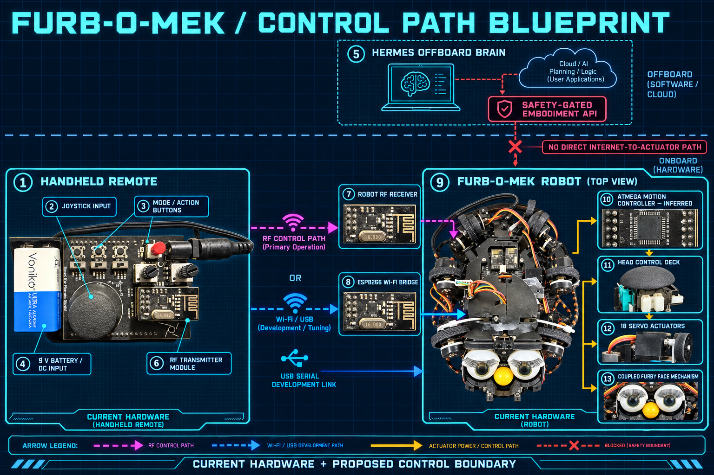

# Furb-o-Mek visual schematics

These sheets are photo-derived technical illustrations for architecture, planning, and component navigation. They are **not fabrication drawings or verified wiring diagrams**. Dimensions, voltages, board revisions, pin assignments, polarity, and electrical continuity must be measured before hardware changes.

## Sheets

### 1. Physical system

Labels the observed Furby head, coupled face mechanism, six-leg chassis, 18 servo actuators, controller deck, dual-18650 bay, wiring harness, and power path.

Source photographs: `IMG_5171.jpeg`, `IMG_5174.jpeg`, `IMG_5175.jpeg`.

### 2. Onboard control electronics

Separates the visible ESP-01/ESP8266 Wi-Fi module, second 2.4 GHz radio module, controller carrier, servo banks, headers, power input, and service paths. The ATmega2560-class controller identification is inferred from the Freenove FNK0031 reference architecture and must be confirmed from the physical board or firmware.

Source photographs: `IMG_5179.jpeg`, `IMG_5180.jpeg`, `IMG_5187.jpeg`.

### 3. Head actuation control deck

Shows the observed red and green momentary controls, speed potentiometer, reversible PWM motor controller, dual relays, motor path, and mechanically coupled face. The dashed button-emulation interface is a proposal, not installed hardware.

Source photographs: `IMG_5527.jpeg`, `IMG_5529.jpeg`, `IMG_5543.jpeg`.

### 4. Control path

Maps the current handheld RF path and USB/Wi-Fi development paths to the proposed safety-gated Hermes embodiment boundary. Internet or model output must never reach actuators without the deterministic gateway and MCU safety layer.

Source photographs: `IMG_5531.jpeg`, `IMG_5533.jpeg`, `IMG_5538.jpeg`, `IMG_5174.jpeg`.

## Evidence status

| Marking | Meaning |
|---|---|
| Photo-derived / visible | Component or relationship is visible in the supplied photographs |
| Reference / inferred | Identification is consistent with the Freenove FNK0031 platform but still needs board/firmware confirmation |
| Proposed / dashed | Planned interface or safety boundary that does not yet exist on the robot |

## Generation provenance

The four PNG files were created with OpenAI's built-in image-generation tool using the listed user-supplied photographs as references. Prompts required the actual six-leg/18-servo geometry, visible electronics, readable labels, and explicit separation between existing, inferred, and proposed components. The original photographs are not committed here.
