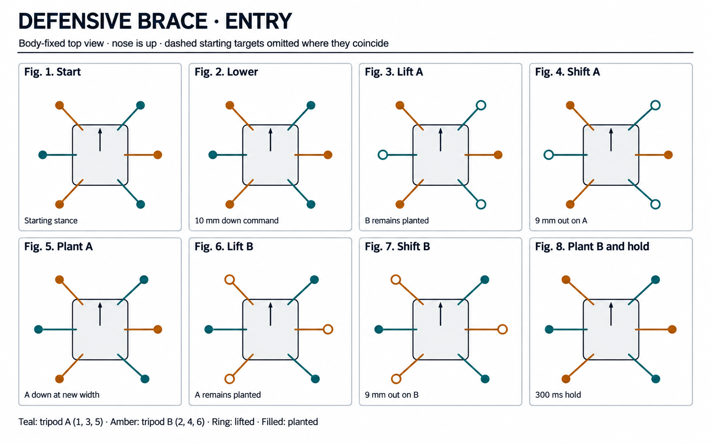
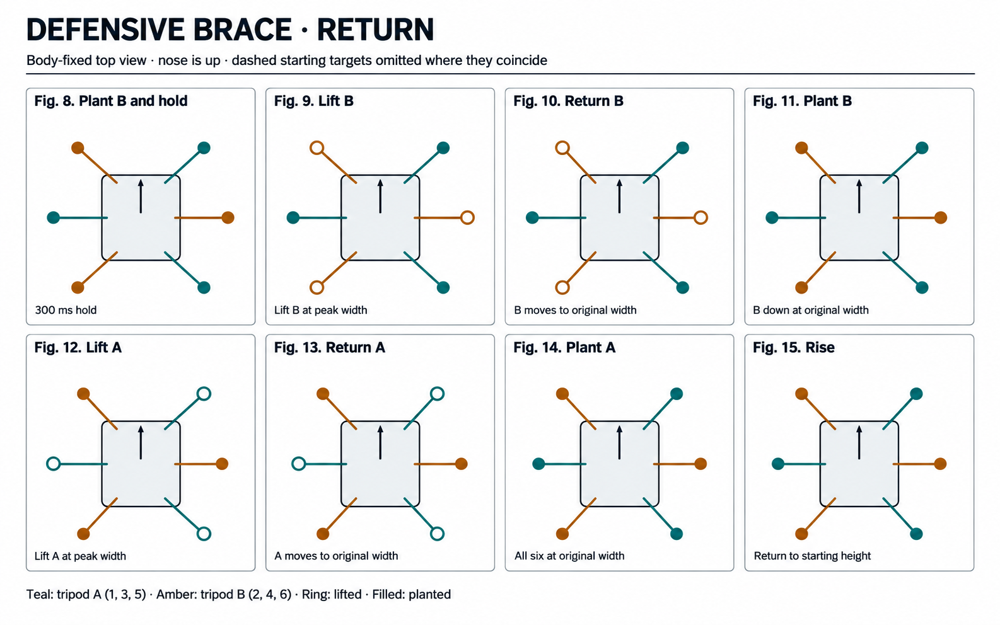

# Defensive brace

[Exact entry targets](target-maps/brace-entry.svg) · [Exact return targets](target-maps/brace-return.svg)

The chassis and the six legs are the relevant parts. The body lowers
first. Each tripod then lifts, shifts outward, and plants. The hold starts
after both tripods have planted. B returns first, then A. Chassis height
returns after all six feet are at their original horizontal targets.

| Figure | Phase | Body lower target | A outward | B outward | Lifted group and height above lowered stance | Step per nominal update | Hold |
| --- | --- | ---: | ---: | ---: | --- | ---: | ---: |
| 1 | Start | 0 mm | 0 mm | 0 mm | — | — | — |
| 2 | Lower | 10 mm | 0 mm | 0 mm | — | 4.00 mm | — |
| 3 | Lift A | 10 mm | 0 mm | 0 mm | A, 9 mm | 4.75 mm | — |
| 4 | Shift A outward | 10 mm | 9 mm | 0 mm | A, 9 mm | 4.75 mm | — |
| 5 | Plant A | 10 mm | 9 mm | 0 mm | — | 3.25 mm | — |
| 6 | Lift B | 10 mm | 9 mm | 0 mm | B, 9 mm | 4.75 mm | — |
| 7 | Shift B outward | 10 mm | 9 mm | 9 mm | B, 9 mm | 4.75 mm | — |
| 8 | Plant B and hold | 10 mm | 9 mm | 9 mm | — | 3.25 mm | 300 ms |
| 9 | Lift B | 10 mm | 9 mm | 9 mm | B, 9 mm | 4.25 mm | — |
| 10 | Restore B inward | 10 mm | 9 mm | 0 mm | B, 9 mm | 3.50 mm | — |
| 11 | Plant B | 10 mm | 9 mm | 0 mm | — | 3.25 mm | — |
| 12 | Lift A | 10 mm | 9 mm | 0 mm | A, 9 mm | 4.25 mm | — |
| 13 | Restore A inward | 10 mm | 0 mm | 0 mm | A, 9 mm | 3.50 mm | — |
| 14 | Plant A | 10 mm | 0 mm | 0 mm | — | 3.25 mm | — |
| 15 | Rise to start | 0 mm | 0 mm | 0 mm | — | 2.75 mm | — |

The wider stance is a brief pulse. It ends at the original footprint
and height. The 2026-11-21 supported pass showed alternating lift and
widening, with about **49 px** of peak travel in a tracked joint region.
The local request completed in **2,396 ms** with normal DISARM. The support
carried the chassis during this pass. The 10 mm drop is the body target
for planted feet, and loaded displacement remains pending.
[Evidence](README.md#evidence)
