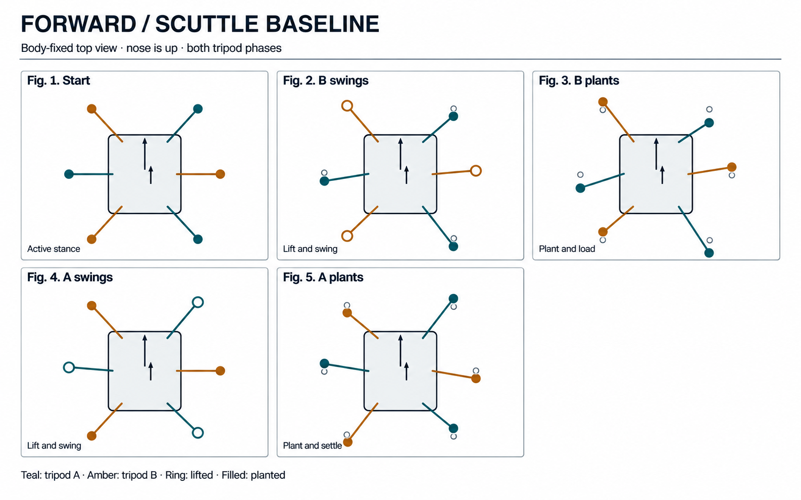

# Forward and scuttle baseline

[Exact nominal targets](target-maps/forward.svg)

The sketch shows the chassis outline and foot targets from above. The
Mac gateway runs **two** Forward phases within one request. The reference
starts at nominal Active after boot, with tripod B swinging first. An
already-advanced gait index can swap the order. Scuttle currently uses
this Forward cycle as its baseline. A separate speed preset or repeated
scuttle cadence remains a proposal.

The default vendor forward parameter is 42 mm, divided into two 21 mm
phase parameters. The following fore-aft foot coordinates are offsets
from nominal standing in the moving body frame. The swinging group
targets a 20 mm lift above its normal stance height.

| Figure | Phase | A forward offset | B forward offset | Raised |
| --- | --- | ---: | ---: | --- |
| 1 | Start Active | 0 mm | 0 mm | — |
| 2 | B swings | −10.5 mm | +5.25 mm | B |
| 3 | B plants | −21 mm | +10.5 mm | — |
| 4 | A swings | +5.25 mm | 0 mm | A |
| 5 | A plants | +10.5 mm | −10.5 mm | — |

These targets represent the nominal, accepted vendor path. The vendor
checks the proposed gait geometry and may reject a swing or lower the
swinging group at a fallback position. The historical two-phase pass
advanced the tracked chassis about **30 px**. Tabletop traction, initial
pose and end settling affect observed travel. [Evidence](README.md#evidence)
