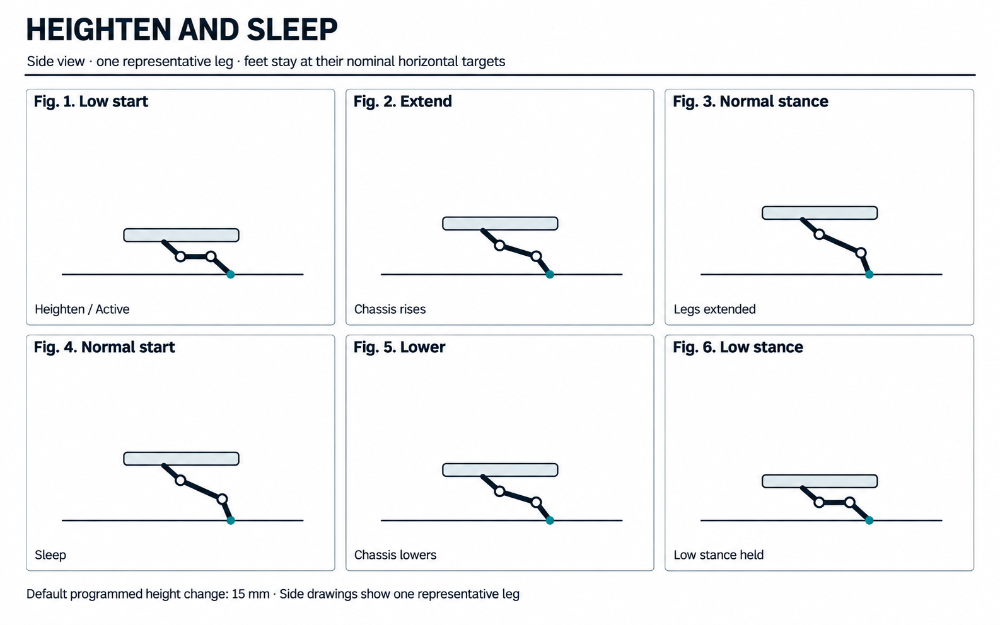

# Heighten and Sleep

[Side-view layout](target-maps/height.svg)

One representative leg and a chassis section show the height change.
The default vendor `bodyLift` is 15 mm. `active` subtracts that
value from the current foot Z targets and `sleep` adds it back.
The six legs use the same direction of vertical change. The intermediate
figures illustrate continuous movement between the endpoints.

| Figure | Action | Phase |
| --- | --- | --- |
| 1 | Heighten / `active` | Start low. |
| 2 | Heighten / `active` | Extend below the chassis as the chassis rises. |
| 3 | Heighten / `active` | Reach the normal Active stance. |
| 4 | `sleep` | Start from Active. |
| 5 | `sleep` | Shorten the vertical reach as the chassis lowers. |
| 6 | `sleep` | Reach the normal low stance with the original horizontal targets. |

On the historical tabletop pass the chassis image rose about **8 px**
with Active and fell about **7 px** with Sleep. Those are camera
displacements. The programmed 15 mm is the vendor default. Sleep did
not show the inward tripod steps of [Tuck Preview](tuck.md).
[Evidence](README.md#evidence)
