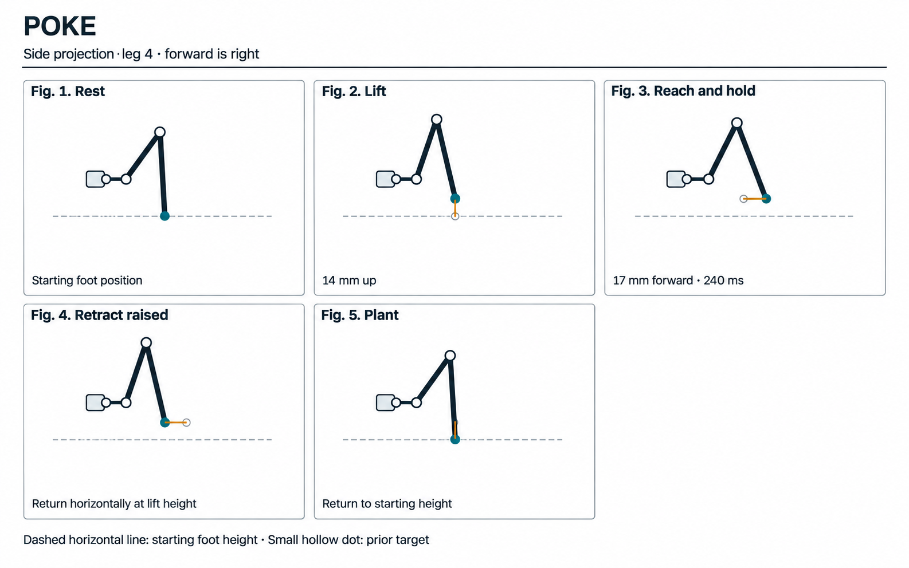

# Poke

[Exact projected targets](target-maps/poke.svg)

Only leg 4 is shown, with its servo and coxa pivot, femur, knee, tibia
and foot. The forward direction is right in the side projection. The
firmware changes this leg's forward and vertical coordinates. The other
five legs keep their existing targets.

| Figure | Commanded phase | Forward offset | Vertical offset | Step per nominal update | Hold after reaching target |
| --- | --- | ---: | ---: | ---: | ---: |
| 1 | Starting stance | 0 mm | 0 mm | — | — |
| 2 | Lift the foot | 0 mm | +14 mm | 4.75 mm | — |
| 3 | Reach while lifted | +17 mm | +14 mm | 5.00 mm | 240 ms |
| 4 | Retract at lift height | 0 mm | +14 mm | 3.50 mm | — |
| 5 | Plant at the original target | 0 mm | 0 mm | 3.25 mm | — |

The lifted reach and slower return are the intended beats of this
gesture. On 2026-11-21 the larger gesture visibly lifted and reached
on the support. A front-view tracked joint region traveled about **37 px**
at peak, and the local request completed in **889 ms** with normal DISARM.
That tracking value is a projected region displacement. The table gives
commanded foot offsets. The loaded check for this larger path is pending.
[Evidence](README.md#evidence)
