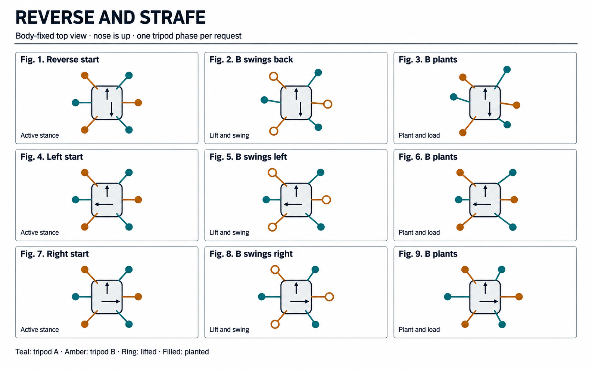

# Reverse and strafe

[Exact nominal targets](target-maps/translation.svg)

Each request uses one vendor tripod phase. The plate shows tripod B
swinging from nominal Active after boot. The actual swinging tripod
depends on the prior gait index. The default 42 mm vendor translation
parameter gives a 21 mm phase parameter. The target for the swinging
group is 20 mm above normal stance at its raised position.

## Backward / recoil

| Figure | Phase | A forward offset | B forward offset | Raised |
| --- | --- | ---: | ---: | --- |
| 1 | Active start | 0 mm | 0 mm | — |
| 2 | B swings back | +10.5 mm | −5.25 mm | B |
| 3 | B plants | +21 mm | −10.5 mm | — |

Recoil maps to one `backward` action. The historical bare-table trial
showed about **16 px** of reverse chassis travel after settling.

## Strafe left

| Figure | Phase | A lateral X | B lateral X | Raised |
| --- | --- | ---: | ---: | --- |
| 4 | Active start | 0 mm | 0 mm | — |
| 5 | B swings left | −10.5 mm | +5.25 mm | B |
| 6 | B plants | −21 mm | +10.5 mm | — |

`left` is the left-strafe command, with positive X pointing left in
this figure. The historical trial showed about **12 px** of lateral
motion with a small accompanying turn.

## Strafe right

| Figure | Phase | A lateral X | B lateral X | Raised |
| --- | --- | ---: | ---: | --- |
| 7 | Active start | 0 mm | 0 mm | — |
| 8 | B swings right | +10.5 mm | −5.25 mm | B |
| 9 | B plants | +21 mm | −10.5 mm | — |

`right` is the right-strafe command. The historical trial showed about
**10 px** of lateral chassis motion.

Figures show nominal foot targets relative to the chassis, so the support
tripod shifts in the opposite body-frame direction. The observed pixel
values are from the earlier fixed camera and do not set a metric stride.
[Evidence](README.md#evidence)
