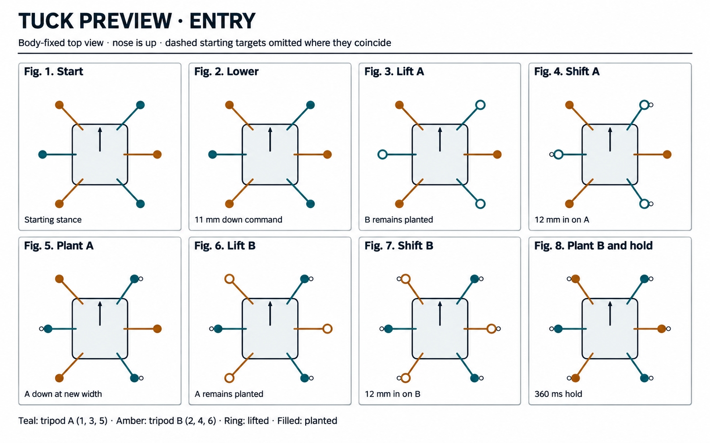
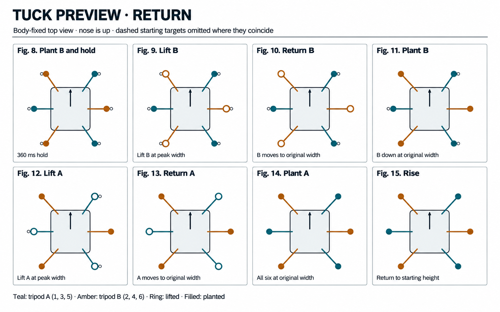

# Tuck preview and curl-up

[Exact entry targets](target-maps/tuck-entry.svg) · [Exact return targets](target-maps/tuck-return.svg)

The chassis and six legs are shown. The body target lowers first. Each
tripod lifts, shifts inward, and plants in turn. The firmware holds the
narrow stance briefly, then restores B, restores A, and rises. The
implemented `tuck_preview` ends standing. Sustained compact rest is the
separate `curl_up` intent in the motion catalog.

| Figure | Phase | Body lower target | A inward | B inward | Lifted group and height above lowered stance | Step per nominal update | Hold |
| --- | --- | ---: | ---: | ---: | --- | ---: | ---: |
| 1 | Start | 0 mm | 0 mm | 0 mm | — | — | — |
| 2 | Lower | 11 mm | 0 mm | 0 mm | — | 4.00 mm | — |
| 3 | Lift A | 11 mm | 0 mm | 0 mm | A, 8 mm | 4.75 mm | — |
| 4 | Shift A inward | 11 mm | 12 mm | 0 mm | A, 8 mm | 4.75 mm | — |
| 5 | Plant A | 11 mm | 12 mm | 0 mm | — | 3.25 mm | — |
| 6 | Lift B | 11 mm | 12 mm | 0 mm | B, 8 mm | 4.75 mm | — |
| 7 | Shift B inward | 11 mm | 12 mm | 12 mm | B, 8 mm | 4.75 mm | — |
| 8 | Plant B and hold | 11 mm | 12 mm | 12 mm | — | 3.25 mm | 360 ms |
| 9 | Lift B | 11 mm | 12 mm | 12 mm | B, 8 mm | 4.25 mm | — |
| 10 | Restore B outward | 11 mm | 12 mm | 0 mm | B, 8 mm | 3.50 mm | — |
| 11 | Plant B | 11 mm | 12 mm | 0 mm | — | 3.25 mm | — |
| 12 | Lift A | 11 mm | 12 mm | 0 mm | A, 8 mm | 4.25 mm | — |
| 13 | Restore A outward | 11 mm | 0 mm | 0 mm | A, 8 mm | 3.50 mm | — |
| 14 | Plant A | 11 mm | 0 mm | 0 mm | — | 3.25 mm | — |
| 15 | Rise to start | 0 mm | 0 mm | 0 mm | — | 2.75 mm | — |

The 2026-11-21 supported pass showed the legs contracting and returning.
A tracked joint region traveled about **66 px** at peak, and the local
request completed in **2,416 ms** with normal DISARM. The 11 mm drop is
the commanded body target for planted feet. The supported run measured
leg motion and the loaded check for this larger path is pending.
[Evidence](README.md#evidence)
