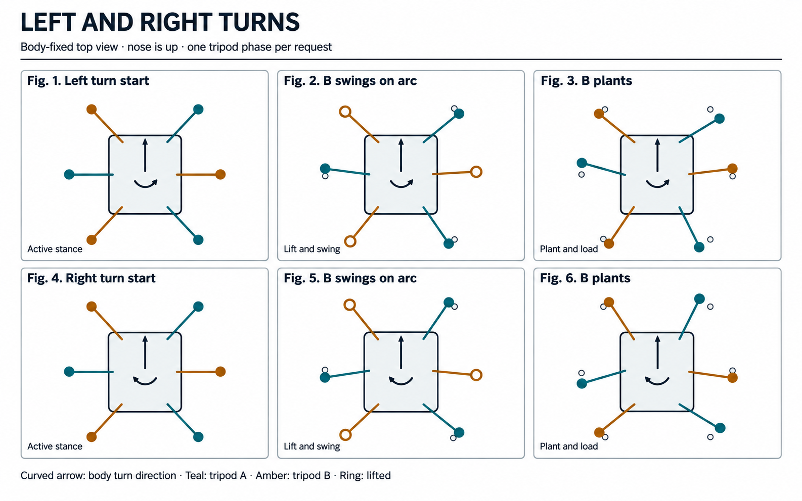

# Turn left and turn right

[Exact nominal targets](target-maps/turns.svg)

The chassis is drawn fixed and the foot targets move on arcs around its
origin. The black curved arrow indicates requested body yaw. The vendor
uses an 18° default turn parameter, divided across two phases. Each guarded
turn command in this setup runs one phase. The example starts with tripod
B swinging from nominal Active after boot.

| Figure | Phase | A target rotation | B target rotation | Raised |
| --- | --- | ---: | ---: | --- |
| 1 | Left turn start | 0° | 0° | — |
| 2 | B swings on left-turn arc | +4.5° | −2.25° | B |
| 3 | B plants | +9° | −4.5° | — |
| 4 | Right turn start | 0° | 0° | — |
| 5 | B swings on right-turn arc | −4.5° | +2.25° | B |
| 6 | B plants | −9° | +4.5° | — |

These angles rotate the foot **targets in the body frame**. They are
not servo angles or measured yaw. The historical tabletop view showed
about **3° counterclockwise** for Turn Left and **3–4° clockwise** for
Turn Right, measured as projected rotation of the tracked chassis.
[Evidence](README.md#evidence)
