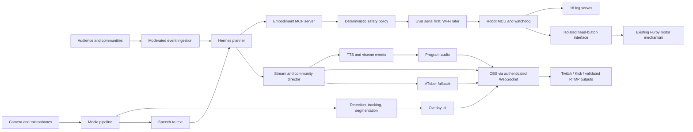
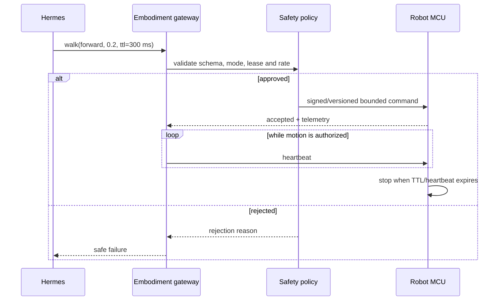
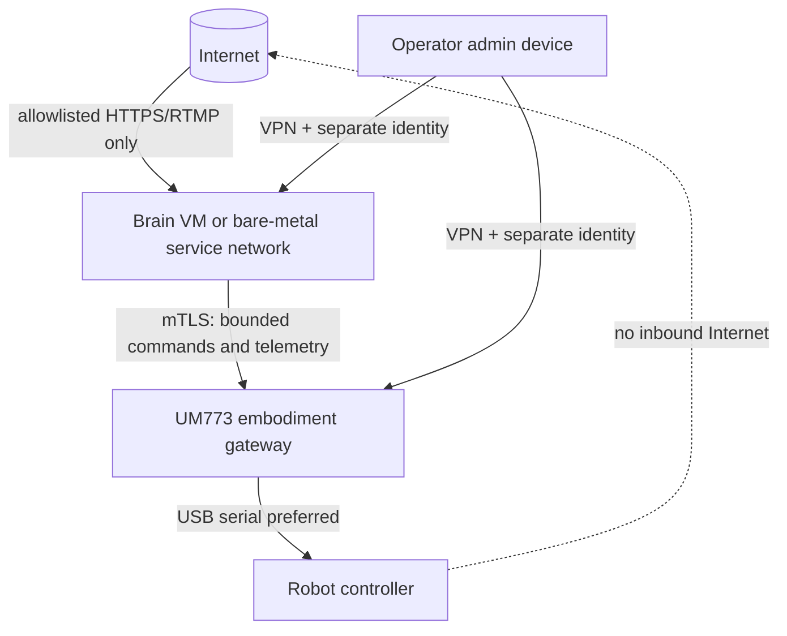
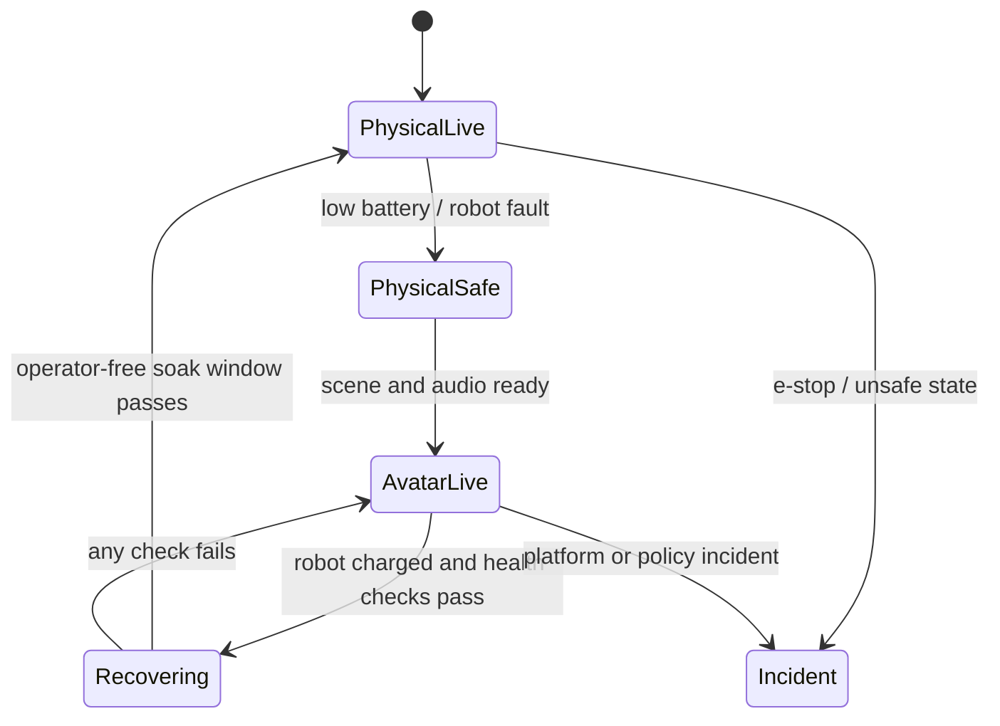

# Furb-o-Mek implementation plan

Status: evidence-backed planning baseline, 2026-09-07

## 1. Outcome and immediate feasibility

Furb-o-Mek can be made to look and behave like a self-contained autonomous streaming robot, but the AI should not run on the robot's existing microcontrollers. The viable design is an offboard brain with a narrow, safety-gated connection to the robot.

| Capability | Possible now? | What is missing |
|---|---:|---|
| Hermes controls walking/poses over USB or Wi-Fi | Yes | Import/restore the Freenove firmware, document its protocol, then expose bounded commands through a robot gateway |
| Hermes speaks through the stream and synchronizes the Furby face | Yes, with limitations | Digitize the two-button head controller; add position/homing feedback for repeatable expressions |
| Hermes controls OBS and appears to self-stream | Yes | OBS scene contract, authenticated WebSocket worker, capture/audio routing, reconnect policy |
| Live object/part recognition and segmentation overlays | Yes on the Omen-class GPU host | Camera, detector/segmenter pipeline, overlay renderer, latency benchmark |
| Twitch/Kick streaming | Yes when RTMP credentials are available | Platform credentials and per-platform soak tests |
| Pump.fun streaming | Needs an integration spike | Confirm the current supported ingest/control path before promising unattended operation |
| Discord voice-channel participation | Yes | Discord bot, audio receive/send bridge, moderation and reconnection logic |
| Discord camera/video as a bot | Not a v1 guarantee | Official voice is supported; autonomous video publishing needs a separately validated client path |
| Telegram group voice/video chat | Possible only through a user/MTProto or RTMP design | Bot API is insufficient; account-policy and WebRTC/RTMP work are required |
| X Spaces hosting/speaking | No supported public-API path identified | X's documented Spaces API is discovery/analytics-oriented; UI automation would be brittle and risky |
| Meaningful AI inference on the stock robot | No | ATmega/ESP8266-class hardware is appropriate for control, not LLM, speech, or vision inference |
| VTuber/avatar takeover while charging | Yes | Avatar asset/rig, viseme and emotion mapping, OBS failover scene |

The first autonomous milestone is therefore not "put Hermes on the robot." It is:

> Hermes runs on a quarantined Linux compute host and calls a local, allowlisted robot-control tool. A deterministic controller on or beside the robot owns timeouts, limits, and emergency stop behavior.

## 2. Evidence baseline

### 2.1 What exists in this repository

This repository is currently a Nuxt 3 browser application plus an Express TTS proxy, not a robotics stack:

- [`package.json`](https://github.com/patchwerks/furbomek/blob/main/package.json#L5-L11) starts Nuxt and `server/tts-proxy.js` together and has no firmware, robot, OBS, or perception service.
- [`nuxt.config.ts`](https://github.com/patchwerks/furbomek/blob/main/nuxt.config.ts#L12) makes the application client-only (`ssr: false`).
- [`src/chat/openai-assistant.ts`](https://github.com/patchwerks/furbomek/blob/main/src/chat/openai-assistant.ts#L24-L28) creates an OpenAI client in the browser; this is not an acceptable privileged control boundary.
- [`src/settings.ts`](https://github.com/patchwerks/furbomek/blob/main/src/settings.ts#L35-L68) defines the current BIPCI personality and provider settings. Credentials in the first GitHub snapshot were blanked before publication.
- [`server/tts-proxy.js`](https://github.com/patchwerks/furbomek/blob/main/server/tts-proxy.js#L5-L18) is a permissive localhost-oriented credential-forwarding proxy on port 3500. It needs authentication and containment before unattended deployment.
- [`src/tts/interfaces.ts`](https://github.com/patchwerks/furbomek/blob/main/src/tts/interfaces.ts#L1-L18) is the most reusable existing seam: it already separates TTS providers and streams.

Consequently, every physical-control, perception, streaming, deployment, and social-call component in this plan is new work.

### 2.2 Robot identification and confidence

The supplied photo sets (`IMG_5171`-`IMG_5187` and `IMG_5527`-`IMG_5544`) are consistent with a modified **Freenove Hexapod Robot Kit FNK0031**:

- six legs with three hobby servos each (18 degrees of freedom);
- a Freenove-style crawling robot controller;
- two flat-top 18650 cells;
- plug-in ESP-01/ESP8266 Wi-Fi and nRF24-compatible remote-radio modules;
- a separately fabricated Furby head assembly and wired control deck.

Freenove's [FNK0031 product page](https://store.freenove.com/products/fnk0031) documents computer/app/Wi-Fi control, an optional wireless remote, and two flat-top 18650 cells. Its [default-functions documentation](https://docs.freenove.com/projects/fnk0031/en/latest/fnk0031/codes/tutorial/Default_Functions.html) documents the robot-created Wi-Fi network, movement/posture controls, and optional remote module. The [official source repository](https://github.com/Freenove/Freenove_Hexapod_Robot_Kit) applies to FNK0031 and contains Arduino/Processing resources.

This is a strong identification, not yet a bill of materials. Exact board revision, MCU, servo models, pin map, battery topology, and installed firmware must be photographed and measured before electrical changes.

### 2.3 Existing robot-side compute

The working assumption from the carrier-board form factor and Freenove reference platform is:

| Part | Role | Suitable work |
|---|---|---|
| ATmega2560-class controller | Gait, servo timing, command parsing | Deterministic motion, watchdog, sensor reads |
| ESP8266/ESP-01 | Wi-Fi-to-controller transport | Compact authenticated/local commands after firmware review |
| nRF24L01-compatible radio | Existing handheld remote link | Low-bandwidth commands/telemetry, not video |
| 18 hobby servos | Hexapod joints | Walking, turning, height and body poses within calibrated envelopes |
| Furby mechanism + reversible DC controller | Coupled facial mechanism | Timed forward/reverse motion; initially not independent eye/ear/beak actuation |

These parts do not provide a Linux-like OS. They run firmware, generally as a single program with interrupts and libraries. They cannot realistically run Hermes, an LLM, speech recognition, SAM-class vision, or OBS. Their correct long-term role is the robot's hardware abstraction and safety layer.

### 2.4 Furby head control deck

The yellow wired deck contains two external momentary buttons, a speed potentiometer, and a reversible PWM DC-motor board with two `SRD-05VDC-SL-C` relays. It appears consistent with the common 1203BS-style reversible motor controller. The deck drives a single Furby mechanism; the eyes, eyelids/ears, and beak appear mechanically coupled rather than independently servo-controlled.

Do **not** wire the ATmega directly to those button leads based only on photographs. First measure each lead relative to controller ground with the button released and pressed.

Decision rule:

- If the button is a ground-triggered logic input at no more than 5 V, an open-drain-style GPIO interface may be possible.
- If voltage, polarity, or shared ground is uncertain, use two optocouplers or transistor outputs in parallel with the existing buttons.
- Never route motor current through the ATmega.
- Preserve the physical buttons and add a hard power cut/e-stop.
- Never permit both direction commands simultaneously.

Timed pulses can produce early demonstrations, including mouth-like motion during speech, but they will accumulate positional error. Repeatable named expressions require a home/limit switch, Hall sensor, encoder, or a verified existing position signal.

## 3. Chosen product architecture

Use one monorepo for the product-owned protocol, firmware changes, services, UI, deployment definitions, tests, and hardware documentation. Keep third-party upstream code out of the tree unless its license has been reviewed.

Why a monorepo now:

- the firmware command schema, gateway types, safety tests, overlays, and operator UI must evolve together;
- a single compatibility matrix can bind robot firmware, gateway, and Hermes tools;
- deployments need reproducible versions of all cooperating services;
- future robots can implement the same embodiment contract without inheriting Furb-o-Mek mechanics.

Proposed evolution after the preservation commit:

```text
furbomek/
├── apps/
│   ├── operator-ui/          # current Nuxt UI, refactored
│   └── overlay-ui/           # transparent OBS browser source
├── services/
│   ├── embodiment-gateway/   # only network path to robot actions
│   ├── perception/           # detection, tracking, segmentation
│   ├── stream-director/      # OBS scenes, captions, failover
│   ├── conversation/         # STT, Hermes session, TTS coordination
│   └── community/            # Twitch/Kick/Discord/Telegram adapters
├── packages/
│   ├── protocol/             # versioned commands/events and schemas
│   ├── safety-policy/        # limits independent of model prompts
│   └── character-state/      # emotions, visemes, gestures, scenes
├── firmware/
│   └── fnk0031/              # reviewed firmware/delta, not blind vendoring
├── infra/
│   ├── containers/           # portable OCI workload definitions
│   ├── vm/                   # KVM/libvirt + VFIO deployment profile
│   └── bare-metal/           # Ubuntu/systemd deployment profile
├── docs/
│   ├── architecture/
│   ├── hardware/
│   ├── operations/
│   ├── security/
│   └── adr/
├── AGENTS.md
└── PLAN.md
```

The official Freenove repository declares CC BY-NC-SA 3.0 and explicitly says its files are not for commercial use. Before this project becomes a commercial desktop-agent platform, either obtain compatible permission, isolate the upstream material as a development reference, or implement a clean project-owned protocol/firmware layer. Do not copy upstream code into a permissively licensed product without a license decision.

## 4. Runtime design

### 4.1 Control and media planes



Hermes supports local stdio and remote HTTP MCP servers and discovers their tools as first-class actions ([Hermes native MCP documentation](https://github.com/NousResearch/hermes-agent/blob/main/skills/autonomous-ai-agents/hermes-agent/references/native-mcp.md)). That makes a narrow MCP server the preferred agent integration:

```text
robot.get_state()
robot.stop()
robot.pose(name, ttl_ms)
robot.walk(direction, speed, ttl_ms)
robot.face(expression, intensity, ttl_ms)
stream.set_scene(name)
stream.show_overlay(payload, ttl_ms)
```

Do not expose raw serial, arbitrary GPIO, shell, OBS credentials, or unrestricted URL fetches to the model.

### 4.2 Command lifecycle and fail-safe behavior



Required invariants:

- `STOP` is local, unconditional, idempotent, and higher priority than every other command.
- Every motion command has a short TTL; movement never depends on a later stop command arriving.
- Loss of agent, gateway, Wi-Fi, serial, or heartbeat returns the robot to a defined neutral posture.
- The MCU rejects unknown protocol versions, illegal ranges, conflicting head directions, and stale sequence numbers.
- Physical e-stop removes actuator power without depending on Linux, network, or the model.
- Public messages and on-chain events can request actions but never bypass policy.
- All requests, policy decisions, actuator acknowledgements, and scene changes enter an append-only audit log.

## 5. Host and quarantine design

### 5.1 Recommended two-host deployment

| Host | Preferred responsibilities | Rationale |
|---|---|---|
| HP Omen with the reported NVIDIA GPU | Hermes inference/provider clients, perception, OBS, video encoding, avatar, platform adapters | Heavy GPU/media workload and the best available inference headroom |
| Minisforum UM773 | Physical robot gateway, watchdog supervisor, telemetry, emergency operator UI | Small always-on machine can stay near the robot and keep safety independent from stream/inference crashes |

The exact Omen model/GPU, UM773 RAM/storage, NICs, BIOS virtualization settings, and IOMMU groups are not captured in this repository. Before choosing the final topology, record outputs of `lscpu`, `lspci -nnk`, `nvidia-smi`, `lsusb`, `ip -br link`, `free -h`, and IOMMU-group enumeration in `docs/hardware/hosts.md`. Until that is done, GPU/VM suitability is a hypothesis, not a promise.

### 5.2 Deployment profiles

#### Profile A: KVM guest with whole-GPU passthrough — strongest preferred quarantine

- Minimal Ubuntu or Proxmox-style Linux hypervisor on the Omen.
- Ubuntu LTS guest owns the discrete GPU, required USB capture/audio devices, and the autonomous stack.
- Workloads still run as unprivileged OCI containers inside the guest for reproducibility.
- A dedicated virtual NIC/VLAN reaches only the UM773 gateway and allowlisted internet destinations.
- The hypervisor retains no agent credentials and exposes no host filesystem mounts to the guest.

Linux VFIO provides IOMMU-protected device assignment, and the IOMMU group is the minimum isolation unit ([Linux kernel VFIO documentation](https://docs.kernel.org/driver-api/vfio.html)). Therefore this profile is possible only if:

1. BIOS exposes AMD-Vi/IOMMU or Intel VT-d;
2. the GPU and its audio function occupy assignable IOMMU groups;
3. the host has another display path or can run headless;
4. capture/audio/USB devices can be passed through without taking host-critical controllers;
5. suspend/resume and GPU reset survive repeated guest restarts.

A passed-through GPU is exclusive to the guest; it is not simultaneously available to the host. Laptop mux wiring and inseparable IOMMU groups are common practical blockers. If the Omen fails the probe, do not weaken isolation with unsafe VFIO modes—use Profile B.

#### Profile B: bare-metal Ubuntu plus restricted containers — most compatible

- Ubuntu LTS installed directly on the chosen host.
- NVIDIA driver and [NVIDIA Container Toolkit](https://docs.nvidia.com/datacenter/cloud-native/container-toolkit/latest/install-guide.html) provide explicitly assigned GPU access to perception/inference containers.
- Hermes, perception, overlay, stream director, and community adapters run as distinct non-root services with read-only filesystems, dropped capabilities, resource limits, and separate credentials.
- OBS may run as a dedicated desktop/service account outside a container if PipeWire, capture, or GPU presentation proves unreliable in-container.
- The embodiment gateway remains on the UM773 or a tightly restricted host service with only the robot device exposed.

Containers improve packaging and blast-radius control but share the host kernel; they are not equivalent to a VM security boundary. This profile satisfies portability and bare-metal deployment, not the strongest interpretation of host quarantine.

#### Profile C: single-machine development

Run the full stack on one Ubuntu machine, initially with USB serial, but preserve the same network APIs and service boundaries. This is appropriate for bench development, not the final unattended safety case.

### 5.3 Network and credential boundaries



- Robot WLAN is never internet-routed.
- The gateway accepts commands only from the brain identity and operator identity.
- Platform, model, TTS, and wallet credentials are isolated by service and never placed in browser defaults.
- Production credentials are injected at runtime from an encrypted secret store; `.env` remains ignored.
- Agent terminal execution uses an isolated backend. Hermes' own documentation notes that its local backend has no isolation and inherits the real user's home, while its Docker/SSH-style backends provide stronger separation ([Hermes configuration](https://github.com/NousResearch/hermes-agent/blob/main/website/docs/user-guide/configuration.md)).

## 6. Streaming, perception, and embodiment

### 6.1 OBS control

OBS WebSocket is built into OBS Studio 28+ and supports authenticated remote control on port 4455 by default ([official obs-websocket repository](https://github.com/obsproject/obs-websocket)). Put it on loopback or a private service network and require a generated password.

The stream director owns a declarative scene model:

```text
PHYSICAL_LIVE   robot camera + captions + status + perception overlay
PHYSICAL_SAFE   robot camera + no motion + maintenance banner
AVATAR_LIVE     avatar + captions + charts/community overlays
INCIDENT        static safe scene + muted robot controls
OFFLINE         local recording/test only
```

OBS must keep streaming when Hermes restarts. Hermes requests scene changes; the director validates and applies them. Multi-platform output is a deployment adapter, not robot-control logic.

### 6.2 Vision overlays

Use a staged pipeline rather than running segmentation on every pixel without context:

1. capture a timestamped camera frame;
2. run a fast detector or open-vocabulary grounding model;
3. track stable objects between frames;
4. invoke segmentation only for selected tracks/regions;
5. emit normalized boxes, masks, labels, confidence, and TTL;
6. render those events in the transparent overlay UI;
7. composite the browser source in OBS.

Meta's [SAM 2 repository](https://github.com/facebookresearch/sam2) describes promptable image/video segmentation with streaming memory for real-time video processing, but "real-time" must be benchmarked on the actual Omen at the target resolution. Start with 720p/30 program video and a lower perception cadence; decouple OBS frame rate from inference rate.

Two modes are distinct:

- **physical annotation:** recognize known chassis regions from a calibrated camera view using project-owned labels and masks;
- **graphic/chart explanation:** capture a specific OBS/browser source, run OCR/chart understanding, and render a textual callout. This is not the same model or latency budget as physical object tracking.

Never allow overlay recognition output to command motion directly.

### 6.3 Voice and facial synchronization

The conversation service emits one time-aligned event stream:

```text
speech.started
speech.viseme(timestamp, phoneme/energy)
character.emotion(name, intensity, ttl)
speech.ended
```

Both the physical face adapter and avatar consume it. The physical adapter maps energy/visemes to safe, short, mutually exclusive motor pulses; the avatar maps the same events to mouth shapes and expressions. This prevents two unrelated lip-sync implementations.

Early physical behavior should be conservative: brief mouth-like chatter at a fixed manual speed setting, periodic re-home, and no promise of independently addressing eyes, ears, or beak. After feedback is added, calibrate named expressions as trajectories with maximum duration/current limits.

### 6.4 Avatar takeover

The avatar is an operational fallback, not a separate personality:



Use an open, Linux-capable renderer—prefer a browser/Godot VRM or Inochi2D-compatible path after an asset spike. It must accept the same character-state protocol, render to an OBS source, and start before the physical scene is removed.

## 7. Community-call capability boundaries

### Hermes versus ElizaOS

Keep **Hermes as the character/planning runtime for v1** and keep platform integrations behind project-owned community adapter interfaces. Do not run two independent agent brains. ElizaOS is still useful as an implementation/reference source: its official project advertises modular Discord, Telegram, X, video, and other plugins ([elizaOS repository](https://github.com/elizaOS/eliza)), and its Discord plugin documents voice-channel support ([elizaOS Discord integration](https://docs.elizaos.ai/plugin-registry/platform/discord)). Evaluate or port individual adapters when they beat a direct implementation, but normalize all inbound events and outbound actions through Furb-o-Mek's policy, identity, rate-limit, and audit contracts. ElizaOS's Telegram integration is Bot API based, so it does not remove the user-only MTProto limitation for live group calls.

### Discord

Discord officially documents bot voice connections, including UDP audio send/receive and speaking state ([Discord Voice documentation](https://docs.discord.com/developers/topics/voice-connections)). This supports an autonomous Discord voice participant after DAVE/E2EE compatibility is verified for the selected library. Treat camera/video publishing as a separate experiment; do not automate a normal user account as a hidden self-bot.

### Telegram

Telegram's MTProto documentation supports creating/joining group calls and RTMP-mode livestreams ([Telegram group calls](https://core.telegram.org/api/group-calls)), but `phone.joinGroupCall` is explicitly user-only ([method documentation](https://core.telegram.org/method/phone.joinGroupCall)). Therefore a normal Telegram bot cannot simply join and speak in a group voice call. Choices are:

- a dedicated, disclosed user account using MTProto and a call engine;
- an admin-created RTMP livestream fed by OBS;
- ordinary bot voice messages instead of a live call.

Do not select the first option until account-policy, credential-custody, and recovery risks are accepted.

### X Spaces

The documented [X Spaces API](https://docs.x.com/x-api/spaces/introduction) supports lookup, discovery, and analytics use cases; no supported create/start/speak control path is documented there. Browser/UI automation is technically possible but too brittle for a zero-human-in-the-loop v1 and may create account-policy risk. Ship X text/clips first and hold Spaces behind an explicit research gate.

## 8. Implementation phases and acceptance gates

### Phase 0 — Preserve, sanitize, and inventory

Deliverables:

- private GitHub source-of-truth repository;
- credential rotation record without secret values;
- host inventory and IOMMU report;
- curated hardware photo set and wiring/BOM document;
- license inventory, including Freenove non-commercial constraints.

Acceptance:

- first source snapshot is immutable in Git history;
- secret scan reports no committed live credentials;
- exact organization/repository recovery procedure is documented;
- each hardware assertion is marked confirmed, measured, or inferred.

### Phase 1 — Restore stock motion on the bench

Deliverables:

- identify controller revision and retrieve its current firmware if possible;
- verify calibration, neutral pose, remote control, USB, and Wi-Fi behavior;
- protocol capture from the Processing app/serial path;
- documented safe servo ranges and current draw.

Acceptance:

- every leg passes a low-speed calibration routine;
- `STOP` and heartbeat timeout are demonstrated repeatedly;
- the robot remains supported so legs cannot injure themselves during tests;
- no Hermes/LLM component is in the actuation loop yet.

### Phase 2 — Versioned embodiment gateway

Deliverables:

- project-owned command/event schemas;
- USB serial adapter and simulator;
- deterministic gateway with leases, TTLs, rate limits, logs, and metrics;
- Hermes MCP server exposing only named robot verbs.

Acceptance:

- hardware-in-loop tests show motion stops when the process, cable, or heartbeat disappears;
- fuzzed/invalid/stale commands never move hardware;
- simulator and physical adapter pass the same contract suite;
- Hermes cannot access the serial device except through the gateway.

### Phase 3 — Digitize and instrument the Furby head

Deliverables:

- measured head-controller schematic and button truth table;
- isolated two-channel button-emulation interface;
- manual controls retained in parallel;
- non-blocking forward/reverse/stop firmware commands;
- home/position sensing decision and calibration tool.

Acceptance:

- direction outputs cannot overlap electrically or in firmware;
- timeout returns both outputs to released state;
- 1,000 repeated cycles do not accumulate unsafe travel or heat;
- e-stop and physical buttons work when Linux/Hermes are off.

### Phase 4 — Conversation, speech, and character state

Deliverables:

- move provider credentials and assistant calls server-side;
- stable STT/Hermes/TTS session service;
- character-state/viseme protocol;
- physical face mapping plus avatar mapping.

Acceptance:

- no model/provider key reaches browser storage;
- speech continues or fails silently without leaving motors active;
- end-to-end response latency and interruption behavior meet defined budgets;
- physical and avatar mouths consume the same timing events.

### Phase 5 — Autonomous stream director and avatar failover

Deliverables:

- authenticated OBS worker;
- declarative scenes and overlays;
- stream health probes, restart policy, local recording, and reconnect logic;
- avatar renderer and charge/fault failover state machine.

Acceptance:

- 24-hour private soak test survives Hermes and service restarts;
- stream remains live when robot motion is paused;
- physical-to-avatar transition has no dead air beyond the agreed threshold;
- incident scene and mute can be forced independently of Hermes.

### Phase 6 — Perception and graphical explanations

Deliverables:

- detector/tracker/segmenter service with GPU and CPU test profiles;
- chassis-part dataset/labels and evaluation set;
- overlay event schema and transparent renderer;
- OCR/chart explanation worker isolated from actuation.

Acceptance:

- measured latency, FPS, VRAM, accuracy, and false-positive rates are recorded on the actual host;
- stale masks disappear by TTL;
- overlay failure cannot affect program audio, stream health, or robot safety;
- every generated factual callout carries source/time metadata internally.

### Phase 7 — Community adapters

Order: Twitch/Kick text and stream events, Discord voice, Telegram RTMP/voice decision, then X Spaces research.

Acceptance:

- per-platform identity, moderation, rate limits, reconnects, and kill switches are tested;
- prompt injection in public messages cannot escape the community adapter or call arbitrary tools;
- social credentials cannot call robot hardware;
- unsupported or policy-sensitive surfaces remain disabled by default.

### Phase 8 — Reproducible deployment

Deliverables:

- signed/versioned OCI images and SBOMs;
- KVM/libvirt deployment with optional VFIO profile;
- bare-metal Ubuntu installer/provisioner;
- backup/restore, upgrade/rollback, monitoring, and incident runbooks.

Acceptance:

- clean-machine install is reproducible from the repository;
- rollback restores the previous working firmware and services;
- VM escape surface is minimized and host files are not mounted into the agent guest;
- bare-metal profile passes the same functional and safety contract tests.

## 9. Immediate execution order

1. Rotate every credential that ever appeared in the original working tree, even though the GitHub snapshot contains blanks.
2. Capture host inventory and determine whether the Omen can dedicate its GPU to a KVM guest.
3. Photograph controller silkscreen/MCU and connectors with plug-in radios removed; archive selected photos under `docs/hardware/evidence/` at web-sized resolution.
4. Locate the actual robot firmware or establish a clean, licensed baseline from hardware behavior and public documentation.
5. Bench-test stock USB/Wi-Fi movement with the robot supported and an independent power cut.
6. Measure the red/green head-button voltages and continuity before designing the interface.
7. Implement the protocol simulator, then the USB embodiment gateway, then the Hermes MCP wrapper.
8. Add head control only after the leg-control watchdog and contract tests pass.
9. Bring up OBS/avatar failover before adding perception or public community automation.
10. Add platform adapters one at a time, with a private soak test and revocable credential for each.

## 10. Definition of "fully autonomous"

For this project, autonomous means that after power-on and credential provisioning, the system can start services, health-check the robot, converse, speak, select safe gestures, manage its stream, transition to the avatar, reconnect, and recover from ordinary process/network faults without routine human approval.

It does **not** mean:

- bypassing physical charging/battery replacement;
- allowing the model to alter safety policy or firmware at runtime;
- moving without valid telemetry/heartbeat;
- automating unsupported platform clients through hidden user-account behavior;
- eliminating an operator e-stop, incident mode, logs, or maintenance access.

Those boundaries are what make zero-human-in-the-loop operation technically credible rather than merely theatrical.
