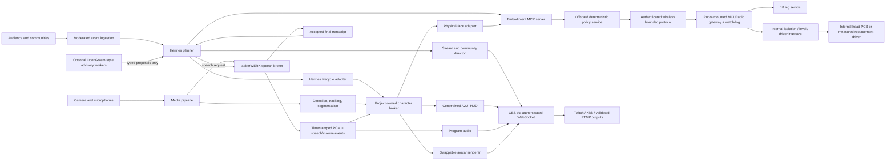
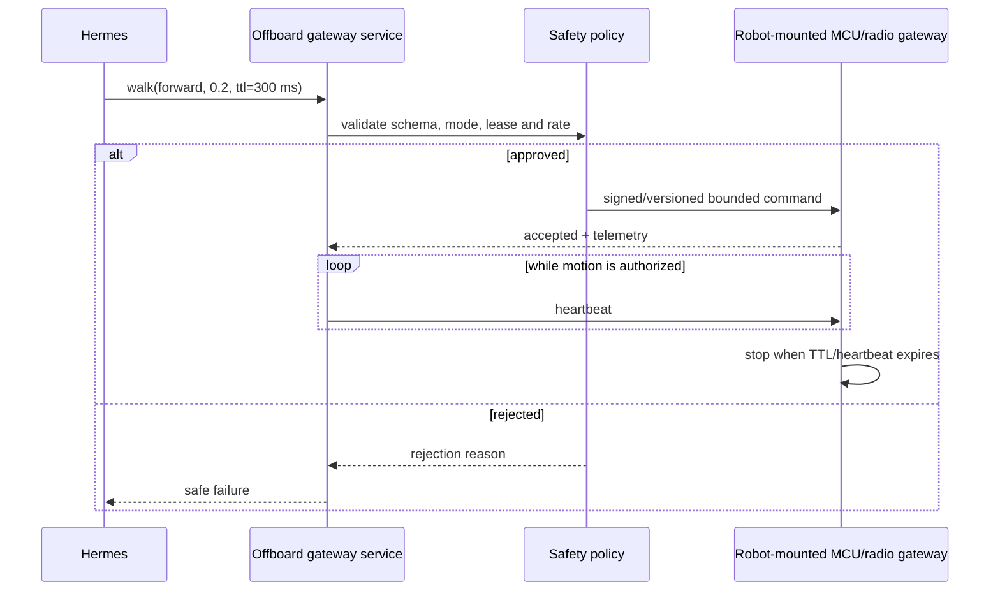
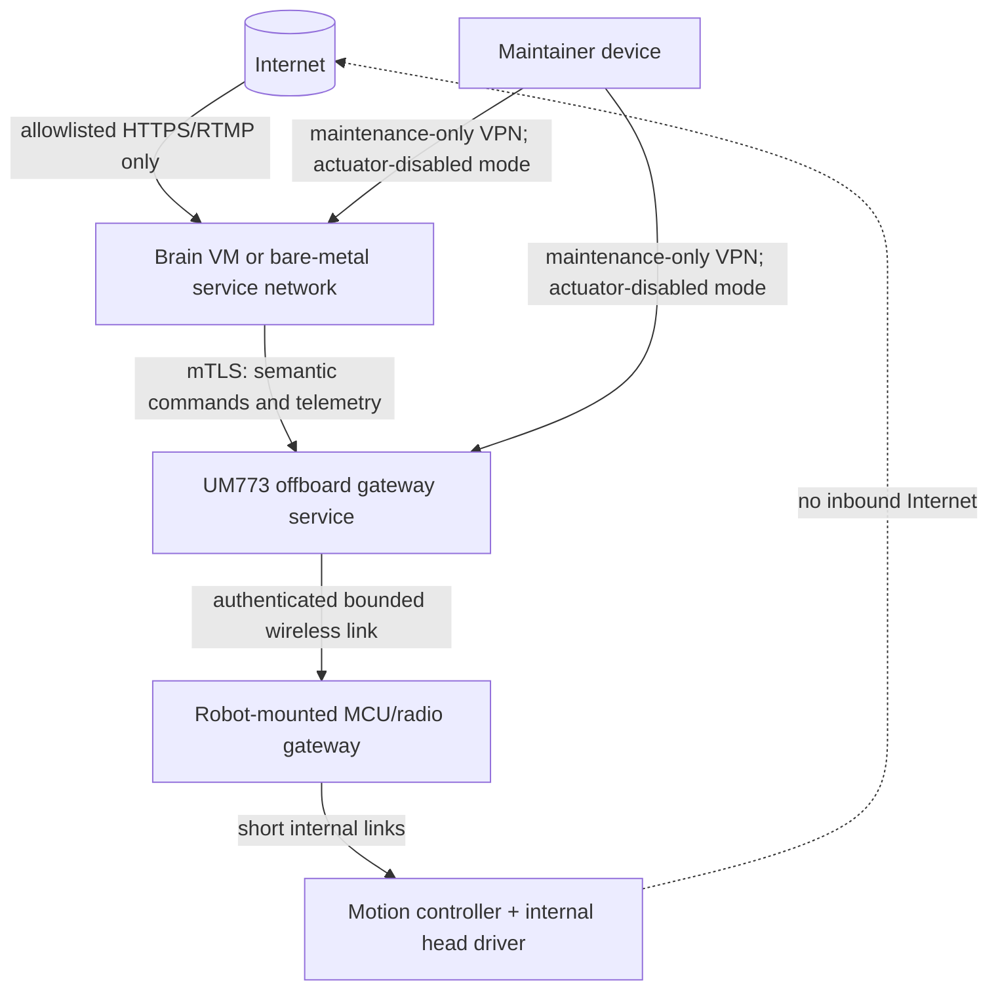
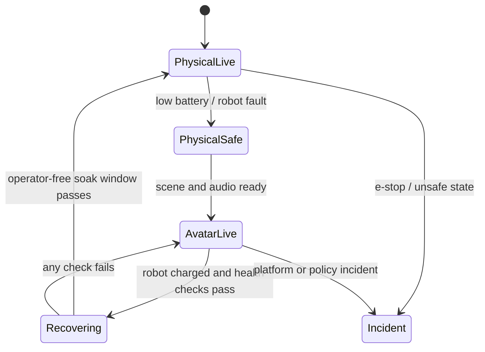
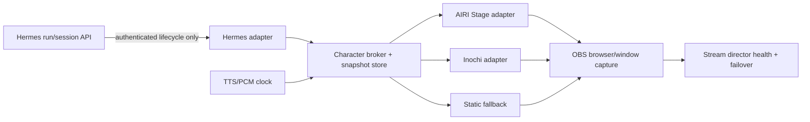

# Furb-o-Mek implementation plan

Status: evidence-backed planning baseline, revised 2026-09-21

## 1. Outcome and immediate feasibility

Furb-o-Mek can be made to look and behave like a self-contained autonomous streaming robot, but the AI should not run on the robot's existing microcontrollers. The viable design is an offboard brain with a narrow, safety-gated connection to the robot.

| Capability | Possible now? | What is missing |
|---|---:|---|
| Hermes controls walking/poses over USB or Wi-Fi | Yes | Import/restore the Freenove firmware, document its protocol, then expose bounded commands through a robot gateway |
| Hermes speaks through the stream and synchronizes the Furby face | Yes, with limitations | Digitize the two-button head controller; add position/homing feedback for repeatable expressions |
| Hermes controls OBS and appears to self-stream | Yes | OBS scene contract, authenticated WebSocket worker, capture/audio routing, reconnect policy |
| Live object/part recognition and segmentation overlays | Yes on the Omen-class GPU host | Camera, detector/segmenter pipeline, overlay renderer, latency benchmark |
| Twitch/Kick streaming | Yes when RTMP credentials are available | Platform credentials and per-platform soak tests |
| Pump.fun streaming | Needs an integration spike | Confirm the current supported ingest/control path before promising unattended operation |
| Discord voice-channel participation | Yes | Discord bot, audio receive/send bridge, moderation and reconnection logic |
| Discord camera/video as a bot | Not a v1 guarantee | Official voice is supported; autonomous video publishing needs a separately validated client path |
| Telegram group voice/video chat | Possible only through a user/MTProto or RTMP design | Bot API is insufficient; account-policy and WebRTC/RTMP work are required |
| X Spaces hosting/speaking | No supported public-API path identified | X's documented Spaces API is discovery/analytics-oriented; UI automation would be brittle and risky |
| Meaningful AI inference on the stock robot | No | Microcontroller-class hardware is appropriate for control, not LLM, speech, or vision inference; exact controller and WLAN chipsets remain unconfirmed |
| VTuber/avatar takeover while charging | Yes | Avatar asset/rig, viseme and emotion mapping, OBS failover scene |

The first autonomous milestone is therefore not "put Hermes on the robot." It is:

> Hermes runs on a quarantined Linux compute host and calls a local, allowlisted robot-control tool. A deterministic robot-mounted microcontroller gateway owns final timeouts, limits, interlocks, and emergency stop behavior.

Normal operation is explicitly untethered from **both** legacy controllers. The handheld movement remote is a characterization reference, not a runtime dependency. The yellow facial-control box may be reverse-engineered and then removed; if a useful control PCB remains, it must be mounted inside the robot, driven electrically through a protected interface, and have no external cable or control authority. No person operates a legacy button or speed knob during normal runtime. An independent actuator-power cutoff remains mandatory safety equipment, not an operating control.

## 2. Evidence baseline

### 2.1 What exists in this repository

This repository is currently a Nuxt 3 browser application plus an Express TTS proxy, not a robotics stack:

- [`package.json`](https://github.com/patchwerks/furbomek/blob/main/package.json#L5-L11) starts Nuxt and `server/tts-proxy.js` together and has no firmware, robot, OBS, or perception service.
- [`nuxt.config.ts`](https://github.com/patchwerks/furbomek/blob/main/nuxt.config.ts#L12) makes the application client-only (`ssr: false`).
- [`src/chat/openai-assistant.ts`](https://github.com/patchwerks/furbomek/blob/main/src/chat/openai-assistant.ts#L24-L28) creates an OpenAI client in the browser; this is not an acceptable privileged control boundary.
- [`src/settings.ts`](https://github.com/patchwerks/furbomek/blob/main/src/settings.ts#L35-L68) defines the current BIPCI personality and provider settings. Credentials in the first GitHub snapshot were blanked before publication.
- [`server/tts-proxy.js`](https://github.com/patchwerks/furbomek/blob/main/server/tts-proxy.js#L5-L18) is a permissive localhost-oriented credential-forwarding proxy on port 3500. It needs authentication and containment before unattended deployment.
- [`src/tts/interfaces.ts`](https://github.com/patchwerks/furbomek/blob/main/src/tts/interfaces.ts#L1-L18) is the most reusable existing seam: it already separates TTS providers and streams.

Consequently, every physical-control, perception, streaming, deployment, and social-call component in this plan is new work.

### 2.2 Robot identification and confidence

The supplied photo sets (`IMG_5171`-`IMG_5187` and `IMG_5527`-`IMG_5544`) are consistent with a modified **Freenove Hexapod Robot Kit FNK0031**:

- six legs with three hobby servos each (18 degrees of freedom);
- a Freenove-style crawling robot controller;
- two flat-top 18650 cells;
- plug-in WLAN and separate optional remote-radio modules whose exact chipsets remain unconfirmed;
- a separately fabricated Furby head assembly and wired control deck.

Freenove's [FNK0031 product page](https://store.freenove.com/products/fnk0031) documents computer/app/Wi-Fi control, an optional wireless remote, and two flat-top 18650 cells. Its [default-functions documentation](https://docs.freenove.com/projects/fnk0031/en/latest/fnk0031/codes/tutorial/Default_Functions.html) documents the robot-created Wi-Fi network, movement/posture controls, and optional remote module. The [official source repository](https://github.com/Freenove/Freenove_Hexapod_Robot_Kit) applies to FNK0031 and contains Arduino/Processing resources. These sources distinguish WLAN from the optional remote-radio path but do not establish the chipset installed on this unit.

This is a strong identification, not yet a bill of materials. Exact board revision, MCU, servo models, pin map, battery topology, and installed firmware must be photographed and measured before electrical changes.

### 2.3 Existing robot-side compute

The working assumption from the carrier-board form factor and Freenove reference platform is:

| Part | Role | Suitable work |
|---|---|---|
| ATmega2560-class controller | Gait, servo timing, command parsing | Reference-platform inference; exact MCU must be photographed or confirmed from firmware |
| WLAN module | Wi-Fi-to-controller transport | Exact chipset/protocol unknown; suitable role only after marking and firmware review |
| Separate remote-radio module | Existing handheld remote link | Exact chipset unknown; legacy characterization path, not final runtime authority |
| 18 hobby servos | Hexapod joints | Walking, turning, height and body poses within calibrated envelopes |
| Furby mechanism + reversible DC controller | Coupled facial mechanism | Timed forward/reverse motion; initially not independent eye/ear/beak actuation |

These parts do not provide a Linux-like OS. They run firmware, generally as a single program with interrupts and libraries. They cannot realistically run Hermes, an LLM, speech recognition, SAM-class vision, or OBS. Their correct long-term role is the robot's hardware abstraction and safety layer.

### 2.4 Furby head control deck

The yellow wired deck contains two external momentary controls, a speed potentiometer, and a reversible PWM DC-motor board with two `SRD-05VDC-SL-C` relays. It appears consistent with a common reversible motor-controller family, but the exact controller model and Furby generation are unconfirmed. The visible mechanism appears mechanically coupled rather than independently servo-controlled. The safest identity is “salvaged Furby-like head mechanism, externally driven through a reversible motor controller; most compatible with original 1998-era architecture.”

Do **not** wire the ATmega directly to those button leads based only on photographs. First measure each lead relative to controller ground with the button released and pressed.

Decision rule:

- If input topology, reference, voltage, or polarity is unknown, make no connection. After measuring, default to an optocoupler, PhotoMOS, or dry-contact relay rated for the measured signal.
- An open-drain or transistor output is permitted only after a compatible shared reference and voltage/current levels are confirmed.
- Never route motor current through the MCU.
- Treat the controls only as legacy circuit inputs for characterization and autonomous electrical emulation; they are not retained as a human runtime interface.
- Never permit both direction commands simultaneously.

Timed pulses can produce early demonstrations, including mouth-like motion during speech, but they will accumulate positional error. Repeatable named expressions require a home/limit switch, Hall sensor, encoder, or a verified existing position signal.

After characterization, remove the yellow enclosure, external cable, buttons, and knob from normal operation. Either mount the necessary PCB entirely inside the robot behind an electrically appropriate isolation/driver interface, or replace it with a measured driver. Both directions must default released on boot, reset, watchdog expiry, and link loss.

### 2.5 Factory audio and speaker evidence

The original-era [US6544098B1 patent](https://patents.google.com/patent/US6544098B1/en) describes an information processor communicating over D0-D3 and CTS with a TI TSP50C04 LPC speech coprocessor, whose internal 10-bit DAC drives a 32-ohm speaker. That is a **patent-described 1998 embodiment**, not proof of the processor, speaker, connector, or board installed here; the patent also does not establish a separate external amplifier IC. A generation-specific [Adopt-a-Furby repair guide](https://www.adoptafurby.com/furbyinfo/speaker.php) reports an approximately 40 mm, 32-ohm, 0.25 W transducer in some original units, but community values cannot replace measurement.

Factory-speaker reuse is **TBD** pending a label photograph, conductor/connector map, unpowered DC-resistance measurement, nominal impedance/power confirmation, and differential drive-waveform measurement. Do not drive an unknown speaker from GPIO or ground an unknown bridged output with an earth-referenced oscilloscope clip. The proposed project path is TTS-decoded PCM feeding OBS program audio and measured local playback from one timestamp authority, with the same events driving the physical face and avatar. Bluetooth is only a provisional playback path, not the authoritative lip-sync clock. See [sheet 05](.schematics/05-furby-audio-mechanism.md).

### 2.6 Camera baseline and staged range goal

The current external OBS camera is the near-term vision source. No camera has been proven to fit an eye or forehead cavity. A later fixed monocular camera behind a reversible forehead or eye insert is preferred over dual/stereo or moving-eye designs until aperture, depth, linkage sweep, focus, ribbon routing, heat, balance, and occlusion are measured. Raspberry Pi lists Camera Module 3 at 25 × 24 × 11.5 mm, which does not itself demonstrate fit ([official product page](https://www.raspberrypi.com/products/camera-module-3/)). See [sheet 06](.schematics/06-eye-camera-integration.md).

The desired 1–3 mile link remains a future site-tested goal, not a present capability. It requires line-of-sight/Fresnel and link-budget work, antenna-height and terrain analysis, jurisdiction-specific spectrum/DFS review, weather/interference tests, and measured video/control latency and loss. Video and control remain logically independent; video loss is never the local motion-stop mechanism. Relevant technical references include [RFC 6184](https://www.rfc-editor.org/rfc/rfc6184), [RFC 8834](https://www.rfc-editor.org/rfc/rfc8834), and US [47 CFR Part 15 Subpart E](https://www.ecfr.gov/current/title-47/chapter-I/subchapter-A/part-15/subpart-E).

The public-safe bench-tool baskets and measurement dependencies are recorded in [`FUNDING.md`](FUNDING.md); all schematic evidence/status notes are indexed in [`.schematics/README.md`](.schematics/README.md). Topic-organized evidence and source inventories begin at [`docs/research/README.md`](docs/research/README.md); the first runtime decision pass remains in [`docs/research/runtime-ui-stack-2026-09-21.md`](docs/research/runtime-ui-stack-2026-09-21.md). A host Hermes starts with [`HERMES.md`](HERMES.md) and [`docs/operations/hermes-one-shot.md`](docs/operations/hermes-one-shot.md).

## 3. Chosen product architecture

Use one monorepo for the product-owned protocol, firmware changes, services, UI, deployment definitions, tests, and hardware documentation. Keep third-party upstream code out of the tree unless its license has been reviewed.

Why a monorepo now:

- the firmware command schema, gateway types, safety tests, overlays, and operator UI must evolve together;
- a single compatibility matrix can bind robot firmware, gateway, and Hermes tools;
- deployments need reproducible versions of all cooperating services;
- future robots can implement the same embodiment contract without inheriting Furb-o-Mek mechanics.

Proposed evolution after the preservation commit:

```text
furbomek/
├── apps/
│   ├── operator-ui/          # current Nuxt UI, refactored
│   ├── overlay-ui/           # constrained A2UI/Lit OBS browser source
│   └── avatar-host/          # renderer shell; AIRI/Inochi/OpenVT adapters
├── services/
│   ├── embodiment-gateway/   # only network path to robot actions
│   ├── perception/           # detection, tracking, segmentation
│   ├── stream-director/      # OBS scenes, captions, failover
│   ├── conversation/         # Hermes sessions + jabberWERK speech bridge
│   ├── character-broker/     # authoritative media/presence event bus
│   ├── hermes-adapter/       # Hermes lifecycle -> safe project events
│   └── community/            # Twitch/Kick/Discord/Telegram adapters
├── integrations/
│   ├── jabberwerk/           # thin client/config; speech implementation stays upstream
│   └── airi/                 # renderer and scoped capability/A2A adapters
├── packages/
│   ├── protocol/             # versioned commands/events and schemas
│   ├── safety-policy/        # limits independent of model prompts
│   ├── character-state/      # emotions, visemes, gestures, scenes
│   └── hud-catalog/          # allowlisted slots, components and effects
├── firmware/
│   ├── robot-gateway/        # robot-mounted MCU/radio/watchdog and protected I/O
│   └── fnk0031/              # reviewed firmware/delta, not blind vendoring
├── infra/
│   ├── containers/           # portable OCI workload definitions
│   ├── vm/                   # KVM/libvirt + VFIO deployment profile
│   └── bare-metal/           # Ubuntu/systemd deployment profile
├── docs/
│   ├── architecture/
│   ├── hardware/
│   ├── operations/
│   ├── security/
│   ├── research/
│   └── adr/
├── AGENTS.md
├── HERMES.md                # clone-to-running agent entrypoint
└── PLAN.md
```

The official Freenove repository declares CC BY-NC-SA 3.0 and explicitly says its files are not for commercial use. Before this project becomes a commercial desktop-agent platform, either obtain compatible permission, isolate the upstream material as a development reference, or implement a clean project-owned protocol/firmware layer. Do not copy upstream code into a permissively licensed product without a license decision. AIRI, A2UI, Live2D/VRM assets, and every avatar model also receive separate source, version, and license records; an application's code license never clears bundled character assets or proprietary runtimes automatically.

## 4. Runtime design

### 4.1 Control and media planes



Hermes supports local stdio and remote HTTP MCP servers and discovers their tools as first-class actions ([Hermes native MCP documentation](https://github.com/NousResearch/hermes-agent/blob/main/skills/autonomous-ai-agents/hermes-agent/references/native-mcp.md)). That makes a narrow MCP server the preferred agent integration:

```text
robot.get_state()
robot.stop()
robot.pose(name, ttl_ms)
robot.walk(direction, speed, ttl_ms)
robot.face(expression, intensity, ttl_ms)
stream.set_scene(name)
stream.show_overlay(payload, ttl_ms)
```

Do not expose raw serial, arbitrary GPIO, shell, OBS credentials, or unrestricted URL fetches to the model.

“Isolated microcontroller gateway” means the **physical robot-mounted assembly**: a microcontroller, robot-side radio, independent watchdog, power conditioning, and an isolation/level-translation/protected-driver board. It is distinct from the offboard Linux embodiment-gateway service, which authenticates requests, applies semantic policy, and sends the bounded protocol. The robot-mounted gateway owns last-line TTL expiry, sequence rejection, head-direction interlock, and stop behavior even if every offboard process fails.

### 4.2 Four-plane authority boundary

The project deliberately separates four planes. Crossing a plane boundary requires a versioned, authenticated schema; sharing a process or database does not grant authority.

| Plane | May do | Must never do |
|---|---|---|
| Swarm/task | Hermes planning, optional specialist workers, retrieval, perception, community and stream proposals | Directly access motors, raw serial/GPIO, firmware, OBS credentials, wallets, or mutable safety policy |
| HUD | Render public-safe activity, evidence, profiles, charts, forms, database/query summaries, vision labels, and alerts | Execute generated code, submit forms, place trades, expose secrets, or issue robot/OBS commands |
| Avatar | Render one character's state, visemes, expressions, gestures, captions, and offline/charging presence | Become a second planner, hold Hermes credentials, invoke tools, or keep robot motion alive |
| Robot safety | Validate and execute bounded physical commands; stop locally on expiry/fault | Accept free-form instructions or depend on Hermes, OBS, HUD, avatar, or video health for STOP |

OpenGolem contributes orchestration vocabulary, not a second authority. Any future swarm sends typed, authenticated, rate-limited **proposals** to Hermes. Each worker has its own identity, scoped credentials, concurrency/cost/delegation limits, replay protection, trace ID, and circuit breaker. It has no robot, OBS, wallet, or social-posting credentials. The legacy OpenGolem notes about anti-detection, account purchasing/concealment, proxy rotation, synthetic-human timing, or engagement automation are explicitly excluded from this project.

### 4.3 Character and HUD event contract

Hermes is the reasoning authority, but it is not exposed directly to renderers. A narrow loopback adapter subscribes to Hermes' run/session lifecycle and emits project events to the character broker. The broker is the sole media/presence state authority; the HUD, avatar, physical-face adapter, and stream director are consumers. Hermes' API bearer key and tool surface never enter a browser source or renderer process. Hermes documents run lifecycle SSE and authenticated API surfaces, but not a stable viseme/emotion protocol, so Furb-o-Mek owns that translation layer ([Hermes programmatic integration](https://hermes-agent.nousresearch.com/docs/developer-guide/programmatic-integration), [Hermes API server](https://hermes-agent.nousresearch.com/docs/user-guide/features/api-server)).

Every event carries at least:

```json
{
  "schemaVersion": "furbomek.character.v1",
  "eventId": "uuid",
  "sessionId": "stream-session",
  "utteranceId": "optional-utterance",
  "stream": "character|hud|vision|system",
  "seq": 1842,
  "source": "hermes-adapter",
  "causationId": "run-or-parent-event",
  "observedAt": "2026-09-21T23:00:00Z",
  "monotonicMs": 1234567,
  "ttlMs": 5000,
  "priority": 40,
  "audience": "public",
  "sensitivity": "public",
  "kind": "agent.activity",
  "payload": {},
  "cancelOf": null
}
```

Rules:

- Each stream is ordered by `seq`; duplicates and older sequence numbers are ignored.
- Transient events expire by TTL. A cancellation/revocation event wins over an earlier event.
- Consumers have bounded queues and may coalesce low-priority updates; they never replay expired animations.
- On first load or reconnect, a consumer requests a complete snapshot, then resumes ordered deltas.
- The broker exposes health and last-applied sequence per consumer so the stream director can fail over deterministically.
- Public HUD text is an activity summary, not hidden chain-of-thought. Secrets, private form fields, full wallet identifiers, cookies, prompts, and raw tool output are redacted before the broker.
- Visemes and mouth energy come from the timestamped TTS/PCM clock, not LLM tokens. Barge-in emits an immediate utterance cancellation to both avatar and physical-face consumers.

Canonical character states are `idle`, `listening`, `thinking`, `speaking`, `interrupted`, `error`, and `offline`. Renderers may add style, but they may not invent operational state.

### 4.4 Canonical speech and audio plane: jabberWERK

Use [`patchwerks/jabberwerk`](https://github.com/patchwerks/jabberwerk) as the canonical speech/media control plane. Furb-o-Mek must not grow a second set of engine-specific STT/TTS implementations. The Furb-o-Mek integration is a thin authenticated client plus configuration; engine routing, profiles, cloning/conversion, DSP, locality, semantic acceptance, and speech capability negotiation remain in jabberWERK.

| Concern | Owner | Boundary |
|---|---|---|
| STT, TTS, streaming speech, duplex STS/S2S | jabberWERK broker and isolated engine packs | Only capabilities declared and empirically qualified may be selected |
| Voice identity, cloning/conversion, DSP, pronunciation | jabberWERK profiles/graphs | Project-owned profile IDs; raw private voice assets never enter this repository |
| VAD, endpointing, wake/address and barge-in media signals | jabberWERK media graph plus Hermes dispatch policy | Rejected/background speech never enters Hermes history |
| Conversation, tools, approvals, memory, delegation | Hermes | jabberWERK is not a second agent or tool authority |
| Avatar lip-sync and physical-face timing | Character broker consuming jabberWERK PCM/timeline events | Renderers may visualize timing but do not synthesize an independent voice |
| OBS program audio and local robot playback | Stream director/media sinks | Both consume the same timestamp authority and cancellation events |

The evaluated Jabberwerk snapshot is development release `0.4.0` at private-repository commit `5d175c7389577785f477c990499e2ace4e91771a`. Source inspection confirms a host-neutral broker, public Hermes batch TTS/STT providers, loopback authentication, engine/profile contracts, semantic audio acceptance, and an atomic deploy/rollback package. It is **not yet installed or production-qualified**. Its own roadmap limits v1.0 to Linux/Hermes batch TTS/STT; public streaming TTS, streaming STT, realtime wake/barge-in, and duplex S2S remain later work until generic Hermes seams and live evidence exist.

Adoption rules:

- Use the public `jabberwerk` Hermes providers for the first batch vertical slice; do not import Hermes private streaming registries into Furb-o-Mek.
- Keep each engine in its independently locked environment. AIRI, Furb-o-Mek, and Hermes select logical capabilities/profiles through the broker rather than importing model SDKs.
- Route AIRI speech through jabberWERK by default. AIRI may consume PCM, visemes, speech-state, emotion, and cancellation events; its own STT/TTS providers stay disabled unless intentionally wrapped as jabberWERK engine adapters and passed through the same qualification suite.
- A local engine failure fails locally. Cloud fallback, unrelated voices, or new license terms require an explicitly enabled route; no silent network egress or identity substitution.
- Do not call speech “working” after a health check or generated file. Require audible-sink evidence, timing metrics, interruption behavior, and rollback as defined by Jabberwerk's live-testing tiers.
- Furb-o-Mek pins the Jabberwerk release/commit and compatibility matrix; it does not copy the private upstream implementation into this monorepo.

Current compatibility consequence: tonight's low-risk path is **batch** Hermes → jabberWERK TTS → OBS/avatar/known speaker. Streaming and duplex are feature-gated until upstream/public APIs and live tests prove them.

### 4.5 Command lifecycle and fail-safe behavior



Required invariants:

- `STOP` is local, unconditional, idempotent, and higher priority than every other command.
- Every motion command has a short TTL; movement never depends on a later stop command arriving.
- Loss of agent, gateway, Wi-Fi, serial, or heartbeat returns the robot to a defined neutral posture.
- The MCU rejects unknown protocol versions, illegal ranges, conflicting head directions, and stale sequence numbers.
- Physical e-stop removes actuator power without depending on Linux, network, or the model.
- Public messages and on-chain events can request actions but never bypass policy.
- All requests, policy decisions, actuator acknowledgements, and scene changes enter an append-only audit log.

## 5. Host and quarantine design

### 5.1 Recommended two-host deployment

| Host | Preferred responsibilities | Rationale |
|---|---|---|
| HP Omen with the reported NVIDIA GPU | Hermes inference/provider clients, perception, OBS, video encoding, avatar, platform adapters | Heavy GPU/media workload and the best available inference headroom |
| Minisforum UM773 | Offboard robot-link service, telemetry, watchdog supervision, maintenance/diagnostics UI, disabled from actuation during autonomous runtime | Small always-on machine can stay near the robot and keep service-level safety independent from stream/inference crashes; last-line watchdog remains on the robot-mounted MCU |

The exact Omen model/GPU, UM773 RAM/storage, NICs, BIOS virtualization settings, and IOMMU groups are not captured in this repository. Before choosing the final topology, record outputs of `lscpu`, `lspci -nnk`, `nvidia-smi`, `lsusb`, `ip -br link`, `free -h`, and IOMMU-group enumeration in `docs/hardware/hosts.md`. Until that is done, GPU/VM suitability is a hypothesis, not a promise.

### 5.2 Deployment profiles

#### Profile A: KVM guest with whole-GPU passthrough — strongest preferred quarantine

- Minimal Ubuntu or Proxmox-style Linux hypervisor on the Omen.
- A **full Omarchy guest** is the desired graphical/streaming target: it boots its own Arch-based userspace, bespoke kernel, systemd session, Hyprland/Wayland, PipeWire, and OBS. It is not an Ubuntu package or container layer.
- An Ubuntu LTS guest remains the reference/fallback when exact GPU, PipeWire, portal, or compositor tests fail.
- The selected guest owns the discrete GPU, required USB capture/audio devices, and the brain/media stack.
- Workloads still run as unprivileged OCI containers inside the guest for reproducibility.
- A dedicated virtual NIC/VLAN reaches only the UM773 gateway and allowlisted internet destinations.
- The hypervisor retains no agent credentials and exposes no host filesystem mounts to the guest.

Linux VFIO provides IOMMU-protected device assignment, and the IOMMU group is the minimum isolation unit ([Linux kernel VFIO documentation](https://docs.kernel.org/driver-api/vfio.html)). Therefore this profile is possible only if:

1. BIOS exposes AMD-Vi/IOMMU or Intel VT-d;
2. the GPU and its audio function occupy assignable IOMMU groups;
3. the host has another display path or can run headless;
4. capture/audio/USB devices can be passed through without taking host-critical controllers;
5. suspend/resume and GPU reset survive repeated guest restarts.

A passed-through GPU is exclusive to the guest; it is not simultaneously available to the host. Laptop mux wiring and inseparable IOMMU groups are common practical blockers. If the Omen fails the probe, do not weaken isolation with unsafe VFIO modes—use Profile B.

Omarchy's official unattended-install path uses a second `cidata` drive and documents a Proxmox/KVM example with OVMF, Q35, virtio storage/network, and virtio graphics ([official unattended-install manual](https://omarchy.org/manual/unattended-installs/)). That establishes a credible full-VM path, not production readiness for OBS or VFIO. The current pinned evaluation target is **Omarchy v4.0.4**, release commit `c668141e9c42b13c80c9ca4ea108e11708c5e8a5`, ISO SHA256 `ddeded2758c48318d201dfdac905ecb28f570441883f0c052ea3cd5d05acf92d` ([official release](https://github.com/omacom/omarchy/releases/tag/v4.0.4)). Keep `cidata` outside the repository; it can contain password hashes, SSH/Tailscale material, or a plaintext disk-encryption passphrase.

The Omarchy gate is empirical:

1. install and recreate from ISO + `cidata` without manual repair;
2. boot Hyprland repeatedly with accelerated rendering, not software fallback;
3. record a moving PipeWire screen, desktop audio, microphone, camera, and required USB device in OBS;
4. run OBS for 30 minutes, then complete scene-switch/source-reload tests;
5. measure A/V latency against the Ubuntu guest;
6. survive guest reboot, renderer kill, portal restart, and GPU reset without stale on-air state;
7. pass a 24–72 hour private soak on the exact Omen GPU/driver before it becomes the unattended stream dependency.

Disable unused Omarchy services/ports such as LocalSend, never enable temporary passwordless sudo on an unattended agent guest, and audit effective listeners/privileges after every image update ([Omarchy security guidance](https://github.com/omacom/omarchy/blob/quattro/manual/48-security.md)). Until the gate passes, Omarchy is the development/streaming guest candidate, while Ubuntu remains the known recovery baseline. Robot-critical services and the robot-mounted safety plane do not move into Omarchy merely because its desktop is preferred.

#### Profile B: bare-metal Ubuntu plus restricted containers — most compatible

- Ubuntu LTS installed directly on the chosen host.
- NVIDIA driver and [NVIDIA Container Toolkit](https://docs.nvidia.com/datacenter/cloud-native/container-toolkit/latest/install-guide.html) provide explicitly assigned GPU access to perception/inference containers.
- Hermes, perception, overlay, stream director, and community adapters run as distinct non-root services with read-only filesystems, dropped capabilities, resource limits, and separate credentials.
- OBS may run as a dedicated desktop/service account outside a container if PipeWire, capture, or GPU presentation proves unreliable in-container.
- The offboard embodiment-gateway service remains on the UM773 or a tightly restricted host service; the distinct robot-mounted MCU/radio gateway remains the final local safety authority.

Containers improve packaging and blast-radius control but share the host kernel; they are not equivalent to a VM security boundary. This profile satisfies portability and bare-metal deployment, not the strongest interpretation of host quarantine.

#### Profile C: single-machine development

Run the full stack on one Ubuntu machine, initially with USB serial, but preserve the same network APIs and service boundaries. This is appropriate for bench development, not the final unattended safety case.

#### Profile D: bare-metal Omarchy — optional after the VM gate

Omarchy can also be installed directly on Linux hardware, but then it replaces Ubuntu rather than running on top of it. Consider this only after the VM profile passes the exact GPU/media soak, an OS/update/rollback ADR is accepted, and the same service isolation, credential separation, backup/restore, and hardware-safety tests pass. Bare metal improves direct device access but gives up the VM quarantine boundary.

### 5.3 Network and credential boundaries



- Robot WLAN is never internet-routed.
- The gateway accepts runtime motion commands only from the brain identity. A separate maintainer identity is read-only by default and can change hardware state only in an explicit maintenance mode that first disables actuator power.
- Platform, model, TTS, and wallet credentials are isolated by service and never placed in browser defaults.
- Production credentials are injected at runtime from an encrypted secret store; `.env` remains ignored.
- Agent terminal execution uses an isolated backend. Hermes' own documentation notes that its local backend has no isolation and inherits the real user's home, while its Docker/SSH-style backends provide stronger separation ([Hermes configuration](https://github.com/NousResearch/hermes-agent/blob/main/website/docs/user-guide/configuration.md)).

### 5.4 Supply-chain and update policy

- Runtime deployments use exact release/commit/OCI digests and committed lockfiles; never deploy `main`, `latest`, or a floating URL.
- Downloaded models, Cubism/VRM/Inochi assets, fonts, shaders, and native binaries require source URL, license, SHA256, size, and redistribution/streaming decision.
- Production builds must succeed offline from reviewed/mirrored inputs and emit an SBOM plus provenance record.
- A2UI protocol, A2UI packages, AIRI, Omarchy, OBS, avatar assets, and robot firmware are upgraded independently through compatibility fixtures; an OS update cannot silently upgrade the character protocol.
- Rollback retains the previous guest image/container digest, broker schema, renderer adapter, OBS scene collection, and robot firmware as one tested compatibility set.
- New dependencies run without production credentials or robot reachability until source review, secret scan, license review, and failure tests pass.

## 6. Streaming, perception, and embodiment

### 6.1 OBS control

OBS WebSocket is built into OBS Studio 28+ and supports authenticated remote control on port 4455 by default ([official obs-websocket repository](https://github.com/obsproject/obs-websocket)). Put it on loopback or a private service network and require a generated password.

The stream director owns a declarative scene model:

```text
PHYSICAL_LIVE   robot camera + captions + status + perception overlay
PHYSICAL_SAFE   robot camera + no motion + maintenance banner
AVATAR_LIVE     avatar + captions + charts/community overlays
INCIDENT        static safe scene + muted robot controls
OFFLINE         local recording/test only
```

OBS must keep streaming when Hermes restarts. Hermes requests scene changes; the director validates and applies them. Multi-platform output is a deployment adapter, not robot-control logic.

### 6.2 A2UI live activity HUD

Use Google's A2UI as an **optional declarative content format inside a project-owned OBS overlay**, not as the stream controller. The correct current protocol is **v0.9.1**, not `v0.91.0`; v1.0 is still a candidate ([A2UI roadmap](https://a2ui.org/roadmap/)). Protocol and library versions are separate pins. The initial evaluation pins A2UI source commit `9263942b373d01cc21ffd2fd9894bda43d9c7080`, `@a2ui/web_core` 0.11.0, and the framework-neutral `@a2ui/lit` 0.11.0 via their `/v0_9` exports ([pinned Lit manifest](https://github.com/a2ui-project/a2ui/blob/9263942b373d01cc21ffd2fd9894bda43d9c7080/renderers/lit/package.json), [v0.9.1 specification](https://github.com/a2ui-project/a2ui/blob/9263942b373d01cc21ffd2fd9894bda43d9c7080/specification/v0_9_1/docs/a2ui_protocol.md)). Lit runs as a separate overlay sidecar so the existing Nuxt/Vue prototype does not require a custom unsupported Vue renderer.

OBS owns the browser source's canvas, source transform, z-order, visibility, permissions, and scene lifecycle. The HUD owns only semantic content inside predeclared slots. OBS documents that a Browser Source can unload when hidden or refresh when a scene activates, so the page must rebuild from a broker snapshot after every load ([OBS Browser Source](https://obsproject.com/kb/browser-source)). Use one persistent full-canvas source; do not create and destroy sources for individual events.

Reference 1920×1080 composition (coordinates scale from normalized anchors):

```text
┌── 48,48  AGENT STATUS 520×120 ──┐     ┌── ALERTS 624×96 ──┐     ┌── ENTITY INSPECTOR 520×560 ──┐
│ state, task, elapsed, source   │     │ policy/fault/approval │     │ profile, wallet, chart, page   │
└───────────────────────────────────┘     └──────────────────────────┘     └───────────────────────────────────┘
┌── 48,184 WORK DETAIL 520×400 ──┐          CENTRAL SAFE AREA          │
│ browser/form/query/tool progress │        robot or avatar remains visible       │
└───────────────────────────────────┘                                           │
┌── 48,888 TELEMETRY 280×144 ─┐  ┌── 360,820 EVIDENCE STRIP 1200×180 ─┐
│ latency, health, source age      │  │ captions, citations, OCR snippets, result │
└───────────────────────────────────┘  └──────────────────────────────────────────┘
```

Allowed event families:

| Event | Example safe content | Slot |
|---|---|---|
| `agent.activity` | “Comparing contract holders”, tool category, elapsed time | agent status/work detail |
| `browser.context` | allowlisted domain and redacted page title | work detail |
| `form.progress` | section/step and validation result; never field secrets | work detail |
| `profile.summary` | public handle, risk flags, source timestamp | entity inspector |
| `wallet.summary` | chain, truncated address, public balances/flows, confidence | entity inspector |
| `market.analysis` | pair, timeframe, indicators, hypothesis, source age | entity inspector/evidence strip |
| `trade.intent/result` | simulated or policy-approved intent/result; never key material | alerts/evidence strip |
| `document.image` | OCR excerpt, image label, citation, confidence | evidence strip |
| `database.query` | dataset, sanitized query purpose, row count, result summary | work detail/evidence strip |
| `vision.annotation` | normalized box/mask/label/confidence/TTL | canvas annotation layer |
| `system.health` | reconnect, stale data, service fault, latency | telemetry/alerts |

Animations are host-owned presets such as `enter_scan`, `pulse_busy`, `resolve`, `fault`, and `expire`. An event may select a preset ID and bounded duration, never arbitrary CSS, coordinates, HTML, JavaScript, shader code, or asset URL. A2UI's first catalog is read-only: text, icon from a bundled set, progress, key/value rows, sparkline from supplied numbers, image from a project media proxy, and bounded boxes/masks. Inputs, client functions, iframes, remote media, outbound links, and action controls are disabled.

Security and recovery requirements:

- Validate the exact protocol/schema before rendering. Initial hard ceilings are 64 KiB per delta, 256 KiB per snapshot, 128 components, depth 12, 2,000 visible characters per component, and 10 deltas/second per producer; changing them requires a versioned manifest plus load-test evidence. Reject unknown catalog items, dangerous JSON Pointer paths, oversized media, and rate abuse.
- Apply a strict CSP and same-origin/allowlisted media policy. The page has no Hermes, OBS, wallet, community, or robot credentials and no network route to those services.
- The project broker provides an authenticated local WebSocket or SSE snapshot/delta feed. OBS WebSocket remains a separate authenticated controller connection owned by the stream director.
- Every surface has sequence, TTL, cancellation, and redaction metadata. On disconnect, show a stale indicator; on reconnect, discard transient effects, fetch a snapshot, and converge before clearing stale state.
- Treat upstream security issues as a reason to pin and fuzz, not as a claim that declarative JSON is automatically safe. A2UI remains behind a feature flag until hostile fixtures cannot execute code, fetch a disallowed URL, spoof a control, or exhaust the renderer.

### 6.3 Vision overlays

Phase 1 uses the current external OBS camera; it is the evidenced near-term source and avoids destructive head work. An embedded monocular camera is a later reversible fixture experiment, not a prerequisite for perception and not proven to fit. Preserve the external source as fallback while testing aperture, mechanism sweep, focus, ribbon routing, temperature, balance, and occlusion; see [sheet 06](.schematics/06-eye-camera-integration.md).

Use a staged pipeline rather than running segmentation on every pixel without context:

1. capture a timestamped camera frame;
2. run a fast detector or open-vocabulary grounding model;
3. track stable objects between frames;
4. invoke segmentation only for selected tracks/regions;
5. emit normalized boxes, masks, labels, confidence, and TTL;
6. render those events in the transparent overlay UI;
7. composite the browser source in OBS.

Meta's [SAM 2 repository](https://github.com/facebookresearch/sam2) describes promptable image/video segmentation with streaming memory for real-time video processing, but "real-time" must be benchmarked on the actual Omen at the target resolution. Start with 720p/30 program video and a lower perception cadence; decouple OBS frame rate from inference rate.

Two modes are distinct:

- **physical annotation:** recognize known chassis regions from a calibrated camera view using project-owned labels and masks;
- **graphic/chart explanation:** capture a specific OBS/browser source, run OCR/chart understanding, and render a textual callout. This is not the same model or latency budget as physical object tracking.

Never allow overlay recognition output to command motion directly.

### 6.4 Voice and facial synchronization

The conversation service emits one time-aligned event stream:

```text
speech.started
speech.viseme(timestamp, phoneme/energy)
character.emotion(name, intensity, ttl)
speech.ended
```

Both the physical face adapter and avatar consume it. The physical adapter maps energy/visemes to safe, short, mutually exclusive motor pulses; the avatar maps the same events to mouth shapes and expressions. This prevents two unrelated lip-sync implementations.

Early physical behavior should be conservative: brief mouth-like chatter at a fixed, measured internal speed setting, periodic re-home, and no promise of independently addressing eyes, ears, or beak. No person operates the legacy knob during runtime. After feedback is added, calibrate named expressions as trajectories with maximum duration/current limits.

TTS decoding, OBS program audio, local playback, physical-face timing, and avatar timing use one timestamp authority. Factory audio electronics are not assumed: the 1998 patent path and actual-unit unknowns are separated in [sheet 05](.schematics/05-furby-audio-mechanism.md). Factory-speaker playback stays disabled until impedance, rating, conductors, connector, and drive topology are measured; use a known external transducer meanwhile.

### 6.5 Avatar takeover

The avatar is an operational fallback, not a separate personality:



The avatar is a swappable renderer behind one project-owned adapter contract:

```text
health() -> ready | degraded | failed
capabilities() -> model formats, expressions, visemes, alpha/capture mode
load_character(asset_id)
apply_snapshot(character_state)
apply_event(seq, ttl, kind, payload)
set_visible(boolean)
shutdown()
```

The renderer runs as a separate least-privilege process or browser origin. It receives no Hermes bearer key, tools, memory database, OBS password, wallet/social credentials, or robot route. Killing it must not stop Hermes or the stream director; the director switches to a static local fallback when its health lease expires.

Renderer decision:

| Candidate | Use | Decision |
|---|---|---|
| **AIRI Stage Web** | Browser-visible Live2D/VRM stage and existing character/audio packages | Preferred first integration when no Inochi2D rig is already ready; run as renderer/consumer only |
| **Inochi Session** | Native Linux Inochi2D playback | Preferred when a project-owned `.inp` model already exists; verify external-control seam before committing |
| **OpenVT** | Open Linux/Godot Live2D renderer with transparent-window focus | Later extensibility spike; build/submodule and proprietary Cubism dependencies make it a poor tonight default |
| **VTube Studio** | Mature Live2D tool | Mac/Windows fallback only; Linux is not officially supported ([official FAQ](https://github.com/DenchiSoft/VTubeStudio/wiki/FAQ/d5e37702314dd984680d2bfde2834e293f1e079e)) |
| **Static project-owned PNG/browser scene** | Minimal character presence + captions + Hermes audio | Mandatory fallback if no model-ready renderer works by Hour 2 |

A renderer-only default does **not** mean discarding AIRI's game, Discord, memory, or plugin work. It means separating capabilities from ownership so Hermes remains the one character/planning authority.

| AIRI integration mode | Use | Authority | Decision |
|---|---|---|---|
| Renderer consumer | Live2D/VRM/MMD/Tachie stage, expressions, motions, lip-sync | Receives character/audio events only | Default and first milestone |
| Capability service | Minecraft/Mineflayer, Factorio/RCON/CV, editor/device bridges, reusable plugins | Hermes invokes narrow named capabilities through MCP/HTTP or a project adapter | Preferred way to retain AIRI features without another brain |
| A2A specialist agent | A capability genuinely depends on AIRI's own cognitive loop, memory, or multi-turn task state | Hermes delegates a bounded task and accepts/rejects the result | Experimental, isolated, and used only when extraction is materially worse |

AIRI's public materials show separate Minecraft and Factorio services/agents rather than one inseparable renderer feature ([Minecraft integration](https://github.com/moeru-ai/airi/blob/main/integrations/minecraft/README.md), [AIRI Factorio](https://github.com/moeru-ai/airi-factorio)). First attempt to expose those existing service capabilities directly to Hermes. Do not rewrite working Mineflayer, RCON, CV, dataset, or game-control code merely to make it “native” to Furb-o-Mek.

Use A2A only across a real agent boundary. Pin A2A protocol `v1.0.1` and use Hermes' native bidirectional A2A plugin, which supports Agent Cards, task send/stream/get/list/cancel/subscribe, push notifications, per-peer credentials, rate limits, redaction, audit, and anti-loop limits ([A2A v1.0.1 release](https://github.com/a2aproject/A2A/releases/tag/v1.0.1), [Hermes A2A documentation](https://hermes-agent.nousresearch.com/docs/user-guide/messaging/a2a)). A delegated AIRI agent gets a distinct context/task ID, capability allowlist, budget/deadline, cancellability, and sandboxed game account/environment. It receives no robot, wallet, social-posting, OBS-control, firmware, or general Hermes tool credentials.

A2A carries task messages, status, and artifacts—not raw realtime PCM or per-frame animation. jabberWERK remains the speech/media plane, and the character broker remains the presentation-state plane. This avoids forcing low-latency media through a task protocol while still preserving AIRI's higher-level agent features.

AIRI is promising but not a plug-and-play silver bullet. It is a full AI-character monorepo with its own agent/provider/audio/memory/plugin surfaces, so embedding the complete runtime without boundaries would duplicate Hermes authority. Pin the evaluation to AIRI `v0.12.0-beta.5`, commit `2c1e223c8dd813d7c74a324d7fd7399fbf47e8bf` ([official releases](https://github.com/moeru-ai/airi/releases/tag/v0.12.0-beta.5)). The renderer adapter is an **external producer**; AIRI Stage remains the consumer. It waits for transport state `ready`, sends only the documented producer event needed for the spike (`input:text` first), treats a false `send()` result as failure, retries with bounded backoff, and verifies observable Stage output. AIRI issue [#2305](https://github.com/moeru-ai/airi/issues/2305) documents messages sent before `ready` being dropped and confirms the server SDK does not expose a public consumer-registration API.

Do not install an in-process Hermes avatar plugin for the production path. Projects that replace Hermes entrypoints, poll ad hoc state files, load runtime code/assets from CDNs, or execute with the agent's full privileges may be explored only in a secret-free disposable sandbox. The project-owned broker/adapter is the durable seam.

AIRI's repository code is MIT, but Cubism Core is separately proprietary and avatar-model rights are per asset ([Live2D Core notice](https://github.com/Live2D/CubismNativeSamples/blob/develop/Core/LICENSE.md)). Do not redistribute AIRI's bundled sample models, Cubism runtime, or any downloaded asset until exact provenance, checksum, commercial/streaming rights, and redistribution terms are recorded. Prefer a project-owned VRM/Inochi2D/Live2D asset with an explicit license.



### 6.6 Embedded and long-range camera staging

The preferred embedded experiment is one fixed camera behind a reversible forehead or eye insert. Dual/stereo and moving-eye cameras remain deferred until the fixed option passes mechanical, optical, thermal, bandwidth, and balance tests. No drawing or module dimension proves fit.

Local embedded video may use onboard H.264 encoding over a private IP link, with timestamped frames and bounded buffers that drop stale video. The later 1–3 mile goal is gated by the actual site and jurisdiction: record line of sight, Fresnel clearance, antenna heights, terrain, link budget, spectrum/DFS basis, interference, weather, throughput, glass-to-glass latency, reconnect behavior, and forced-loss stop distance. The control heartbeat and robot-local TTL are independent of video; loss of video can request a safe state but cannot be the only stop mechanism.

### 6.7 Initial media/runtime budgets

These are test targets, not claims about the unmeasured Omen. Record p50/p95/p99 and revise the budget only with benchmark evidence.

| Measure | First target | Failure behavior |
|---|---:|---|
| OBS program output | 1080p30 baseline; 60 fps only after soak | Keep audio/scene live; reduce HUD/avatar/perception cadence |
| Broker event to first visible frame | p95 ≤250 ms for status/HUD; ≤1 s tonight gate | Mark consumer degraded; coalesce low-priority events |
| Audio-to-mouth skew | p95 absolute skew ≤80 ms | Fall back to amplitude mouth or neutral mouth |
| Snapshot convergence after reload | ≤2 s | Show stale banner; do not replay transient effects |
| Renderer health lease/fallback | static fallback visible ≤2 s | Stream director keeps program audio and safe scene |
| HUD producer rate | ≤10 deltas/s/producer | Drop/coalesce lowest priority; never unbounded queue |
| GPU reserve | ≥25% VRAM/encoder headroom during private soak | Lower perception/model/avatar profile before affecting OBS |
| Dead air during physical↔avatar transition | 0 s program audio; ≤2 s visual fallback | Hold current safe scene, then static fallback |

No benchmark may trade away the robot-local watchdog, stream incident scene, redaction, or credential isolation.

## 7. Community-call capability boundaries

### Hermes versus ElizaOS

Keep **Hermes as the character/planning runtime for v1** and keep platform integrations behind project-owned community adapter interfaces. Do not run two independent agent brains. ElizaOS is still useful as an implementation/reference source: its official project advertises modular Discord, Telegram, X, video, and other plugins ([elizaOS repository](https://github.com/elizaOS/eliza)), and its Discord plugin documents voice-channel support ([elizaOS Discord integration](https://docs.elizaos.ai/plugin-registry/platform/discord)). Evaluate or port individual adapters when they beat a direct implementation, but normalize all inbound events and outbound actions through Furb-o-Mek's policy, identity, rate-limit, and audit contracts. ElizaOS's Telegram integration is Bot API based, so it does not remove the user-only MTProto limitation for live group calls.

### Discord

Discord officially documents bot voice connections, including UDP audio send/receive and speaking state ([Discord Voice documentation](https://docs.discord.com/developers/topics/voice-connections)). This supports an autonomous Discord voice participant after DAVE/E2EE compatibility is verified for the selected library. Treat camera/video publishing as a separate experiment; do not automate a normal user account as a hidden self-bot.

### Telegram

Telegram's MTProto documentation supports creating/joining group calls and RTMP-mode livestreams ([Telegram group calls](https://core.telegram.org/api/group-calls)), but `phone.joinGroupCall` is explicitly user-only ([method documentation](https://core.telegram.org/method/phone.joinGroupCall)). Therefore a normal Telegram bot cannot simply join and speak in a group voice call. Choices are:

- a dedicated, disclosed user account using MTProto and a call engine;
- an admin-created RTMP livestream fed by OBS;
- ordinary bot voice messages instead of a live call.

Do not select the first option until account-policy, credential-custody, and recovery risks are accepted.

### X Spaces

The documented [X Spaces API](https://docs.x.com/x-api/spaces/introduction) supports lookup, discovery, and analytics use cases; no supported create/start/speak control path is documented there. Browser/UI automation is technically possible but too brittle for a zero-human-in-the-loop v1 and may create account-policy risk. Ship X text/clips first and hold Spaces behind an explicit research gate.

## 8. Implementation phases and acceptance gates

### Phase 0 — Preserve, sanitize, and inventory

Deliverables:

- private GitHub source-of-truth repository;
- credential rotation record without secret values;
- host inventory and IOMMU report;
- curated hardware photo set and wiring/BOM document;
- license inventory, including Freenove non-commercial constraints.

Acceptance:

- first source snapshot is immutable in Git history;
- secret scan reports no committed live credentials;
- exact organization/repository recovery procedure is documented;
- each hardware assertion is marked confirmed, measured, or inferred.

### Phase 1 — Restore stock motion on the bench

Deliverables:

- identify controller revision and retrieve its current firmware if possible;
- verify calibration, neutral pose, remote control, USB, and Wi-Fi behavior;
- protocol capture from the Processing app/serial path;
- documented safe servo ranges and current draw.

Acceptance:

- every leg passes a low-speed calibration routine;
- `STOP` and heartbeat timeout are demonstrated repeatedly;
- the robot remains supported so legs cannot injure themselves during tests;
- no Hermes/LLM component is in the actuation loop yet.

### Phase 2 — Versioned embodiment gateway

Deliverables:

- project-owned command/event schemas;
- USB serial adapter and simulator;
- offboard deterministic gateway service with leases, TTLs, rate limits, logs, and metrics;
- robot-mounted MCU/radio gateway with independent watchdog, protected I/O, sequence checks, local TTL expiry, and head-direction interlock;
- Hermes MCP server exposing only named robot verbs.

Acceptance:

- hardware-in-loop tests show motion stops when the process, radio link, local interface, or heartbeat disappears;
- fuzzed/invalid/stale commands never move hardware;
- simulator and physical adapter pass the same contract suite;
- Hermes cannot access the serial device except through the gateway.

### Phase 3 — Digitize and instrument the Furby head

Deliverables:

- measured head-controller schematic and button truth table;
- isolated two-channel button-emulation interface;
- yellow external deck removed after characterization; any retained PCB mounted inside the robot with no external cable/control authority;
- legacy control inputs driven only by the robot-mounted gateway, with no human runtime button or knob operation;
- non-blocking forward/reverse/stop firmware commands;
- home/position sensing decision and calibration tool.

Acceptance:

- direction outputs cannot overlap electrically or in firmware;
- timeout returns both outputs to released state;
- 1,000 repeated cycles do not accumulate unsafe travel or heat;
- independent actuator cutoff works when Linux/Hermes are off;
- boot, reset, radio loss, and watchdog expiry leave both head directions released.

### Phase 4 — Conversation, speech, and character state

Deliverables:

- move provider credentials and assistant calls server-side;
- pinned jabberWERK broker/client integration and public Hermes batch TTS/STT providers;
- stable microphone/jabberWERK/Hermes/jabberWERK/PCM session path with explicit locality/fallback policy;
- authenticated Hermes lifecycle adapter and project-owned character broker;
- versioned event envelope with ordering, dedupe, cancellation, TTL, snapshot/reconciliation, bounded queues, and stale-state disposal;
- character-state/viseme protocol driven by the TTS/PCM clock;
- physical face mapping plus avatar mapping;
- one PCM/event clock for OBS, local playback, physical face, and avatar; measured speaker path or known external transducer.

Acceptance:

- no model/provider key reaches browser storage;
- no AIRI or Furb-o-Mek process imports speech-engine SDKs or selects an engine outside jabberWERK;
- the same logical voice profile and timeline feed OBS, avatar, and physical-face consumers;
- generated, written, and audibly confirmed speech are measured as distinct states;
- batch rollback restores the exact prior Hermes provider/configuration;
- speech continues or fails silently without leaving motors active;
- end-to-end response latency and interruption behavior meet defined budgets;
- physical and avatar mouths consume the same timing events;
- renderer processes cannot authenticate to Hermes or invoke tools;
- reconnect restores a snapshot, rejects duplicates/stale sequences, and never resumes cancelled speech;
- factory-speaker reuse remains disabled until the installed transducer and drive path are measured.

### Phase 5 — Autonomous stream director and avatar failover

Deliverables:

- authenticated OBS worker;
- declarative scenes and one persistent transparent Browser Source;
- reduced-catalog A2UI/Lit HUD, fixed slot/effect manifest, redaction policy, CSP, snapshot/delta feed, and static non-A2UI fallback;
- stream health probes, restart policy, local recording, and reconnect logic;
- swappable avatar-host contract plus AIRI Stage Web or Inochi first adapter;
- AIRI renderer adapter plus a separately scoped capability-service adapter for reusable game/plugin features;
- project-owned licensed character asset and static fallback scene;
- charge/fault failover state machine.

Acceptance:

- 24-hour private soak test survives Hermes and service restarts;
- stream remains live when robot motion is paused;
- physical-to-avatar transition has no dead air beyond the agreed threshold;
- incident scene and mute can be forced independently of Hermes;
- browser source reload/scene switch converges from snapshot with no stale or replayed transient effect;
- hostile HUD fixtures cannot execute code, fetch disallowed media, spoof a control, or exhaust the renderer;
- renderer kill leaves Hermes healthy and activates the static fallback within the measured threshold.
- disabling AIRI does not disable Hermes, jabberWERK speech, OBS, or static avatar fallback.

### Phase 6 — Perception and graphical explanations

Deliverables:

- detector/tracker/segmenter service with GPU and CPU test profiles;
- chassis-part dataset/labels and evaluation set;
- `vision.annotation`/explanation events rendered through the same constrained HUD;
- OCR/chart explanation worker isolated from actuation;
- current external OBS camera baseline plus a separately gated reversible embedded-camera fixture experiment;
- site/jurisdiction research and staged link tests for the future 1–3 mile goal.

Acceptance:

- measured latency, FPS, VRAM, accuracy, and false-positive rates are recorded on the actual host;
- stale masks disappear by TTL;
- overlay failure cannot affect program audio, stream health, or robot safety;
- every generated factual callout carries source/time metadata internally;
- no eye/forehead fit or 1–3 mile capability is claimed without recorded mechanical, RF, latency, loss, and regulatory evidence.

### Phase 7 — Community adapters

Order: Twitch/Kick text and stream events, Discord voice, Telegram RTMP/voice decision, then X Spaces research.

Acceptance:

- per-platform identity, moderation, rate limits, reconnects, and kill switches are tested;
- prompt injection in public messages cannot escape the community adapter or call arbitrary tools;
- social credentials cannot call robot hardware;
- unsupported or policy-sensitive surfaces remain disabled by default.

### Phase 8 — Optional advisory swarm

Start only after the single-Hermes vertical slice, broker, stream director, and safety gateway are stable.

Deliverables:

- concrete OpenGolem-style task-plane specification or identified implementation;
- AIRI capability inventory classifying each feature as renderer, direct capability service, or A2A specialist;
- pinned A2A v1.0.1 Hermes↔AIRI interoperability fixture only for capabilities that require an AIRI agent loop;
- typed proposal schema, per-agent identities/credentials, capability allowlists, recursion/concurrency/cost limits, replay protection, idempotency, trace IDs, and circuit breakers;
- adversarial public-input and compromised-worker tests;
- explicit prohibition on direct robot, OBS, wallet, social-posting, and firmware authority.

Acceptance:

- spoofed, replayed, stale, over-budget, and over-authority proposals are rejected and audited;
- killing or isolating any worker does not interrupt Hermes character state or the stream;
- AIRI game tasks can be cancelled, rate-limited, and contained without granting AIRI general Hermes or robot authority;
- a worker cannot turn a proposal into an external side effect without Hermes plus the relevant deterministic policy service;
- no anti-detection, account concealment/purchasing, proxy rotation, synthetic-human timing, or engagement-manipulation feature enters the product.

### Phase 9 — Reproducible deployment

Deliverables:

- signed/versioned OCI images and SBOMs;
- KVM/libvirt deployment with pinned Omarchy full-guest and Ubuntu recovery profiles plus optional VFIO;
- bare-metal Ubuntu installer/provisioner;
- optional bare-metal Omarchy profile only after its ADR and soak gate;
- root `HERMES.md` plus `docs/operations/hermes-one-shot.md` as the exact clone-to-running entrypoint;
- one idempotent bootstrap/doctor command that selects a declared profile, verifies pins/hardware/secrets, builds immutable artifacts, runs tests, stages configuration, and reports every blocked gate;
- a separate explicit activation transaction for credentials, live services, OBS output, and robot actuation;
- backup/restore, upgrade/rollback, monitoring, and incident runbooks.

Acceptance:

- clean-machine install is reproducible from the repository;
- rollback restores the previous working firmware and services;
- VM escape surface is minimized and host files are not mounted into the agent guest;
- Omarchy ISO/source/package pins and `cidata` secret handling are documented;
- a clean host Hermes can clone the repository, follow `HERMES.md`, and reach the maximum safe milestone without inventing commands, paths, versions, or permissions;
- rerunning bootstrap is idempotent and rollback restores the prior complete compatibility set;
- Omarchy VM and every bare-metal profile pass the same functional and safety contract tests.

## 9. Immediate execution order

### 9.1 Tonight: Hermes + avatar + OBS vertical slice

The tonight goal is deliberately smaller than the production architecture: prove that Hermes can drive a visible, swappable character through the project broker while OBS stays independent. Do this on the current working Linux environment; do **not** make an Omarchy install, GPU passthrough, A2UI generation, OpenGolem integration, public trading, or robot motion a prerequisite.

| Hour | Work | Exit condition |
|---|---|---|
| 0–1 | Inventory existing `.inp`, VRM, Live2D, PNG, audio and OBS assets; confirm PipeWire/window/browser capture; pin jabberWERK `0.4.0` source/artifacts | One legally usable project asset, one capture method, and one non-live Jabberwerk configuration selected |
| 1–2 | Launch Inochi Session if a model-ready `.inp` exists; otherwise launch pinned AIRI Stage Web; if neither is model-ready, use static PNG/browser fallback | Transparent or keyed character is visible in a private OBS scene for 10 minutes |
| 2–3 | Stand up the minimal character broker and replay fixture events: `idle`, `thinking`, `speaking`, `interrupted`, `error` | Deterministic visible state change in under 1 second; stale/duplicate sequence rejected |
| 3–4 | Connect the narrow Hermes run/session adapter and isolated jabberWERK batch provider; no renderer receives Hermes or broker secrets | A real Hermes run changes the avatar and requests speech through jabberWERK |
| 4–5 | Route jabberWERK output PCM to OBS and drive mouth energy or available visemes from the shared audio clock | Recorded sample has audibly confirmed speech, speech start/end, and cancellation behavior |
| 5–6 | Kill/restart renderer, broker, and Hermes independently; switch scenes and reload source | Thirty-minute private soak; reconnect snapshot converges; static fallback appears in under 2 minutes |

Tonight's artifacts:

- one recorded OBS sample;
- one fixture event log with sequence/TTL/cancel cases;
- renderer choice and exact version/asset license note;
- measured event-to-visible latency and audio/video skew;
- failure/reconnect checklist with pass/fail results.

Stop rather than hiding a failure if the renderer requires an unlicensed asset, CDN runtime, in-process Hermes patch, broad CORS, disabled authentication, or agent/robot credentials. A static project-owned avatar plus Hermes audio is a successful tracer bullet; it preserves the correct seam and can be replaced later.

Do not enable a second AIRI STT/TTS provider for the tracer bullet. If the current Jabberwerk snapshot cannot pass its isolated batch provider/broker checks, record the blocker and use an existing known audio file only to verify rendering/capture; do not mislabel that fallback as Hermes voice integration or activate an unverified live provider.

The first HUD proof may be a fixed local HTML/Lit overlay fed by fixture events. A2UI stays feature-flagged until the reduced catalog and hostile-input fixtures exist. The first Omarchy action is only to create the VM/ADR branch after host inventory; it is not on tonight's critical path.

### 9.2 Hardware and full-autonomy sequence

1. Rotate every credential that ever appeared in the original working tree, even though the GitHub snapshot contains blanks.
2. Capture host inventory and determine whether the Omen can dedicate its GPU to a KVM guest.
3. Photograph controller silkscreen/MCU and connectors with plug-in radios removed; identify WLAN/remote-radio chipsets rather than assuming ESP8266/nRF24; archive selected photos under `docs/hardware/evidence/` at web-sized resolution.
4. Locate the actual robot firmware or establish a clean, licensed baseline from hardware behavior and public documentation.
5. Bench-test stock USB/Wi-Fi movement with the robot supported and an independent power cut.
6. Measure the red/green head-button voltages and continuity before designing the interface.
7. Implement the protocol simulator, then the offboard gateway service, robot-mounted MCU/radio gateway, and Hermes MCP wrapper.
8. Add head control only after the leg-control watchdog and contract tests pass; then internalize or replace the head PCB and remove the external yellow deck/cable/controls from runtime.
9. Pin and qualify jabberWERK as the sole STT/TTS/STS/voice/DSP plane; establish one jabberWERK/OBS/avatar/local-playback timing path and use the existing external camera before embedded-camera work.
10. Bring up the broker, OBS/A2UI HUD, avatar failover, and recovery tests before adding perception or public community automation.
11. Build the Omarchy full-VM profile and compare it with the Ubuntu recovery guest; select it for unattended streaming only after the exact hardware soak passes.
12. Add platform adapters one at a time with a private soak test and revocable credential.
13. Inventory AIRI/OpenGolem capabilities as direct services first; add an A2A specialist or broader advisory swarm only after single-Hermes authority and every side-effect boundary are proven.
14. Attempt reversible embedded-camera and site-specific 1–3 mile trials only after baseline autonomy is stable.

## 10. Definition of "fully autonomous"

For this project, autonomous means that after power-on and credential provisioning, the system can start services, health-check the robot, converse, speak, select safe gestures, manage its stream, transition to the avatar, reconnect, and recover from ordinary process/network faults without routine human approval or a person operating the handheld remote, yellow facial-control box, legacy buttons, or speed knob.

It does **not** mean:

- bypassing physical charging/battery replacement;
- allowing the model to alter safety policy or firmware at runtime;
- moving without valid telemetry/heartbeat;
- automating unsupported platform clients through hidden user-account behavior;
- eliminating an operator e-stop, incident mode, logs, or maintenance access.

Normal runtime has no external tether to either legacy controller. Maintenance may inspect or electrically characterize removed controls on a supported bench, but they never regain runtime authority.

Those boundaries are what make zero-human-in-the-loop operation technically credible rather than merely theatrical.
