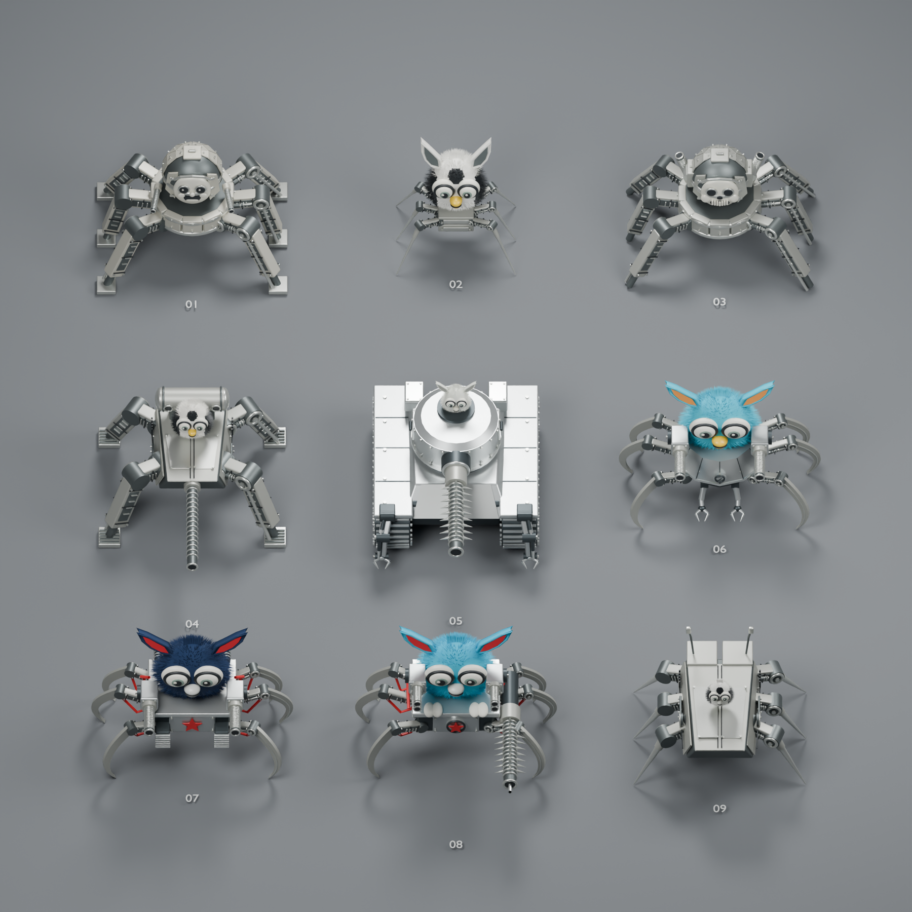
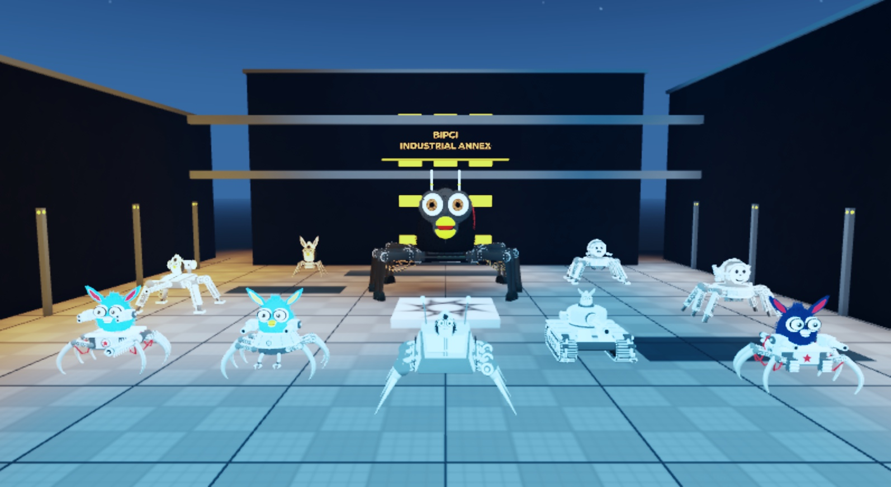

# Furb-o-Mek model pack

Ten distinct, editable character models: the F-069 hero, eight illustration-derived miniatures (including the tracked tank), and the ninth miniature, a long armored crawler derived from video. These are static, unrigged meshes. They are visual production assets; no robot controls or avatar runtime are implemented by this pack.

## Contents





| Path | Purpose |
|---|---|
| [manifest.json](manifest.json) | Ten model identities, file hashes/sizes, geometry inventory and import metadata |
| [provenance.json](provenance.json) | Source, evidence and licensing status |
| `blender/` | Full-detail editable Blender sources; `f069.blend` is the hero source |
| `exports/glb/` | Ten game-oriented GLBs |
| `exports/roblox/` | Individual FBXs and `BIPCI_All_10_Characters.fbx` combined import |
| [scenes/BIPCI_Furbomek_Arena_Blender_Models.rbxl](scenes/BIPCI_Furbomek_Arena_Blender_Models.rbxl) | Saved Roblox arena with all ten characters |
| `previews/` | Source-model and scene previews |
| [tools/](tools/) | Validation, nine-mini source builder, and account-specific scene rebinding |

The game conversion contains 131 material mesh chunks, at most 18,000 triangles per chunk. Its pre-FBX inventory is 858,006 triangles; FBX readback and the supplied GLBs contain 857,970, with 36 degenerate hero triangles removed during conversion. The full-detail Blender geometry remains authoritative. Blender **5.2.2** is the observed authoring/export version; other versions have not been validated.

## Retrieve and verify

Install Git LFS, then from the repository root:

```sh
git lfs install
git lfs pull
python3 assets/models/furbomek/tools/validate_assets.py
```

The standard-library validator reads files without modifying them. It verifies the manifest's SHA256/byte sizes, ten distinct assets, GLB container structure and per-mesh triangle limits, binary FBX headers, and public text for common private paths/secrets. It does not establish rendering quality, binary privacy, rigging, collision suitability, or Roblox account permissions. A clone containing only LFS pointer files will fail validation.

## Blender editing and source rebuild

Open the desired `blender/*.blend` directly. Geometry, materials and object organization are retained; animation rigs are not supplied. The nine-mini source builder includes its own geometry modules and design brief, and does not require the omitted reference images:

```sh
blender --background --python assets/models/furbomek/tools/build_swarm.py -- --output /tmp/furbomek-source-rebuild --ids 1 --no-render
```

Use a new output directory. Omit `--ids` to build all nine miniatures, or pass distinct comma-separated numbers from 1–9. The builder creates full-detail `.blend` and `.glb` files, without preview rendering or game chunk optimization. `--no-render` is accepted explicitly for this non-rendering workflow. Rebuilding all nine miniatures was verified in Blender 5.2.2. This generator is an editable starting point and does not promise byte-identical recreation of subsequent source edits. For the hero, edit `blender/f069.blend`; no from-scratch F-069 generator is supplied.

Optional `--references DIRECTORY` packs available files named in `tools/design_brief.json`; missing images are skipped. Review any images you supply before distributing a rebuilt file. Keep rebuild outputs outside this pack.

## Roblox scene and your account

The saved scene's MeshIds were uploaded under the original Roblox account. Another account may need to reimport the supplied FBX and rebind those meshes; cloning the repository does not grant access to private Roblox assets.

1. Open a copy of the supplied `.rbxl` in Studio. Use **File → Import** (3D files), or **Home → Import**, to import `exports/roblox/BIPCI_All_10_Characters.fbx` under the intended account/experience owner.
2. Use **No Rig**, **UsesCages=false**, **Anchored=true**, **ScaleUnit=Stud**, **ScaleFactor=0.01** (the centimeter conversion), and **Add to Workspace**. Keep the imported bundle named `BIPCI_All_10_Characters` and retain its semantic model containers and mesh names.
3. In edit mode, run [tools/rebind_roblox_scene.lua](tools/rebind_roblox_scene.lua) from Studio's Command Bar. It validates all 131 imported MeshParts before replacing the ten characters, matches exact names or unique material-hash/chunk suffixes inside each model, and archives the previous characters in ServerStorage. Save your new scene after reviewing it.

The helper restores canonical placement, colors and approximate Roblox materials, sets non-colliding anchored meshes with double-sided rendering, and sizes the hero to 18 studs, miniatures to 7, and tank to 6. It preserves the arena, camera and existing motion scripts. It returns a report for ten models and 131 chunks. Rebinding source is supplied for other-account recovery; this packaged helper has not been executed against a second account. The original characters remain recoverable in `ServerStorage.BIPCI_Character_Archive_*`.

## Evidence and distribution status

The geometry was authored for this project from private user-supplied references: eight patent-style illustrations, video for the ninth crawler, and hero references. “Patent-style” describes the visual sheets and is not a verified patent attribution. Relative proportions are **reference/inferred**, not measured dimensions or verified hardware. These models are not fabrication drawings.

Raw references are omitted for scope, privacy and unresolved licensing. No reference license was supplied, and the repository currently has no root LICENSE. This pack does not introduce a license grant. The owner's licensing and public redistribution decision is **TBD** before public distribution; code licensing does not automatically clear character assets. See the recorded status in [provenance.json](provenance.json) and the repository's [supply-chain and Phase 5 gates](../../../PLAN.md).
