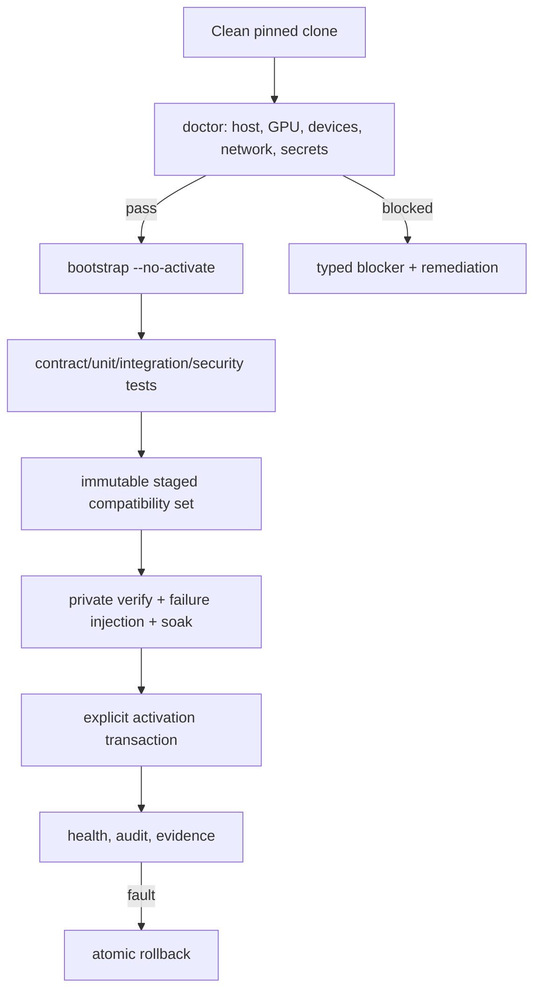

# Hermes clone-to-running deployment contract

Reviewed: 2026-09-21

## Outcome

A host Hermes Agent should be able to clone this repository, read one root entrypoint, determine the maximum safe implemented milestone, execute it idempotently, produce evidence, and either activate or stop with an exact blocker. No undocumented tribal knowledge or guessed command should be required.

This document separates what works **now** from the target end-to-end deployment.

## Current repository reality

Implemented today:

- Nuxt 3 client-only conversation/TTS prototype;
- Express TTS proxy;
- npm lockfile/build/start commands;
- planning, hardware evidence, schematics and research notes.

Not implemented today:

- Hermes server-side conversation integration;
- jabberWERK client/deployment;
- character broker and event schemas in code;
- AIRI/Inochi/avatar adapter;
- A2UI/OBS overlay and stream director;
- perception service;
- embodiment gateway/robot firmware;
- Omarchy/Ubuntu deployment automation;
- unified `furbomek` bootstrap CLI.

Therefore the current one-shot ceiling is a **private app build/smoke run**, not an autonomous robot deployment.

## Fresh-clone command

On the target machine:

```bash
git clone https://github.com/patchwerks/furbomek.git
cd furbomek
hermes chat -q "Read AGENTS.md and HERMES.md completely. Follow HERMES.md exactly, beginning with the non-mutating checks. Do not activate public services or robot power."
```

If the private repository cannot be cloned, fix repository authentication outside the project rather than embedding a token in the URL, shell history or files.

## Current private-app path

Hermes executes:

```bash
git status --short --branch
git rev-parse HEAD
git remote -v
node --version
npm --version
npm ci
npm run build
git status --short
```

Expected:

- clean checkout before and after;
- root `postinstall` prepares/builds Nuxt and installs `server/` dependencies;
- final build exits zero;
- no secret or local environment file appears in Git status.

Private smoke run:

```bash
npm run start
```

Record the actual bound ports and verify the UI from the target machine. Stop the processes after the smoke run unless this development service was explicitly requested to remain active.

Do not call this production-ready: the current browser-side assistant/provider design and permissive proxy are documented security hotspots in `AGENTS.md`.

### Current verification record

On 2026-09-21, the exact `npm ci` path passed on macOS with Node `26.8.1` and npm `11.19.0`; Nuxt `3.12.4` produced `.output/server/index.mjs`, and nested proxy installation used `npm ci --prefix server`.

`npm run start` then launched Nuxt on port 3000 and the proxy on port 3500. A localhost request to the UI returned HTTP 200; the proxy root returned its expected HTTP 404 because it exposes only provider-specific `/proxy/...` routes. Both processes stopped cleanly on interrupt. This proves the current private-app startup surface, not any provider call or live speech.

The same run exposed release blockers:

- root audit: 60 vulnerable packages (6 low, 15 moderate, 33 high, 6 critical);
- `server/` audit: 7 vulnerable packages (3 low, 1 moderate, 3 high, 0 critical);
- deprecated dependencies and a missing explicit Nuxt compatibility date;
- no Linux/Brodex execution evidence from this macOS run.

Production bootstrap must fail closed on the configured severity threshold. Do not run `npm audit fix --force` blindly; upgrade/retest the dependency graph as a separate compatibility change.

## Production target workflow

The future `furbomek` CLI must implement this state machine:



### 1. `doctor`

Collect and validate without changing the host:

- OS/release/kernel, architecture and virtualization;
- CPU, RAM, storage/free space;
- GPU, driver, encoder, IOMMU groups and passthrough feasibility;
- USB camera/mic/audio/capture/robot devices;
- network interfaces/routes/listeners/firewall boundary;
- OBS/PipeWire/portal availability for graphical profiles;
- Hermes version/config/plugin API/A2A capability;
- exact jabberWERK release/artifact and license state;
- avatar asset provenance/license/checksum;
- required secret **presence and permissions**, never values;
- physical hardware evidence/measurement gates.

Emit a redacted machine-readable report under a local runtime/evidence directory outside Git.

### 2. `bootstrap --no-activate`

- verify repository/release signatures and hashes;
- build pinned OCI/packages/firmware without floating revisions;
- create immutable service generations;
- create non-secret example/config templates;
- install services disabled and non-root;
- create loopback/private-network identities and least-privilege device grants;
- do not start public outputs, select live Hermes providers or energize actuators.

Rerunning with identical inputs must make no semantic change.

### 3. Tests

Run in order:

1. schemas/contracts and simulators;
2. dependency/license/SBOM/known-vulnerability gates;
3. Jabberwerk isolated batch TTS/STT and rollback;
4. character/HUD snapshot, sequence, TTL, cancel and hostile-input fixtures;
5. avatar/static failover and OBS private recording;
6. perception without actuation;
7. embodiment simulator;
8. supported-bench hardware tests with independent actuator cut;
9. process/link/heartbeat/watchdog/STOP failure injection.

A lower tier never implies a higher tier passed.

### 4. Private verification

- no production credentials unless needed for a private canary;
- no public stream destination;
- robot supported and bounded, or simulator-only;
- record event-to-visible, speech/audibility, A/V skew, GPU/CPU/RAM and reconnect metrics;
- complete 30-minute tracer bullet, then required 24–72 hour soaks.

### 5. Activation

Activation is one explicit, transactional command after all applicable evidence passes. It:

- snapshots the prior compatibility set and config;
- starts the exact staged versions;
- verifies authenticated health and effective configuration;
- enables only approved stream/platform/device routes;
- never restarts or reconfigures unrelated host services;
- automatically restores the prior set on failure.

Provisioning authorization is not runtime human-in-the-loop. After activation, ordinary operation/failover is autonomous.

### 6. Rollback

Rollback restores as one set:

- guest/container/service generation;
- Hermes adapter/plugin selection;
- jabberWERK broker/engines/profile derivations;
- character/HUD schemas and renderer adapter;
- OBS scene collection/config;
- embodiment gateway and robot firmware.

It preserves private profiles/evidence and never overwrites later operator changes silently.

## Deployment profiles

| Profile | Host shape | Gate |
|---|---|---|
| `omarchy-vm` | Minimal Ubuntu/Proxmox host → full Omarchy guest → isolated workloads | Preferred graphical target after GPU/PipeWire/OBS/device soak |
| `ubuntu-bare-metal` | Ubuntu LTS plus restricted containers/systemd and dedicated OBS account | Compatibility/recovery baseline |
| `development` | One Linux machine, private services, simulator/USB bench | No unattended/public safety claim |

The UM773 offboard gateway and robot-mounted MCU safety plane remain distinct from the Omen brain/media guest.

## Required repository artifacts before full one-shot is real

- `bin/furbomek` or equivalent typed CLI;
- signed deployment manifest/schema;
- pinned guest/image/container definitions;
- secrets manifest containing names/permissions only;
- Jabberwerk release manifest and adapter;
- character/HUD schemas and fixtures;
- OBS scene/source manifest;
- simulator and hardware-in-loop suite;
- service units/health probes;
- backup/rollback/incident runbooks;
- redacted evidence ledger tied to exact commit/digests.

Until those exist and pass, `HERMES.md` requires Hermes to stop at the current safe ceiling rather than fabricate a complete deployment.
