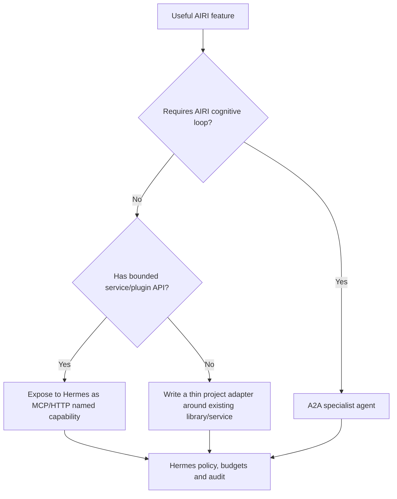

# Agent interoperability: Hermes, AIRI and A2A

Reviewed: 2026-09-21

## Decision

Hermes remains the single top-level character, planning, memory, approval and tool authority. This does not require throwing away AIRI's agentic features. Reuse each AIRI capability at the narrowest boundary that preserves its implementation:

1. **Renderer consumer** when AIRI only needs character/audio/state input.
2. **Capability service** when existing code exposes a bounded action/context API.
3. **A2A specialist agent** only when the useful behavior genuinely depends on AIRI's own cognitive loop, memory or multi-turn task state.

This order avoids both extremes: forking AIRI into a fragile renderer-only shell that discards useful work, and running two unrestricted peer brains that can race over identity, tools and side effects.

## What AIRI actually contains

Verified source facts:

- AIRI advertises Minecraft and Factorio play, Discord/Telegram, memory, browser-local inference, audio input/STT and multi-provider TTS in its project roadmap ([AIRI repository](https://github.com/moeru-ai/airi)).
- Minecraft is an integration/service built around Mineflayer plus a cognitive stack and Stage bridge ([Minecraft integration README](https://github.com/moeru-ai/airi/blob/main/integrations/minecraft/README.md)).
- Factorio is a separate project using LLM/CV, RCON, mods and automation libraries, and its own README still describes development setup rather than a production service ([AIRI Factorio](https://github.com/moeru-ai/airi-factorio)).
- AIRI's plugin-platform architecture explicitly separates plugins, bridges, viewers, control/data planes and remote capability registration ([plugin architecture](https://github.com/moeru-ai/airi/blob/main/packages/plugin-sdk/docs/design/architecture.md)).

These boundaries make reuse possible without adopting AIRI as the governing agent.

## Selection decision tree



Examples:

| Feature | First integration | Why |
|---|---|---|
| Stage avatar, expressions, motion | Character-broker consumer | No second planner is needed |
| Minecraft movement/inventory/actions | Mineflayer capability service called by Hermes | Retains tested game primitives while Hermes plans |
| Factorio RCON/mod/CV primitives | Capability service with a dedicated game account/server | Existing control code is more valuable than AIRI's general personality |
| A long-lived AIRI game strategy that relies on AIRI memory/cognitive modules | A2A specialist task | Legitimate independent-agent boundary |
| Discord/Telegram voice | Hermes platform adapter + jabberWERK | Avoid duplicate platform and speech sessions |
| AIRI STT/TTS provider | Disabled, or wrapped as a jabberWERK engine pack | One voice/media policy and clock |

## A2A baseline

Pin the protocol to **A2A v1.0.1** ([official release](https://github.com/a2aproject/A2A/releases/tag/v1.0.1)). A2A is for discovery and stateful agent tasks, not tool/media streaming. Its v1 line supports Agent Cards, versioned interfaces, task lifecycle, messages/artifacts, polling, streaming and push delivery.

Hermes ships native bidirectional A2A support. The official documentation describes:

- Agent Card discovery;
- outbound `a2a_discover`, `a2a_call`, `a2a_list`, `a2a_history` and `a2a_orchestrate`;
- inbound task send/stream/get/list/cancel/subscribe;
- SSE and push notifications;
- per-peer tokens, trusted-peer allowlists, rate limits, output redaction, audit and anti-loop caps.

Source: [Hermes A2A documentation](https://hermes-agent.nousresearch.com/docs/user-guide/messaging/a2a).

Use Hermes-native delegation/Kanban/Bot Mode for same-Hermes work; use A2A when crossing a process, machine or framework boundary. Do not install archived standalone Hermes A2A bridges that have been superseded by upstream.

## Hermes → AIRI specialist contract

An AIRI Agent Card advertises only deliberately exposed skills, such as:

```text
game.minecraft.observe
game.minecraft.execute_bounded_plan
game.factorio.observe
game.factorio.execute_bounded_plan
```

Each request includes:

- unique task/context/correlation IDs;
- game/environment/account identity;
- declared capability and typed goal;
- deadline, step/action/token/cost limits;
- permitted world/server/region and action allowlist;
- cancellation and progress cadence;
- sensitivity and retention policy;
- requested artifact schema.

The AIRI specialist receives only game-scoped credentials and network/filesystem reach. It cannot reach robot control, OBS control, wallets, social posting, Hermes secrets, Jabberwerk private profiles or the host filesystem.

Hermes validates the terminal artifact before using it. A completion is not authority to actuate the robot or publish externally.

## Media and UI do not ride A2A

Keep these planes separate:

| Plane | Protocol/owner |
|---|---|
| Agent tasks/status/artifacts | A2A |
| Hermes tools/context | MCP or project APIs |
| STT/TTS/STS/PCM/visemes | jabberWERK media contracts |
| Character/HUD state | Furb-o-Mek character broker |
| Declarative HUD content | constrained A2UI |
| OBS scenes/sources | authenticated stream director |
| Robot motion | deterministic embodiment gateway + robot MCU |

Raw PCM and frame-by-frame animation over A2A would add latency, backpressure and recovery ambiguity without providing agent interoperability.

## Acceptance gates

Before enabling an AIRI A2A specialist:

1. direct capability-service extraction was evaluated and found materially worse;
2. Agent Card and exact A2A version are pinned;
3. identity, network, filesystem and credentials are isolated;
4. task send/stream/get/cancel/reconnect and duplicate delivery pass;
5. deadline, budget, action and anti-loop limits fail closed;
6. game state and actions are recorded without leaking unrelated secrets;
7. killing AIRI does not interrupt Hermes, Jabberwerk, OBS, avatar fallback or robot safety;
8. a compromised AIRI task cannot call robot, wallet, social or firmware paths.

## Open questions

- Which AIRI game capabilities already have stable remote/plugin APIs at the pinned release?
- Can the Minecraft cognitive stack run with Hermes as planner without retaining a redundant LLM layer?
- Which Factorio actions are safe primitive tools versus generated code/RCON commands requiring a stricter sandbox?
- Does AIRI publish a stable A2A server, or should a small project-owned bridge wrap only the chosen capability?

Resolve these experimentally; do not fork the AIRI agent core preemptively.
