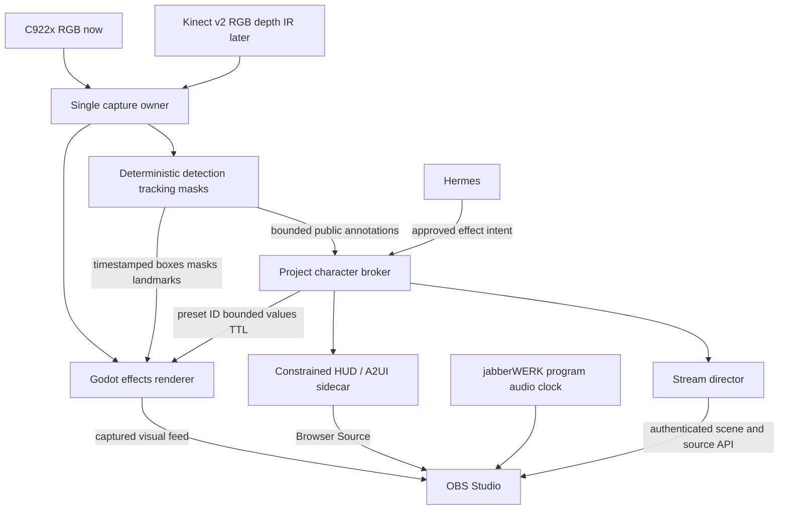

# Linux FOSS live-visuals stacks for Furb-o-Mek

Date: 2026-10-01. Decision scope: Ubuntu first; Omarchy later. The reference is the user-supplied 6.57-second MOV, inspected upright at five points across the clip. This is a source and feasibility assessment, not a claim that the effects have already been built.

## Decision

**Recommendation:** build the durable renderer in **Godot 4**, with a separate camera/perception process and **OBS Studio** as the final stream compositor. Use the existing **Logitech C922x** to reproduce the reference's visible red sampled surface, tracking graphics, inset views, and HUD first. Add a **complete Kinect v2 PC kit** through libfreenect2 when measured depth, IR, or viewpoint-correct XYZ geometry is specifically needed. Godot has native Linux camera feeds, GPU instancing, shaders, viewports, UI and WebSocket APIs; libfreenect2 exposes Kinect v2 color/depth/IR and registration. The acquisition and control bridges are integration work, and the full composition has **not** been run on the intended Linux host. [Godot CameraServer](https://docs.godotengine.org/en/4.7/classes/class_cameraserver.html), [MultiMesh](https://docs.godotengine.org/en/stable/tutorials/performance/using_multimesh.html), [SubViewports](https://docs.godotengine.org/en/stable/tutorials/rendering/viewports.html), [libfreenect2](https://github.com/OpenKinect/libfreenect2).

**If a TouchDesigner-like patch editor is the main authoring preference, start with cables.gl standalone.** It has a current Linux AppImage and visual node editor, webcam and rendering operators, plus face/pose operators. Its Kinect operator is a deprecated joint-data converter, not Kinect v2 acquisition; depth still needs a custom bridge. The standalone editor runs trusted patches with powerful Electron/Node settings, and some tracking operators fetch assets from a CDN. Keep that authoring process isolated from Hermes/OBS/robot credentials and verify export behavior before using its output inside OBS. [cables standalone](https://cables.gl/standalone), [webcam operator](https://github.com/cables-gl/cables/blob/8983a642b895d640ef11967153c459ae129ec9a0/src/ops/base/Ops.Gl.Textures.WebcamTexture_v5/Ops.Gl.Textures.WebcamTexture_v5.js#L305-L321), [Kinect converter](https://github.com/cables-gl/cables/blob/8983a642b895d640ef11967153c459ae129ec9a0/src/ops/extensions/Ops.Extension.Deprecated/Ops.Extension.Deprecated.Kinect/Ops.Extension.Deprecated.Kinect.js#L33-L43), [standalone privilege settings](https://github.com/cables-gl/cables_electron/blob/e67191b1ef2ae517dddcdb5a70c317e3f5c51515/src/electron/main.js#L328-L333).

**No investigated FOSS application is plug-and-play for this exact clip across both the C922x and Kinect v2.** The programs have the necessary rendering primitives, but automatic target reacquisition, synchronized crops, red point styling, depth transfer, and OBS recovery need a project implementation. A claim of exact reproduction requires a candidate recording checked against the supplied MOV; no such run exists yet. The clip itself does **not** prove its red point field came from a depth sensor. [Video inspection, V1](#v1), [current Furb-o-Mek plan](../../PLAN.md).

## What the supplied video establishes

The reference shows a recognizable person and room represented as a crimson sampled/dotted surface on nearly black; the samples and missing patches move with the scene. Magenta corner brackets follow the subject with a `SUBJECT 01 / BODY ACQUIRED` label. An early `FACE LOCK` state uses a small head box and white dots; a later amber `SURFACE PROBE` reticle moves between regions. At right are a processed magnification inset and a smoother photographic face crop, with leader lines, zoom/scan text, telemetry, tick marks, and thin red borders. These are **observations** from the attached video, not an identification of its source software or camera. [V1](#v1).

The visible data supports **depth-like styling**, but cannot distinguish calibrated depth from a sampled RGB image, estimated monocular depth, authored geometry, or shader displacement. Nor can the 6.57-second recording establish camera-to-program latency, frame rate, object detector, true metric distance, or whether its labels reflect an actual recognition state. A GPU renderer's own depth buffer also says nothing about distance measured by the webcam. [V1](#v1), [Depth Anything V2 relative-depth description](https://github.com/DepthAnything/Depth-Anything-V2/blob/a561b849ebae10a6f5ef49e26c83cbbcd36c71bf/README.md#L33-L42).

The black left-side pill/orange indicator and rounded corners appear to belong to the screen recording; the visual acceptance target excludes them unless the user intentionally wants that device UI copied. [V1](#v1).

## Current Furb-o-Mek boundary

The checked-in Nuxt client is an audio/chat/TTS prototype. Its two microphone acquisitions explicitly set `video: false`, enumerate audio devices, and feed text to the chat adapter. There is no checked-in camera capture, Kinect driver, tracker, effects renderer, OBS worker, A2UI HUD, or robot gateway. The documented external OBS camera is a **near-term physical baseline**, not evidence that the application already ingests its frames. [app.vue](../../app.vue), [chat adapter](../../src/chat/openai-assistant.ts), [PLAN.md](../../PLAN.md), [HERMES.md](../../HERMES.md).

The planned topology keeps Hermes as the character/planning authority; a project broker owns public visual state; a separate stream director owns authenticated OBS control; and A2UI, if used, carries constrained HUD content. Approved effect presets may contain reviewed shaders inside the renderer, while incoming events select bounded preset IDs and parameters rather than arbitrary code or asset URLs. Perception boxes/masks are advisory media data and cannot actuate the robot. These are **planned** contracts to preserve while adding an effects process. [PLAN.md §§4, 6.1–6.3](../../PLAN.md), [existing HUD research](a2ui-and-obs-overlays.md).

## Camera facts and budget

### Logitech C922x: available RGB path

The user's Amazon shortlink resolves in a rendered browser to the **C922x**, ASIN B01LXCDPPK; the page selected the 1080p30/720p60 variant on 2026-10-01. Its lower description inconsistently says C920x, so the selected variant and Logitech's own C922-family specifications are the safer evidence. Logitech specifies **1920×1080/30 fps**, **1280×720/60 fps**, USB 2.0/UVC 1.1, autofocus, 78° diagonal FOV, and no night vision; its OBS guide recommends **MJPEG** at 720p60. These are published modes, **not measurements of the user's unit on Ubuntu**. The live new Amazon price was $119.99 before unverified tax/shipping; the user already owns this camera, so repurchase is not assumed. [Amazon C922x](https://www.amazon.com/dp/B01LXCDPPK), [Logitech specifications](https://support.logi.com/hc/en-001/articles/360023462473-C922-Pro-Stream-Webcam-Technical-Specifications), [Logitech OBS setup](https://support.logi.com/hc/en-us/articles/360023347053-Set-up-C922-Pro-Stream-Webcam-for-OBS-Studio).

Logitech does not list Ubuntu in its supported-OS table. Its UVC declaration, Linux's uvcvideo driver, and OBS's V4L2 Video Capture Device make Ubuntu capture a strong **reference/inferred** path, not vendor certification or an observed device test. Enumerate the actual camera with `v4l2-ctl --list-devices` and `v4l2-ctl -d /dev/videoX --list-formats-ext`; then measure delivered frame intervals and exposure behavior at 720p60 and 1080p30. Camera-side H.264 and the exact Linux control list remain unverified. [Linux UVC](https://docs.kernel.org/userspace-api/media/drivers/uvcvideo.html), [OBS V4L2 source](https://obsproject.com/kb/video-capture-sources), [v4l2-ctl option](https://github.com/gjasny/v4l-utils/blob/95ad25f6a77a0a6650f5f657ac2c5046efcd04a0/utils/v4l2-ctl/v4l2-ctl-vidcap.cpp#L27-L30).

The C922x can supply live RGB for color remapping, posterization, sampled-dot/ASCII/edge/glitch shaders, optical flow and motion trails, face/pose landmarks, predefined-object boxes, segmentation masks, raw and processed crops, and an estimated-depth **visual** point field. Those outputs depend on software and lighting; the camera does **not** natively provide an IR image, measured scene depth, occluded-surface geometry, or calibrated distance. MediaPipe and OpenCV document the image-derived capabilities; standard Depth Anything V2 models document **relative** estimated depth, with model-specific license restrictions. [MediaPipe pose](https://developers.google.com/edge/mediapipe/solutions/vision/pose_landmarker/python), [OpenCV optical flow](https://docs.opencv.org/4.13.0/d4/dee/tutorial_optical_flow.html), [Depth Anything V2](https://github.com/DepthAnything/Depth-Anything-V2/blob/a561b849ebae10a6f5ef49e26c83cbbcd36c71bf/README.md#L33-L42).

### Kinect v2: primary budget depth target

For the **Xbox One / Kinect for Windows v2** generation, libfreenect2 supports simultaneous RGB, IR, depth and color/depth registration. Its native color frame is 1920×1080; IR and depth are 512×424. Registered color on depth and mapped depth on color do **not** create 1080p native depth detail. Nominal 30-fps stream modes are documented, while delivered end-to-end frame rate and latency are unmeasured here. Kinect v1 instead uses libfreenect; Azure Kinect is a separate product. [libfreenect2 README](https://github.com/OpenKinect/libfreenect2/blob/fd64c5d9b214df6f6a55b4419357e51083f15d93/README.md), [frame types](https://github.com/OpenKinect/libfreenect2/blob/fd64c5d9b214df6f6a55b4419357e51083f15d93/include/libfreenect2/frame_listener.hpp#L47-L53), [registration contract](https://github.com/OpenKinect/libfreenect2/blob/fd64c5d9b214df6f6a55b4419357e51083f15d93/include/libfreenect2/registration.h#L45-L105).

This is an actual time-of-flight depth source, with edge noise, invalid samples and multipath limitations. A full PC setup needs the sensor **and** AC/power/USB 3 adapter path; USB 2 is unsupported. Upstream flags host-controller sensitivity, especially ASMedia, and says VM USB 3 isochronous transfer likely fails. **Ubuntu 24.04** has later third-party ROS2 build instructions and an available Noble PPA package; upstream driver HEAD is old, and Ubuntu 26.04 or the target host remains unqualified. A no-CUDA build is documented, so CUDA problems are not a universal Ubuntu failure. [Microsoft ToF study](https://www.microsoft.com/en-us/research/wp-content/uploads/2016/02/HandShapeVariation.pdf), [libfreenect2 requirements](https://github.com/OpenKinect/libfreenect2/blob/fd64c5d9b214df6f6a55b4419357e51083f15d93/README.md#L41-L67), [Ubuntu 24.04 bridge instructions](https://gitioc.upc.edu/labs/kinect2_ros2/-/blob/a567c730f78310eb35c4d1b612add5b34ddf0342/README.md), [Noble package index](https://ppa.launchpadcontent.net/deb-rob/noble-robotics/ubuntu/dists/noble/main/binary-amd64/Packages.gz).

**Price correction, checked twice:** a live US Mercari listing observed **2026-10-01 08:47–08:49 UTC** offered an **apparently complete Xbox One/Kinect v2-style sensor and Windows PC hub/adapter bundle for $39.32 before tax**: displayed $29.99 item + $7.97 shipping + $1.36 buyer fee. Rendered seller photos show the sensor, separate hub, power brick and USB-A cable; the listing says used-good and seller-tested. The sensor label, adapter authenticity, actual depth function, USB3 cable specification and final checkout tax were **not verified**. Buy controls were visible, but this is one volatile used offer, not a guaranteed market minimum. Two more used bundle candidates were observed at $59.43 and $71.66 before tax; the latter's photo gives weaker completeness evidence. Another apparently complete kit listed at $150 confirms a broad individual-listing spread. Your roughly $40 budget premise is therefore **supported by a current seller-described complete-bundle listing**, with condition and host-validation risk. [Mercari $39.32 listing](https://www.mercari.com/us/item/m72455244036/), [Mercari $59.43 listing](https://www.mercari.com/us/item/m47567310331/), [Mercari $71.66 listing](https://www.mercari.com/us/item/m22118812134/), [KSL $150 listing](https://classifieds.ksl.com/listing/80164965).

| Alternative, observed 2026-10-01 | Offer before tax/shipping unless specified | Tradeoff versus a used complete Kinect v2 kit |
|---|---:|---|
| RealSense D415, direct store | $325, in stock | Higher nominal depth resolution; narrower depth FOV and rolling depth shutter. Vendor tariff surcharge may increase checkout total. |
| RealSense D435, direct store | $375, out of stock/backorder (6–8 weeks stated) | Wider active-stereo depth FOV and high-rate modes, but much higher current base price; tariff surcharge may apply. |
| Orbbec Astra Mini Pro | $150, in stock; store warns post-Sep-29 orders resume Oct 8 | Structured light, narrower 58.4°×45.5° depth FOV; RGB can reach 1280×960 at 7 fps, while 30-fps RGB is 640×480. USB 2.0 DF13 connector; required host cable inclusion unverified. |
| Orbbec Gemini 2 | $234, in stock; same Oct 8 order-processing notice | More modern stereo and single USB cable, but above the observed used-kit price. |
| Arducam B0410 ToF | $49.99, add-to-cart | 240×180 depth, CSI/Pi-style host, no equivalent integrated RGB: not a complete PC RGB-D substitute. |
| OAK-D Lite | $269, add-to-cart | Passive stereo and lighting/texture dependence; cable may be extra. |

These are **seller/vendor page observations**, not like-for-like latency benchmarks. RealSense $325/$375 are **displayed base prices**; its store announces a tariff surcharge, while tax and shipping are also unverified. The direct store prices supersede lower figures still shown on RealSense's comparison page. This search found **no evidenced zero-tradeoff camera at or below the observed $39.32 apparently complete Kinect v2 bundle**; that is a bounded search result, not proof that no such used listing can ever appear. [D415 store](https://store.realsenseai.com/buy-realsense-depth-camera-d415.html), [D435 store](https://store.realsenseai.com/buy-realsense-depth-camera-d435.html), [Astra Mini Pro](https://store.orbbec.com/products/astra-mini-pro), [Gemini 2](https://store.orbbec.com/products/gemini-2), [Arducam](https://www.arducam.com/time-of-flight-camera-for-raspberry-pi.html), [OAK-D Lite](https://shop.luxonis.com/products/oak-d-lite-1?variant=48792979112159).

## Ranked Linux FOSS choices

The order weights this project's **complete video composition, both camera classes, programmable control, and current OBS architecture**. “C922 input” means documented ingestion capability, not a test of the user's unit. “Kinect input” distinguishes an included driver from a custom libfreenect2 bridge. An OBS capture path must be measured on the actual Ubuntu compositor/GPU; window-capture documentation alone does not certify alpha, frame pacing, or recovery. [OBS window capture](https://obsproject.com/kb/window-capture-sources), [PLAN.md](../../PLAN.md).

| Rank / choice | C922x RGB | Kinect v2 depth/IR | Exact composition building blocks | OBS and agent path | Main cost |
|---|---|---|---|---|---|
| **1. Godot 4 + libfreenect2/OpenCV worker** | Linux CameraServer/V4L2 | External custom bridge | Strong shader, instancing, SubViewport, UI | Window capture; native WebSocket with project schema | Build acquisition, tracker and synchronized texture/data transfer |
| **2. cables.gl standalone** | WebcamTexture | External custom bridge; built-in Kinect op is not acquisition | Closest live node patching; shader/instances, face/pose, render-to-texture | Standalone window capture; JSON WebSocket or standalone OSC behind adapter | Privileged authoring, CDN-bound tracking, depth bridge, export parity |
| **3. openFrameworks 0.12.1** | ofVideoGrabber/GStreamer | libfreenect2 addon exists but targets older OF; test or build direct bridge | Strong compiled C++ shaders, VBO points, FBO, tracking addons | Window/optional obs-vkcapture; OSC addon/project contract | Most code/build maintenance; old Kinect addon |
| **4. Praxis LIVE 6.7.0** | Native video:capture via GStreamer/V4L2 | External custom bridge; normal video path is BGRx image | Visual patching/live Java, P3D/GLSL, text/video components | Window capture; custom OSC template or CORE launch | Dense depth transport and clip-specific patch work |
| **5. OBS 32 + shaderfilter + OpenCV/GStreamer** | Native V4L2 source | External libfreenect2 source/renderer; obs-kinect Linux path is experimental and untested here | Fastest 2D color/glitch/tiles/HUD stream proof | OBS itself streams; built-in authenticated WebSocket | Automatic tracking and true 3D cloud remain external code |

All five have FOSS core code or an FOSS stack route: Godot and openFrameworks use MIT; cables standalone/editor/core are MIT; PraxisLIVE IDE/core are GPLv3/LGPLv3; OBS and selected shaderfilter are GPL-family projects. **Addon, model-weight, shader, and exported-asset licenses are separate checks**; for example old ofxFaceTracker has noncommercial upstream terms, and some Depth Anything V2 checkpoints are CC BY-NC. This is not a blanket license clearance for a finished distribution. [Godot license](https://godotengine.org/license/), [openFrameworks license](https://github.com/openframeworks/openFrameworks/blob/74d2770153dc65fda03a483cc61f69230ce43e79/LICENSE.md), [cables licenses](https://cables.gl/docs/faq/licence_payment/userlicence/userlicence), [Praxis download](https://www.praxislive.org/download/), [OBS license](https://github.com/obsproject/obs-studio/blob/master/COPYING), [shaderfilter license](https://github.com/exeldro/obs-shaderfilter/blob/10c59eae85abb4ed306c7a2192c210aa8469f6e9/LICENSE), [model license matrix](https://github.com/DepthAnything/Depth-Anything-V2/blob/a561b849ebae10a6f5ef49e26c83cbbcd36c71bf/README.md#L178-L180).

### 1. Godot 4 — best durable renderer for Furb-o-Mek

The current Linux download advertises Godot **4.7.2**. Linux CameraServer discovers /dev/video feeds, while shaders, MultiMesh and SubViewports can build the red sampled surface, both independent insets, layered reticles, text and glitch treatment in one coherent scene. A separate deterministic perception worker supplies recognized targets and masks; Godot draws them. It can render RGB-only pseudo-clouds now and consume libfreenect2 XYZ/depth later, but **no built-in Kinect v2 driver or project-ready bridge was established**. [Linux release](https://godotengine.org/download/linux/), [camera implementation](https://github.com/godotengine/godot/blob/084a2caa05119b625a99b6b51d44b459a26362de/modules/camera/camera_linux.cpp#L64-L74), [MultiMesh buffer API](https://github.com/godotengine/godot/blob/084a2caa05119b625a99b6b51d44b459a26362de/scene/resources/multimesh.cpp#L198-L208), [viewport guide](https://docs.godotengine.org/en/stable/tutorials/rendering/viewports.html).

This is strong for AI-assisted GDScript/shader work and a bounded WebSocket state adapter. It is **not** a live node graph or TouchDesigner project loader. A real GStreamer-to-Godot extension illustrates external camera ingress, but its inspected callback copies RGB frame bytes into a Godot image; do not assume zero-copy or current-release compatibility from that example. The ordinary `--headless` mode selects no display/rendering driver, so a live GPU scene needs a graphical context and tested OBS capture. [WebSocketPeer](https://docs.godotengine.org/en/stable/classes/class_websocketpeer.html), [GStreamer bridge source](https://github.com/linuxsocke/gd_gst_service/blob/e3354c5a5db656b5cfcee7a09518898b1e7e548d/src/gd_gst_service.cpp#L15-L27), [headless source](https://github.com/godotengine/godot/blob/084a2caa05119b625a99b6b51d44b459a26362de/main/main.cpp#L1464-L1467).

### 2. cables.gl standalone — closest visual-patch workflow

The current standalone download is **0.11.3**, with a Linux AppImage and MIT source. Its actual operators include browser webcam capture, custom shaders, point materials/instancing, render-to-texture, and pose/face tracking; SubPatches provide reusable node groups. That covers the **presentation primitives** of the clip unusually well for a FOSS visual editor. The deprecated “Kinect” operator merely converts supplied joint data; it does **not** capture Kinect v2 RGB/depth/IR. An external depth producer and binary frame/point transport remain to be designed. [standalone](https://cables.gl/standalone), [operator catalog](https://cables.gl/ops/Ops.Gl.Shader), [pose operator](https://cables.gl/op/Ops.Extension.Mediapipe.MpPoseTracking_v2), [face operator](https://cables.gl/op/Ops.Extension.Mediapipe.MpFaceTracking), [Kinect converter source](https://github.com/cables-gl/cables/blob/8983a642b895d640ef11967153c459ae129ec9a0/src/ops/extensions/Ops.Extension.Deprecated/Ops.Extension.Deprecated.Kinect/Ops.Extension.Deprecated.Kinect.js#L33-L43).

For this project, launch a **trusted standalone patch** and capture its window in OBS first. Browser export is a separate gate: ordinary web core's `op.require()` returns null, while standalone OSC needs `op.require("osc")`, so exporting a native-OSC patch does not preserve that control path automatically. The face/pose operators currently fetch runtime assets from jsDelivr, meaning “offline editor” does not establish offline tracking; bundle matching MediaPipe assets and test a cold network-disabled run. OBS Browser Source's webcam permission path has an open first-party proposal, so do not promise direct camera capture inside an exported OBS page without an exact-build test. [core require](https://github.com/cables-gl/cables/blob/8983a642b895d640ef11967153c459ae129ec9a0/src/core/core_op.js#L376-L382), [OSC op](https://github.com/cables-gl/cables/blob/8983a642b895d640ef11967153c459ae129ec9a0/src/ops/extensions/Ops.Extension.Standalone/Ops.Extension.Standalone.Net.Osc_v2/Ops.Extension.Standalone.Net.Osc_v2.js#L9-L10), [MediaPipe asset URL](https://github.com/cables-gl/cables/blob/8983a642b895d640ef11967153c459ae129ec9a0/src/ops/extensions/Ops.Extension.Mediapipe/Ops.Extension.Mediapipe.MpPoseTracking_v2/Ops.Extension.Mediapipe.MpPoseTracking_v2.js#L28), [OBS camera-permission PR](https://github.com/obsproject/obs-browser/pull/530).

The standalone Electron configuration enables Node integration and disables context isolation, sandbox and web security. It is appropriate for **trusted local authoring**, but imported/community patches must not run with Hermes keys, OBS credentials, wallet access or a route to robot hardware. Its native OSC operator listens on `0.0.0.0` by default; bind or firewall it through a project adapter. [privilege settings](https://github.com/cables-gl/cables_electron/blob/e67191b1ef2ae517dddcdb5a70c317e3f5c51515/src/electron/main.js#L328-L333), [OSC listen address](https://github.com/cables-gl/cables/blob/8983a642b895d640ef11967153c459ae129ec9a0/src/ops/extensions/Ops.Extension.Standalone/Ops.Extension.Standalone.Net.Osc_v2/Ops.Extension.Standalone.Net.Osc_v2.js#L23-L29).

### 3. openFrameworks — strongest direct C++ depth route

openFrameworks **0.12.1** ships Linux packages and an MIT core; Linux ofVideoGrabber chooses GStreamer. Shader, FBO, VBO/mesh and OSC building blocks can implement the point field, tracking-driven insets, scan effects and bounded live controls. The older `ofxKinectV2` addon exposes raw depth, registered color and world coordinates through libfreenect2, but its README says optimized for **OF 0.10.1**, so current 0.12.1 compatibility is **unverified**. Building directly against libfreenect2 may be more maintainable than relying on that addon. [downloads](https://openframeworks.cc/download/), [Linux capture source](https://github.com/openframeworks/openFrameworks/blob/74d2770153dc65fda03a483cc61f69230ce43e79/libs/openFrameworks/video/ofVideoGrabber.cpp#L10-L12), [shader API](https://openframeworks.cc/documentation/gl/ofShader/), [Kinect addon README](https://github.com/ofTheo/ofxKinectV2/blob/f456de7d1956c10cb49b774bea781ddf9c7b8759/README.md), [raw-depth API](https://github.com/ofTheo/ofxKinectV2/blob/f456de7d1956c10cb49b774bea781ddf9c7b8759/src/ofxKinectV2.h#L78-L82).

This is the most code-intensive choice, with good agent editability and reproducibility once pinned. Its bundled point-cloud example takes Z from image alpha, showing why a point-cloud screenshot does not itself prove sensor depth. Linux Spout is not the answer: Spout documents Windows sharing. OBS window capture or Linux obs-vkcapture are candidate routes; capture/alpha/performance must be tested on the actual display server. Avoid the old `ofxFaceTracker` as a blanket FOSS dependency because its upstream FaceTracker license and compatibility warnings are material. [point-cloud example](https://github.com/openframeworks/openFrameworks/blob/74d2770153dc65fda03a483cc61f69230ce43e79/examples/3d/pointCloudExample/src/ofApp.cpp#L12-L28), [Spout](https://github.com/leadedge/Spout2/blob/c2bcc12147711d12ace7d5f08e869d774d840f8a/README.md#L1-L3), [obs-vkcapture](https://github.com/nowrep/obs-vkcapture/blob/8a2c43295fae2ede8ffd382a1581281ceb6153c0/README.md), [ofxFaceTracker caveat](https://github.com/kylemcdonald/ofxFaceTracker).

### 4. Praxis LIVE — Linux visual patching with live Java

PraxisLIVE **6.7.0** provides Linux amd64/arm64 DEBs, a visual patcher, live Java, GStreamer/V4L2 webcam capture, P3D point drawing, editable GLSL filters and text/HUD components. This is a credible RGB clip authoring environment. Its standard capture path is BGRx image data; no native Kinect v2 acquisition or lossless metric-depth channel was found. A libfreenect2 producer plus custom binary/Java component is needed for true XYZ point rendering. [download](https://www.praxislive.org/download/), [video components](https://docs.praxislive.org/components-video/), [V4L2 source default](https://github.com/praxis-live/praxiscore/blob/d048bdebc4140412003ee96a82b7ce2e788b0ad7/praxiscore-video-gstreamer/src/main/java/org/praxislive/video/gstreamer/configuration/GStreamerSettings.java#L46-L59), [BGRx sink](https://github.com/praxis-live/praxiscore/blob/d048bdebc4140412003ee96a82b7ce2e788b0ad7/praxiscore-video-gstreamer/src/main/java/org/praxislive/video/gstreamer/components/PImageSink.java#L49-L54), [P3D points](https://github.com/praxis-live/praxiscore/blob/d048bdebc4140412003ee96a82b7ce2e788b0ad7/praxiscore-video-pgl-code/src/main/java/org/praxislive/video/pgl/code/P3DCodeDelegate.java#L168-L170).

The normal OBS path is capture of its video-output window. Praxis v6 removed the old built-in OSC root, but its current official components contain a **custom OSC root template**; small bounded presentation parameters can use that or the project broker. Do not send dense depth arrays through OSC without a benchmark. GStreamer 1.x is a separate video dependency, and optional shader components need individual provenance checks. [v6 migration](https://www.praxislive.org/blog/praxislive-v6/), [OSC template](https://github.com/praxis-live/components/blob/9a2a66ecf73d1263345d9fb0967055f6f55225c0/Roots/OSC.pxx#L80-L86), [installation](https://docs.praxislive.org/installation/).

### 5. OBS Studio + shaderfilter + OpenCV/GStreamer — fastest broadcast path

Keep OBS for cameras, source compositing, Browser Source, scenes, encoding and streaming. The GPL-licensed `obs-shaderfilter` has Linux releases and example edge, scanline, glitch, ASCII and pixel effects. A separate OpenCV/MediaPipe worker computes body/face boxes and probe coordinates; the browser HUD draws labels/reticles/leader lines, while raw and processed camera branches feed the two insets. This can reproduce the **broadcast composition** from the C922x with the least new application framework, but **automatic tracking and a real 3D cloud are not built into OBS**. For measured depth, libfreenect2 plus a custom GL/effects producer remains necessary. [OBS camera](https://obsproject.com/kb/video-capture-sources), [Browser Source](https://obsproject.com/kb/browser-source), [shaderfilter release](https://github.com/exeldro/obs-shaderfilter/releases/tag/2.6.0), [shader examples](https://github.com/exeldro/obs-shaderfilter/blob/10c59eae85abb4ed306c7a2192c210aa8469f6e9/README.md#L158-L235), [libfreenect2](https://github.com/OpenKinect/libfreenect2).

An external renderer can enter OBS by documented Linux window capture, or a measured GStreamer/V4L2-loopback route. Neither is automatically zero-copy or alpha-preserving; inspected obs-gstreamer code maps a CPU buffer before handing a frame to OBS. The obs-kinect plugin includes libfreenect2 support, but calls Linux support qualified and does not supply Microsoft's skeleton tracker. OBS WebSocket is built in and supports authenticated scene/filter/source control; expose only project-approved operations through the stream director. [window capture](https://obsproject.com/kb/window-capture-sources), [v4l2loopback](https://github.com/v4l2loopback/v4l2loopback), [obs-gstreamer mapped buffer](https://github.com/fzwoch/obs-gstreamer/blob/87645be6e51f175af8952cb1c688a16843430880/gstreamer-source.c#L194-L209), [obs-kinect README](https://github.com/SirLynix/obs-kinect/blob/4d2e7b17c142183d30a843572a9a231896329260/README.md#L130-L152), [obs-websocket](https://github.com/obsproject/obs-websocket).

## Can each visible effect be built?

**Yes, as an implementation target:** the shortlisted tools collectively expose the relevant live camera, shader/point, image/viewport, text/shape and capture/control primitives. **No exact-match run has been observed.** The table specifies what must be implemented and what the C922x can do before buying depth hardware. “Measured” means depth from a calibrated RGB-D stream, not red pixels or a 3D-looking shader. [Godot shader/viewport docs](https://docs.godotengine.org/en/stable/tutorials/shaders/custom_postprocessing.html), [openFrameworks shader/mesh APIs](https://openframeworks.cc/documentation/gl/ofVboMesh/), [Praxis video components](https://docs.praxislive.org/components-video/), [libfreenect2 XYZ](https://github.com/OpenKinect/libfreenect2/blob/fd64c5d9b214df6f6a55b4419357e51083f15d93/src/registration.cpp#L342-L359).

| Reference element | With existing C922x RGB | With Kinect v2 RGB-D/IR | Required software work |
|---|---|---|---|
| Dense red dot/sampled person and room | Sample image grid; edge/threshold, segmentation or relative-depth displacement; **stylized/inferred** surface | Reject invalid depth, project calibrated XYZ, sample registered color, render GPU points/splats | Custom shader, point density, palette, cracks/noise and motion tuning |
| Magenta body box and `BODY ACQUIRED` | Person detector/pose/segmentation coordinates | Same recognition step; depth can help foreground separation | Tracker identity, coordinate transforms, lock/loss/TTL rules |
| `FACE LOCK` and face dots | Face landmarks/mesh from RGB | Kinect RGB or C922x can still supply the face image | Chosen face model; state threshold and dot styling |
| Moving gold `SURFACE PROBE` | Tracked 2D sample position; U/V are image coordinates | Sample valid registered depth at position for a **measured** XYZ/distance readout | Probe-selection policy and honest units; do not invent metres from RGB |
| Processed magnification inset | Crop processed image using same source frame/ROI | Crop depth visualization or registered color/depth view | Render target, cropping and timestamp alignment |
| Smooth optical head inset | Raw C922x face crop | Kinect RGB crop or separate C922x | Preserve raw and processed branches; same-frame face ROI |
| Thin telemetry, ticks, leader lines, HUD boxes | Browser/A2UI reduced catalog or renderer-owned vector/UI layer | Same | Fixed safe layout, legible labels and reconnect snapshot |
| Scanlines, color breakup, local glitch | GPU post-processing on RGB | Same on RGB/depth-rendered branch | Author and tune shader; reference does not establish heavy datamosh |

AprilTag/ArUco is the smallest reliable path for **predefined tagged props**: a decoded tag has an ID and corners, and calibrated pose requires known tag dimensions and camera calibration. For an untagged person, face/pose detection is more appropriate; for multiple untagged predefined object classes, a detector plus tracker is required. A correlation tracker only follows an initialized rectangle, and optical flow follows image features rather than recognizing an object. A language model is **not** needed to label a known class or tag; model/checkpoint licenses and false positives still need review. [AprilTag detection fields](https://github.com/AprilRobotics/apriltag/blob/b7c0ebe9aa20f82ec7a828579004f9e706bfecd9/apriltag.h#L201-L230), [OpenCV marker guide](https://docs.opencv.org/4.13.0/d5/dae/tutorial_aruco_detection.html), [tracker API](https://github.com/opencv/opencv/blob/ab4038aacbc8ce49c92dcb3de81ce50e51813524/modules/video/include/opencv2/video/tracking.hpp#L924-L937), [MediaPipe face](https://developers.google.com/edge/mediapipe/solutions/vision/face_landmarker/python).

For the first RGB shader, treat point positions as a **visual design decision**: a 2D image-grid point field is a baseline for the sampled appearance, not demonstrated exact parity. Matching the clip's short strokes, contour gaps and evolving surface distortion requires shader tuning and a candidate recording. A relative-depth model can add viewpoint-dependent displacement, but its error and licensing vary by checkpoint. For the Kinect variant, libfreenect2's undistorted depth is converted from millimetres to metres and projected with camera intrinsics; invalid samples are rejected. Compare the two renderings against the same footage rather than assuming the depth variant looks closer. [Depth Anything V2 relative output](https://github.com/DepthAnything/Depth-Anything-V2/blob/a561b849ebae10a6f5ef49e26c83cbbcd36c71bf/README.md#L33-L42), [model license matrix](https://github.com/DepthAnything/Depth-Anything-V2/blob/a561b849ebae10a6f5ef49e26c83cbbcd36c71bf/README.md#L178-L180), [libfreenect2 projection](https://github.com/OpenKinect/libfreenect2/blob/fd64c5d9b214df6f6a55b4419357e51083f15d93/src/registration.cpp#L342-L359).

## Recommended Furb-o-Mek integration

**Figure 1 — proposed media and authority flow.** Solid arrows represent data/control roles from the project's plan; this diagram is **proposed**, not checked-in runtime. [PLAN.md](../../PLAN.md), [OBS Browser Source](https://obsproject.com/kb/browser-source), [OBS WebSocket](https://github.com/obsproject/obs-websocket).

One process should own a physical camera, timestamp frames, and distribute the latest RGB image plus derived metadata to perception and visual consumers. The effect renderer and the raw optical inset must use coordinates from the **same frame** with explicit crop/scale/mirror transforms. Transport is still a design choice: begin with a window-capture proof, then compare a bounded GStreamer/V4L2 or GPU capture route only if the measured latency/alpha cost warrants it. GStreamer queues block by default and shared-memory sinks can wait for a consumer, so a real-time bridge needs explicit stale-frame and disconnect behavior. [GStreamer queue](https://gstreamer.freedesktop.org/documentation/coreelements/queue.html), [shmsink](https://gstreamer.freedesktop.org/documentation/shm/shmsink.html), [OBS capture](https://obsproject.com/kb/window-capture-sources).

The proposed visual event should carry a schema version, camera/frame ID, monotonic capture timestamp, image size and normalized coordinate space, track ID, object class/label, observation state, box/corners/landmarks, typed confidence/score, depth provenance (`measured`, `inferred`, or `unavailable`), and expiry. Masks and point clouds use a bounded media/binary path, not giant per-frame A2UI or OSC messages. Hermes sends only an allowlisted preset and bounded parameters through the broker; it neither writes shaders nor talks directly to OBS or the robot. This extends the existing PLAN.md perception/HUD design and is **proposed**, not a published protocol. [PLAN.md §§4, 6.2–6.3](../../PLAN.md), [A2UI/OBS note](a2ui-and-obs-overlays.md).

**TouchDesigner collaboration:** none of the five candidates has a verified importer for TouchDesigner `.toe` project graphs or `.tox` components. TouchEngine loads `.tox` in other hosts but its documented SDKs target Windows/macOS and require an installed TouchDesigner/TouchPlayer runtime and a paid license for external-app use; that is not FOSS Linux graph interchange. Preserve exportable textures, media, GLSL concepts, parameter names and reference recordings; recreate the patch graph and test the resulting output in Furb-o-Mek. “AI can translate” is an **engineering workflow**, not a proven automatic converter. [Derivative file types](https://docs.derivative.ca/File_Types), [TouchEngine](https://docs.derivative.ca/TouchEngine), [Derivative licensing](https://derivative.ca/UserGuide/Licensing).

## Acceptance gates before selecting a deployed stack

The source review establishes feasibility, not deployment throughput. These gates make the recommendation falsifiable on the actual Ubuntu machine; the existing plan's numbers are **targets**, not measurements. [PLAN.md performance/failure targets](../../PLAN.md).

1. **Camera inventory:** identify the physical C922x `/dev/videoX`, enumerate formats/intervals and controls with `v4l2-ctl`; record actual 720p60 MJPEG and 1080p30 frame intervals under the room's lighting. Do not publish device serials. Pass only when the chosen capture path displays a live, correctly timed frame after unplug/replug. [Logitech OBS guidance](https://support.logi.com/hc/en-us/articles/360023347053-Set-up-C922-Pro-Stream-Webcam-for-OBS-Studio), [V4L2 source](https://obsproject.com/kb/video-capture-sources).
2. **Reference RGB recording:** show subject movement, face-lock-to-probe transition, processed and raw insets, body box, leader lines, and the red sampled surface together in a recorded OBS program. Compare the candidate **upright** to the supplied MOV at corresponding events. Mark each visible element pass/fail/not demonstrated; a still image does not pass moving tracking. [V1](#v1).
3. **Tracking truth:** lose and reacquire the face/body, introduce a second subject or known prop, and confirm the label, box, probe and crop do not latch onto stale positions. Capture tracking age/TTL and score type; decorative `FACE LOCK` text is insufficient. [OpenCV tracker API](https://github.com/opencv/opencv/blob/ab4038aacbc8ce49c92dcb3de81ce50e51813524/modules/video/include/opencv2/video/tracking.hpp#L924-L937), [PLAN.md perception contract](../../PLAN.md).
4. **Kinect purchase/bring-up:** confirm an available **complete** sensor + hub/PSU/USB path before purchase; then on Ubuntu 24.04 verify USB3 controller, simultaneous RGB/IR/depth, native dimensions, registration, invalid-depth behavior and sustained frame delivery. A source build or PPA package is only a starting point. Keep the video stack independent of robot actuation. [libfreenect2 README](https://github.com/OpenKinect/libfreenect2/blob/fd64c5d9b214df6f6a55b4419357e51083f15d93/README.md), [Ubuntu 24.04 integration](https://gitioc.upc.edu/labs/kinect2_ros2/-/blob/a567c730f78310eb35c4d1b612add5b34ddf0342/README.md).
5. **Real depth claim:** compare reported distance with independently measured targets at several ranges and angles, and move a virtual viewpoint to test coherent parallax/occlusion. A plausible parallax effect can come from an estimate; only sensor values validated against known distances support “measured depth.” [Microsoft ToF study](https://www.microsoft.com/en-us/research/wp-content/uploads/2016/02/HandShapeVariation.pdf), [libfreenect2 projection](https://github.com/OpenKinect/libfreenect2/blob/fd64c5d9b214df6f6a55b4419357e51083f15d93/src/registration.cpp#L342-L359).
6. **OBS program:** measure end-to-end glass-to-OBS frame age, dropped frames, render/encode lag, GPU/encoder reserve, camera-to-HUD coordinate drift, raw/processed crop alignment, alpha and source restart on the target compositor. The early §6.3 evaluation describes 720p30 and lower inference cadence; the §6.7 runtime budget uses 1080p30 program output, 60 fps only after soak, and ≥25% GPU/encoder reserve. Record which phase/profile was tested. [PLAN.md §§6.3, 6.7](../../PLAN.md), [OBS capture](https://obsproject.com/kb/window-capture-sources).
7. **Failure and authority:** kill/restart renderer, camera feed, perception worker, browser source and broker separately. With OBS still running, expire stale boxes/probes, restore from a broker snapshot, and keep program audio/stream active with a static fallback. For an **OBS crash**, measure restart, director reconnection, scene reconciliation and the actual stream/audio outage; static scene fallback cannot operate while OBS itself is down. The §6.7 runtime targets are static fallback ≤2 seconds and HUD event p95 ≤250 ms; the §9.1 first tracer bullet uses <2-minute fallback and a 30-minute private soak. Record the phase and measured result. Verify no renderer receives Hermes/OBS/robot credentials. [PLAN.md §§4, 6.7, 9.1](../../PLAN.md), [Browser Source lifecycle](https://obsproject.com/kb/browser-source).
8. **Untrusted visual input:** feature-flag A2UI until hostile fixtures reject unknown presets/catalog items, unsafe code/URLs, oversize and rate-abusive updates, stale/replayed/cancelled sequences, and disallowed media. Check CSP and the absence of privileged network routes from HUD/renderers. This is a required qualification of the proposed event path, not a camera effect. [PLAN.md §§6.2, 9.1](../../PLAN.md), [A2UI/OBS security note](a2ui-and-obs-overlays.md).

## Other investigated software and exclusions

| Candidate | Why it did not enter the five |
|---|---|
| **Processing 4** | FOSS Linux, GStreamer video, P3D points and shaders are real. Its current editing/compile-run workflow is less like TouchDesigner than cables/Praxis, and Kinect/modern tracker libraries need legacy JNI/compatibility work. KinectPV2 itself is Windows SDK/DirectX based; another Processing bridge contains Linux v2 build instructions but not a verified current Processing 4 setup. [Processing download](https://processing.org/download/), [Video library](https://github.com/processing/processing-video/releases), [legacy Linux v2 bridge](https://github.com/shiffman/OpenKinect-for-Processing/blob/52e879db6da6bf397b7536fb08a2d4d65cc60604/build_openKinect2/C%2B%2BCmakeLinux/README.md#L2-L7). |
| **Mosaic/ofxVisualProgramming** | Closer OF-based patching, but its current README warns the Flathub webcam is broken; its built-in Kinect node binds **ofxKinect v1**, not libfreenect2/v2; some composer/particle nodes remain “in process.” Linux source build may work, but this adds more qualification work than the selected five. [Mosaic README](https://github.com/d3cod3/Mosaic/blob/09f83674781af3f82ac5e54119ac972985f008db/README.md), [Kinect node](https://github.com/d3cod3/ofxVisualProgramming/blob/8cbae4d6bb8ae2d8f361e5682bceb1524a43b8b8/src/objects/video/KinectGrabber.h#L35-L40). |
| **Pure Data + GEM** | Linux V4L2 and graphics patching are real, but this is a lower-level audiovisual environment with optional proprietary capture backends and no proven turnkey Kinect v2/HUD workflow. [GEM README](https://github.com/umlaeute/Gem/blob/40c7079ca9846aeebe11797e2d3c27bbda7cb7b9/README.md#L80-L105). |
| **Hydra** | AGPL browser live-video synthesis is useful for 2D feedback/glitch, but it is a narrower foundation for calibrated 3D clouds and the full tracking/HUD composition. Its default canvas size is configuration, not a benchmark. [Hydra source](https://github.com/hydra-synth/hydra-synth/blob/9d29a9f4fd8f9081b9759943f38db36f05b9a88f/README.md#L54-L62). |
| **TiXL/Tooll3** | Current official installation targets Windows/DirectX; native Linux is still in progress. Official Bottles/WINE Linux instructions exist, but this native-Linux review did not qualify that route. [Installation](https://help.tixl.app/install/Installation/#non-windows-systems), [Linux wrapper instructions](https://help.tixl.app/install/InstallLinux/). |
| **Natron / Blender** | Useful offline compositing/modeling references, but the reviewed “real-time” Natron claim describes cached playback, not a proven live camera renderer for this stream. [Natron README](https://github.com/NatronGitHub/Natron/blob/3763d805d7d277d10af10025ae41af677682b3e6/README.md#L45-L50). |
| **StreamFX as OBS baseline** | The reviewed public repository says current source/binaries require paid supporter access; historical public binaries were removed. Shaderfilter has a clearer accessible Linux release for the initial 2D proof. Paid distribution alone is not a FOSS disqualifier. [StreamFX wiki](https://github.com/Vhonowslend/StreamFX-Public/wiki/About-StreamFX), [shaderfilter release](https://github.com/exeldro/obs-shaderfilter/releases/tag/2.6.0). |

## Evidence limits and next decision

**Unverified on actual hardware:** the C922x's negotiated Ubuntu modes, the Omen's GPU/compositor and OBS package, a Kinect v2 unit/adapter's condition and controller compatibility, the five stacks' simultaneous capture/render/encode throughput, and exact visual parity. The public project plan itself says these are qualification gates. No source review can supply an honest FPS, latency, “zero performance tradeoffs,” or final camera fit for that machine. [PLAN.md](../../PLAN.md), [libfreenect2 requirements](https://github.com/OpenKinect/libfreenect2/blob/fd64c5d9b214df6f6a55b4419357e51083f15d93/README.md#L41-L67).

The decision enabled **now** is to prototype the exact composition with the owned C922x using Godot plus OBS, keeping cables.gl as the visual-node trial. Buy an apparently complete Kinect v2 kit only when actual depth/IR/parallax is required and the specific listing, power/USB kit, and host controller pass the checks above. The current low-cost used listing makes Kinect v2 the first budget depth candidate; nothing found justifies a $325–375 **base-price, surcharge-extra** RealSense purchase for this visual target. [Mercari observed kit](https://www.mercari.com/us/item/m72455244036/), [D415 store](https://store.realsenseai.com/buy-realsense-depth-camera-d415.html), [D435 store](https://store.realsenseai.com/buy-realsense-depth-camera-d435.html).

## Sources and method

**V1 — user-provided reference video.** `ScreenRecording_09-28-2026-18-01-51_1.mov`, SHA-256 `01ed4004af22efb02ed2882f8f8eec6c923dddd419aa056c68f47a80ab0cb01f`; 6.573333 seconds, 1206×2622 HEVC. Inspected 2026-10-01 at approximately 0.3, 1.8, 3.3, 4.4 and 5.8 seconds after orientation correction. It remains outside Git; its appearance is direct visual evidence, not evidence of capture hardware or implementation.

**Project evidence:** checked-in [PLAN.md](../../PLAN.md), [app.vue](../../app.vue), [chat adapter](../../src/chat/openai-assistant.ts), [research index](README.md), [A2UI/OBS note](a2ui-and-obs-overlays.md), and [runtime-UI synthesis](runtime-ui-stack-2026-09-21.md), read at repository HEAD `98fd3d2b1679200ca589c4d5fa11c758166f64bd` on 2026-10-01. “Observed code” and “proposed architecture” are intentionally separated above.

**Primary project/technical sources, accessed 2026-10-01:** [Logitech C922 specifications](https://support.logi.com/hc/en-001/articles/360023462473-C922-Pro-Stream-Webcam-Technical-Specifications), [Linux UVC](https://docs.kernel.org/userspace-api/media/drivers/uvcvideo.html), [OpenKinect/libfreenect2 pinned code](https://github.com/OpenKinect/libfreenect2/tree/fd64c5d9b214df6f6a55b4419357e51083f15d93), [Godot Linux/manual](https://godotengine.org/download/linux/), [cables standalone/source](https://cables.gl/standalone), [openFrameworks download/source](https://openframeworks.cc/download/), [PraxisLIVE download/source](https://www.praxislive.org/download/), [OBS source documentation](https://obsproject.com/kb/), [OpenCV](https://docs.opencv.org/4.13.0/), [MediaPipe](https://developers.google.com/edge/mediapipe/solutions/vision), and [Derivative file types/TouchEngine](https://docs.derivative.ca/File_Types). Specific feature and source-code citations are inline at the claims they support.

**Price sources, observed 2026-10-01:** [Mercari Kinect v2-style complete bundle](https://www.mercari.com/us/item/m72455244036/), [additional used offer A](https://www.mercari.com/us/item/m47567310331/), [additional used offer B](https://www.mercari.com/us/item/m22118812134/), [KSL complete bundle](https://classifieds.ksl.com/listing/80164965), [RealSense D415](https://store.realsenseai.com/buy-realsense-depth-camera-d415.html), [D435](https://store.realsenseai.com/buy-realsense-depth-camera-d435.html), [Orbbec Astra Mini Pro](https://store.orbbec.com/products/astra-mini-pro), [Gemini 2](https://store.orbbec.com/products/gemini-2), [Arducam ToF](https://www.arducam.com/time-of-flight-camera-for-raspberry-pi.html), [Luxonis OAK-D Lite](https://shop.luxonis.com/products/oak-d-lite-1?variant=48792979112159). Seller listings and stock/prices are temporally fragile; arithmetic is shown rather than treated as a vendor quotation for the complete pipeline.

The research used 15 first-wave lanes spanning codebase, footage, five finalist families, recognition, cameras, streaming, rendered pages and skeptical counter-search, followed by focused expansion on cables.gl, modern Ubuntu Kinect builds, Mosaic, footage acceptance, export/offline behavior and low-cost complete kits. Multiple first-party GitHub source files were read at pinned SHAs; live pages were browser-rendered where static fetches failed. **No Linux camera, Kinect, OBS or renderer was run in this macOS research environment.** The complete acceptance matrix above remains the condition for an exact-effect and deployment claim.
