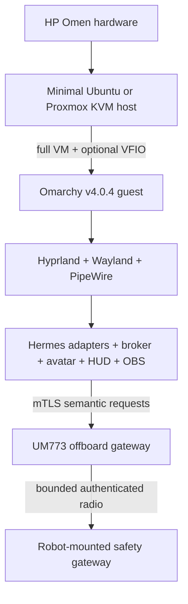

# Runtime UI, avatar, swarm, and Omarchy research

Date: 2026-09-21
Status: planning evidence; implementation still requires the acceptance tests below

## Decision summary

1. **Hermes stays the only character/planning authority.** A project-owned adapter translates Hermes run/session lifecycle into a versioned character/HUD event broker. Renderers never receive the Hermes API key or tool surface.
2. **A2UI v0.9.1 is an optional HUD content protocol.** The overlay host owns layout, animation, security, redaction, transport, and OBS integration. The first implementation uses the official Lit renderer in a separate sidecar because this repository is Vue/Nuxt and A2UI has no official Vue renderer.
3. **AIRI is evaluated as a renderer consumer, not adopted as a second agent runtime.** AIRI Stage Web is the preferred first spike when no Inochi2D rig is ready. Inochi Session wins when a usable project-owned `.inp` model already exists. Static PNG/browser output is the mandatory fallback.
4. **Omarchy is a full Arch/Hyprland operating system.** It cannot be layered into an Ubuntu container as an OS. The desired path is a full Omarchy guest on a minimal Ubuntu/Proxmox KVM host; Ubuntu remains the recovery guest until Omarchy passes the exact GPU/media soak.
5. **OpenGolem ideas stay in the advisory task plane.** Workers may submit typed proposals to Hermes. They receive no robot, OBS, wallet, social-posting, firmware, or safety-policy authority.

## Evidence pins

| Item | Evaluated pin | Evidence |
|---|---|---|
| A2UI source | `9263942b373d01cc21ffd2fd9894bda43d9c7080` | [repository commit](https://github.com/a2ui-project/a2ui/tree/9263942b373d01cc21ffd2fd9894bda43d9c7080) |
| A2UI protocol | v0.9.1 current; v1.0 candidate | [official roadmap](https://a2ui.org/roadmap/), [pinned spec](https://github.com/a2ui-project/a2ui/blob/9263942b373d01cc21ffd2fd9894bda43d9c7080/specification/v0_9_1/docs/a2ui_protocol.md) |
| A2UI libraries at source pin | `@a2ui/web_core` 0.11.0; `@a2ui/lit` 0.11.0; `@a2ui/react` 0.11.1 | [web core](https://github.com/a2ui-project/a2ui/blob/9263942b373d01cc21ffd2fd9894bda43d9c7080/renderers/web_core/package.json), [Lit](https://github.com/a2ui-project/a2ui/blob/9263942b373d01cc21ffd2fd9894bda43d9c7080/renderers/lit/package.json), [React](https://github.com/a2ui-project/a2ui/blob/9263942b373d01cc21ffd2fd9894bda43d9c7080/renderers/react/package.json) |
| AIRI | `v0.12.0-beta.5`, commit `2c1e223c8dd813d7c74a324d7fd7399fbf47e8bf` | [official release](https://github.com/moeru-ai/airi/releases/tag/v0.12.0-beta.5) |
| Omarchy | `v4.0.4`, commit `c668141e9c42b13c80c9ca4ea108e11708c5e8a5` | [official release](https://github.com/omacom/omarchy/releases/tag/v4.0.4) |
| Omarchy ISO | SHA256 `ddeded2758c48318d201dfdac905ecb28f570441883f0c052ea3cd5d05acf92d` | [release checksum](https://github.com/omacom/omarchy/releases/tag/v4.0.4) |

Package versions and protocol versions are intentionally recorded separately. `v0.91.0` is not the A2UI version found in official material; the current protocol is `v0.9.1`.

## A2UI fit for the OBS HUD

A2UI sends declarative component/data updates that a host maps into approved components. Its v0.9 family includes `createSurface`, component updates, data-model updates, and surface deletion. The transport is an application choice; A2A's `application/a2ui+json` binding does not require Furb-o-Mek to use A2A. A local authenticated WebSocket/SSE snapshot-and-delta feed is the smaller first implementation.

The official stable web choices are Web Core, Lit, Angular, and React. Lit is the least coupled option for a Vue/Nuxt repository because it can run as its own browser-source sidecar. A custom Vue renderer would add protocol-maintenance work without helping tonight's tracer bullet.

A2UI does **not** provide the following project requirements by itself:

- OBS scene/source control;
- a transport, durable snapshot store, replay/idempotency policy, or authentication policy;
- lip-sync, audio timing, avatar animation, or robot commands;
- a safe default catalog for public streaming;
- the fixed HUD composition or branded animations.

Those remain project-owned.

### Reduced first catalog

Allowed: bundled icon, text, status badge, progress, key/value rows, bounded list, sparkline from supplied numbers, proxied image, normalized box/mask overlay.

Disabled: inputs, form submission, client functions, arbitrary Markdown/HTML, iframe, remote media URL, outbound link, executable script, arbitrary CSS/shader, free coordinates, and every OBS/Hermes/robot action.

Host validation must cap message bytes, component count, tree depth, text length, media dimensions, update rate, and animation duration; sanitize JSON Pointer paths; apply a strict CSP; and reject unknown schema/catalog/version values. The official renderer guidance makes the integrator responsible for phishing/XSS/media/layout risks ([A2UI Angular renderer security guidance](https://github.com/a2ui-project/a2ui/blob/9263942b373d01cc21ffd2fd9894bda43d9c7080/renderers/angular/README.md)).

### What the audience sees

The HUD may expose safe activity summaries such as:

- browsing a named public domain or moving through a form section;
- reading an image/document and showing a cited excerpt or confidence;
- querying a named dataset and showing row count/summary;
- inspecting a public profile or truncated public wallet address;
- analyzing a market pair/timeframe and showing indicators/hypothesis;
- announcing a simulated or separately authorized trade intent/result;
- displaying perception boxes/masks over the robot or scene;
- service/reconnect/latency state.

It must not expose hidden chain-of-thought, prompts, cookies, private form fields, API keys, seed phrases, full private identifiers, raw database rows, or unredacted tool output.

## Hermes-centric character bus

Hermes exposes authenticated HTTP/OpenAI-compatible, runs/SSE, TUI JSON-RPC, and in-process integration surfaces. These surfaces carry sessions, lifecycle and tool progress, not a stable character animation protocol ([programmatic integration](https://hermes-agent.nousresearch.com/docs/developer-guide/programmatic-integration)). The API server also carries the agent's full tool authority and explicitly requires bearer authentication even on loopback ([API server](https://hermes-agent.nousresearch.com/docs/user-guide/features/api-server)).

Therefore the adapter, not the browser, holds the Hermes key. It emits only allowlisted public activity and character events. The broker owns order, dedupe, TTL, cancel/revoke, snapshots, reconciliation, backpressure and consumer health. TTS/PCM owns viseme timing.

## AIRI and renderer alternatives

AIRI has reusable Stage, Live2D, audio/lip-sync, server-runtime and SDK packages, but it is a complete AI-character runtime rather than a renderer-only library. The safe relationship is:

```text
Hermes -> project adapter -> character broker -> AIRI Stage adapter -> OBS
```

Hermes acts as an external producer. AIRI Stage remains the consumer. AIRI issue [#2305](https://github.com/moeru-ai/airi/issues/2305) documents that SDK messages sent before transport state `ready` can return false/be dropped, and that `server-sdk` does not expose public consumer registration. The adapter must wait for `ready`, inspect the send result, retry with bounded backoff, reconnect/reannounce, and verify visible output.

The AIRI code license does not automatically license bundled models or Cubism Core. Live2D identifies Cubism Core as proprietary ([official notice](https://github.com/Live2D/CubismNativeSamples/blob/develop/Core/LICENSE.md)); AIRI issue [#2206](https://github.com/moeru-ai/airi/issues/2206) also shows bundled and imported model paths behaving differently. Production uses a project-owned asset with recorded rights and checksum.

Alternatives:

- [Inochi Session](https://inochi2d.com/download/) is the strongest native Linux first choice when a compatible model already exists.
- [OpenVT](https://github.com/erodozer/open-vt) is Linux-focused and supports transparent-window capture, but requires build/submodule work and separately licensed Cubism components.
- VTube Studio is not officially supported on Linux ([official FAQ](https://github.com/DenchiSoft/VTubeStudio/wiki/FAQ/d5e37702314dd984680d2bfde2834e293f1e079e)); it is not the Omarchy default.

## OBS ownership and recovery

OBS Browser Source owns the viewport, frame rate, transparency, visibility, unload/refresh behavior and page permissions ([official Browser Source guide](https://obsproject.com/kb/browser-source)). The stream director alone holds authenticated OBS WebSocket credentials ([official obs-websocket repository](https://github.com/obsproject/obs-websocket)). The browser page uses only the project event feed.

Required failure tests:

1. hide/show and switch scenes;
2. reload/clear the Browser Source;
3. restart its local event transport;
4. restart OBS WebSocket and OBS;
5. kill the avatar renderer;
6. restart Hermes;
7. send duplicate, stale, expired, cancelled, oversized and malformed events;
8. verify snapshot convergence, stale indication, no replayed transient animation and continuous static fallback.

## Omarchy deployment analysis

Omarchy is a bootable Arch/Hyprland system with its own kernel/userspace. A container shares the Ubuntu host kernel and cannot supply Omarchy's boot, systemd session, DRM/KMS/device ownership, compositor and desktop portal as an independent OS. The correct topology is:



Omarchy officially documents unattended VM installation using a second `cidata` filesystem/ISO and gives a Proxmox example using OVMF, Q35, virtio storage/network and virtio graphics ([manual](https://omarchy.org/manual/unattended-installs/)). This proves imageability, not GPU/media reliability. A `cidata` drive may contain credentials or an encryption passphrase and is secret material.

Adoption requires clean rebuild, accelerated rendering, PipeWire portal capture, desktop audio, microphone, camera/USB, OBS stability, latency, crash/reboot recovery and 24–72 hour exact-hardware soak. Until then, Ubuntu remains the recovery guest and robot-critical safety remains outside Omarchy.

## Legacy-note reconciliation

Accepted concepts from the private Furtronic Mekanoid, VTube Rig and OpenGolem notes:

- offboard Hermes on the stronger host;
- robot/avatar split-stream operation;
- swappable Live2D/VRM/Inochi-style characters;
- orchestrator, specialist worker, message bus, memory, health and audit concepts;
- UM773 near the robot as an offboard network/service boundary.

Superseded or rejected concepts:

- onboard Hermes on the robot's microcontrollers;
- unrestricted administrator/browser/computer-use authority;
- a renderer plugin marketed as “drop-in/no-code” without an isolated audited boundary;
- multiple peer brains co-owning the character, stream or actuators;
- anti-detection, account purchase/concealment, proxy rotation, synthetic-human timing, account farms, mass engagement, or automatic “poke” behavior;
- performance or “production-ready” claims without an exact version, license, benchmark and failure test.

## Known unknowns before implementation claims

- Exact Omen GPU/mux/IOMMU groups, driver, capture/audio devices and available VRAM.
- Exact UM773 RAM/storage/NICs and intended host OS.
- Existing avatar files and their streaming/commercial/redistribution rights.
- Current OBS scenes, PipeWire devices and capture path.
- Inochi Session's best external-control seam for this project.
- AIRI `input:text` payload details and issue #2305 behavior on the pinned build, verified by a live test.
- A2UI reduced-catalog rendering and hostile-input behavior in OBS CEF, verified by a live test.
- Omarchy/Hyprland/NVIDIA/VFIO behavior on the actual Omen, verified by the acceptance matrix.

No source review substitutes for those measurements.
