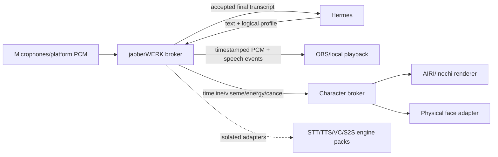

# Voice and speech architecture

Reviewed: 2026-09-21
Decision owner: `PLAN.md` section 4.4

## Decision

Use [`patchwerks/jabberwerk`](https://github.com/patchwerks/jabberwerk) as the single speech/media control plane for Furb-o-Mek, Hermes, AIRI rendering, OBS program audio, platform voice, and physical-face timing.

This consolidation applies to:

- batch and streaming STT;
- batch and streaming TTS;
- STS/S2S/duplex sessions;
- voice profiles, cloning and conversion;
- VAD, endpointing and wake/address signals;
- denoise, echo cancellation, loudness, effects and other DSP;
- engine selection, locality, fallback and resource policy;
- canonical PCM timestamps, cancellation and audible-sink evidence.

It does **not** apply to Hermes reasoning/tools, AIRI game logic, A2UI/HUD state, OBS scenes, social policy, or robot actuation/safety.

## Inspected Jabberwerk baseline

Private repository snapshot inspected at:

- release: `0.4.0`;
- commit: `5d175c7389577785f477c990499e2ace4e91771a`;
- repository: `patchwerks/jabberwerk`;
- current stated scope: deployment-ready Linux/Hermes **batch** plugin first; realtime breadth later.

The source contains:

| Component | Inspected behavior | Evidence |
|---|---|---|
| `jabberwerk-broker` | Host-neutral capability/profile routing, authenticated loopback batch API, explicit local-only policy, semantic TTS acceptance/quarantine | [broker README](https://github.com/patchwerks/jabberwerk/blob/5d175c7389577785f477c990499e2ace4e91771a/projects/hermes-voice-stack-plugin/packages/jabberwerk-broker/README.md), [contracts](https://github.com/patchwerks/jabberwerk/blob/5d175c7389577785f477c990499e2ace4e91771a/projects/hermes-voice-stack-plugin/packages/jabberwerk-broker/src/jabberwerk_broker/contracts.py) |
| `jabberwerk-hermes` | Public Hermes `TTSProvider` and `TranscriptionProvider`, dependency-free broker client, no engine/model load during registration | [plugin README](https://github.com/patchwerks/jabberwerk/blob/5d175c7389577785f477c990499e2ace4e91771a/projects/hermes-voice-stack-plugin/packages/jabberwerk-hermes/README.md), [provider code](https://github.com/patchwerks/jabberwerk/blob/5d175c7389577785f477c990499e2ace4e91771a/projects/hermes-voice-stack-plugin/packages/jabberwerk-hermes/jabberwerk_providers.py) |
| `jabberwerk-deploy` | Immutable generations, manifest/digest binding, explicit activation, doctor, exact rollback and non-destructive uninstall | [deploy README](https://github.com/patchwerks/jabberwerk/blob/5d175c7389577785f477c990499e2ace4e91771a/projects/hermes-voice-stack-plugin/packages/jabberwerk-deploy/README.md) |
| Engine packs | Independently locked Chatterbox, faster-whisper and experimental Pocket TTS environments | [workspace registry](https://github.com/patchwerks/jabberwerk/blob/5d175c7389577785f477c990499e2ace4e91771a/WORKSPACE.yaml) |
| Voice graph | Typed TTS/STT/VC/S2S/DSP contracts, logical profiles, explicit routing/fallback and resource leases | [architecture](https://github.com/patchwerks/jabberwerk/blob/5d175c7389577785f477c990499e2ace4e91771a/projects/hermes-voice-stack-plugin/ARCHITECTURE.md) |

The downloaded source was read, but its pytest suite was not rerun in this task because the available Python environment did not contain `pytest`. Existing repository verification records are evidence supplied by that project, not a fresh Furb-o-Mek runtime qualification.

## Integration topology

Furb-o-Mek stores only the pinned dependency, broker client configuration, logical profile IDs, event mappings and qualification evidence. Speech engines and private voice artifacts do not move into this repository.

## AIRI rule

AIRI may consume Jabberwerk audio and timing. Its own speech provider stack is disabled by default to prevent divergent voices, retention policies, clocks and fallback behavior.

An AIRI-only engine is still usable if it becomes a normal Jabberwerk engine adapter and passes the same:

- provenance/license/model-digest record;
- locality and network-egress policy;
- TTS/STT/stream/cancel contract tests;
- latency and resource measurements;
- voice-identity and intelligibility qualification;
- rollback and failure tests.

This keeps one user-visible voice across robot, avatar, Discord/Telegram and OBS without coupling Furb-o-Mek to one synthesis model.

## Current limitation and delivery order

Jabberwerk's own `v1.0.0` target is Linux/Hermes batch voice. The inspected design says the following are not production-ready yet:

- public plugin-to-platform streaming TTS;
- streaming STT partial/final events;
- realtime wake/address gating and barge-in;
- duplex S2S/STS;
- raw PCM platform ingress/egress through a documented generic Hermes plugin seam.

Hermes currently has most platform PCM consumers, but a public producer registration seam is still needed; importing its internal streaming registry is explicitly rejected by Jabberwerk's architecture. See [required Hermes changes](https://github.com/patchwerks/jabberwerk/blob/5d175c7389577785f477c990499e2ace4e91771a/projects/hermes-voice-stack-plugin/ARCHITECTURE.md#14-required-generic-hermes-changes).

Delivery sequence:

1. verify pinned batch broker and public Hermes providers in an isolated `HERMES_HOME`;
2. connect batch PCM to OBS/avatar and measure actual audibility/timing;
3. preserve the exact prior provider/config and prove rollback;
4. upstream or adopt the generic public streaming seam;
5. qualify streaming TTS, then streaming STT/wake/barge-in;
6. add duplex S2S only after task/tool authority remains in Hermes.

## Security and privacy

- Broker defaults to owner-only UDS or authenticated loopback; engine packs receive scrubbed environments and explicit file grants.
- No engine receives Hermes, Discord, Telegram, OBS, wallet or robot credentials.
- Raw speech, transcripts, embeddings and clone artifacts remain local and outside Git.
- A local failure never silently selects cloud or a different voice identity.
- Generated audio is not success until the intended sink is audibly confirmed.
- Voice cloning requires explicit provenance/consent and does not auto-promote to the live profile.

The Jabberwerk charter states that the repository lacks a top-level FOSS license even though the plugin manifest currently names Apache-2.0. Do not redistribute or vendor its code until the repository-level license is actually committed. Invoking the private repository as a separately installed dependency is the current path.

## Furb-o-Mek acceptance gate

- One logical voice profile produces equivalent qualified routes for the selected engines.
- A Hermes batch turn reaches Jabberwerk and produces audibly confirmed OBS output.
- The same utterance/timeline drives avatar and physical-face consumers.
- Barge-in/cancellation does not replay stale audio or face motion.
- AIRI cannot bypass the broker to synthesize or transcribe independently.
- Broker/engine failure leaves OBS and robot motion safe and produces a visible incident state.
- Exact provider/config rollback is demonstrated before live activation.
